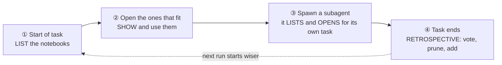

# AGENTS.md — the operating guide for `agent-notebook`

This file is written for whoever is reading it:

- **If you are an AI agent** (Claude Code, Codex CLI, or any harness that wired
  a notebook into your context), §1–§4 are your *operating contract*: what to do
  with the notebook at each moment of a task. A harness often injects this file
  verbatim, so it is short and imperative on purpose.
- **If you are a human** setting this up, reading §1–§4 tells you exactly what
  behaviour you are turning on before you read [how to turn it on](docs/harness-setup.md).
- **If you are contributing to this repository**, skip to [§6](#6-if-you-are-working-on-this-repository).

New here? Start with the [plain-language guide](docs/getting-started.md) or the
[visual explainer](docs/visual-explainer.html). The full behavioural spec is
[docs/requirements.md](docs/requirements.md).

---

## 1. What the notebook is (one paragraph)

A notebook is a bounded, voted, plain-text memory. Each notebook file is a *shelf*:
a group of lessons that should surface together (`reviewer`, `release`, `repro`) —
grouped by co-access, not by which agent writes them. It holds at most 50 one-line lessons by
default (raise the cap with `NB_MAX_LINES`),
ranked by the votes agents cast on them; when it is full a new lesson still goes
in — the lowest-scored line is evicted and the stalest one ages a point, so a
once-useful lesson that goes quiet eventually makes way (see
[docs/eviction-and-aging.md](docs/eviction-and-aging.md)). There is one file
per shelf, and `nb list` shows the whole set —
each with a one-line description of *when to open it* — so you can see what
experience exists and open what fits, without having to name it in a search.
There is no server, no embedding, no network call: every `nb` command is a fast
local file edit.

## 2. The four moments — what to do, and when

Memory is only worth its tokens if you act on it at the right four moments. You
drive all four with `nb` yourself — nothing here depends on your harness
auto-loading a notebook for you. (A harness *may* inject the index or nudge the
retrospective; see [harness-setup](docs/harness-setup.md). The commands below are
what you run regardless.)



### ① At the start of a task — **list what's there**

Run `nb list` before you plan. It prints every notebook with its one-line
description — a trigger that says "open me when you're doing X." Reading the whole
index is how a lesson you would never think to search for still reaches you: you
meet its notebook's trigger unbidden.

```sh
nb list                    # the index: every notebook, its lesson count, its description
nb list "<prefix>."        # scoped to a namespace, e.g. nb list review.
```

### ② Open the notebooks that fit — **show and use**

Open the one or few whose description matches your task, and keep their lessons in
front of you as you work — re-checking the index whenever a new sub-task turns up
that another notebook might cover. Reach for `nb search` only for a known-item
lookup: surfacing from the index is the primary path, search is the fallback.

```sh
nb show "<shelf>"           # a notebook's lessons, highest-scored first
nb search "<keywords>"     # SECONDARY keyword fallback — only for a known-item lookup
```

### ③ When you spawn a subagent — **it lists and opens for its own task**

A subagent doing specialised work (reviewing, patching, reproducing a bug) does
the same ① → ② for its own job: point it at this same contract so it runs
`nb list`, opens the notebooks that fit, and runs the retrospective at its end.
Reuse an existing notebook rather than minting a near-duplicate — shelf matching is
exact, so `reviewer` and `review` become two unrelated memories.

### ④ At the end of a task — **the retrospective** (the step that makes tomorrow faster)

This is the one that compounds. Before you finish, spend a moment maintaining the
notebook so the next run of this task starts wiser:

1. **Vote the lessons you actually used.** `+1` the ones that helped; `-1` the
   ones that were shown to you but misled or wasted your time. (The `<id>` is the
   short code `nb show` prints at the start of each line; a unique snippet of the
   lesson text works too. `vote` takes no `--reason` — record *why* on the `rm`
   below, which does.)
   ```sh
   nb vote "<shelf>" <id> +1
   nb vote "<shelf>" <id> -1
   ```
2. **Prune what proved incorrect or obsolete.**
   ```sh
   nb rm "<shelf>" <id> --reason wrong        # it was never true / it misled
   nb rm "<shelf>" <id> --reason obsolete      # it was true but no longer applies
   ```
3. **Tidy, if the notebook is cluttered or full.**
   ```sh
   nb merge "<shelf>" <idA> <idB> "<one tighter lesson>" --reason duplicate
   nb split "<shelf>" <id> "<lesson A>" "<lesson B>" --reason overloaded
   ```
4. **Add at most one new lesson** — to the notebook whose topic it fits (check
   `nb list` if unsure which; start a new shelf only if no notebook covers this
   kind of task). Make it the single most useful, non-obvious thing you learned
   that you would want *surfaced to you* next time. One line, ≤200 chars,
   concrete, no preamble. Adding nothing is a valid and honest outcome.
   ```sh
   nb add "<shelf>" "fresh worktree has no node_modules — run npm install before build/test"
   ```

> Never pad the notebook to hit a quota — a forced lesson pollutes a bounded
> notebook and skews the usage signals `nb stats` reads. "I learned nothing new
> worth storing" is a perfectly good outcome; add nothing.

## 3. How to write a lesson that earns its line

A notebook line is read by a *future* agent who has none of your current context.
Write for that reader.

| Example | Why |
|---|---|
| `run npm run build before vitest — tests exec dist/, bare vitest skips the build` | ✓ A concrete trap + the mechanism, in one line. |
| `release: push a vX.Y.Z tag; CI publishes it — there is no local npm token` | ✓ Names the non-obvious fact you'd otherwise relearn. |
| ~~`be careful with the build`~~ | ✗ Vague; the future agent can't act on it. |
| ~~`the tests pass`~~ | ✗ Not durable; true today, noise tomorrow. |

Rules the tool enforces, so you don't have to guess:

- **One line, ≤200 characters.** An over-long `add` is *rejected*, never
  truncated — rewrite it shorter and complete, don't store a cut-off fragment.
- **Near-duplicates are skipped.** If a lesson already says it, your `add` is a
  no-op; that's a signal the notebook already covered you (good), not a failure.
- **A reason is always optional.** Omit it rather than invent one; an unknown
  code is kept as free text, never rejected.

## 4. Shelves, namespaces, and scoping — pick the right notebook

- A **shelf** is one `<name>.md` notebook file, a group of lessons that should
  surface together: `reviewer`, `patcher`, `release`. Group by co-access, not by
  agent role: an agent that opens a shelf gets the lessons it looks for plus ones
  it would not think to search for. Reuse an existing shelf (`nb list`) before
  creating a new one — shelf matching is exact, so a typo silently starts an orphan
  notebook.
- **Namespace** a shelf that grows several concerns with a `.` prefix:
  `review.tests`, `review.correctness`, `review.security`. It is a naming
  convention only — still one flat file each, no new storage.
- Scope a shelf **to a project** with `@` (`shelf@project`): `reviewer@my-repo`. It composes with a
  namespace: `review.tests@my-repo`.

---

## 5. The whole contract on one card

```
START       nb list                  # see every notebook + its "open me when…" description
OPEN        nb show <shelf>           # open the one(s) whose description fits your task
            nb search <kw>           # only for a known-item lookup (secondary)
SUBAGENT    point it at this contract # it runs nb list & opens notebooks for its own task
END (retro) nb vote <shelf> <id> +1   # the lessons that helped
            nb vote <shelf> <id> -1   # the ones that misled (vote takes no --reason)
            nb rm   <shelf> <id> --reason obsolete   # what no longer applies
            nb merge/split …         # keep it tidy
            nb add  <shelf> "<=200-char lesson"       # at most ONE, to the fitting notebook
```

---

## 6. If you are working **on** this repository

This is the `agent-notebook` source tree, not a notebook. Before changing
behaviour, read **[docs/requirements.md](docs/requirements.md)** — it is the
single source of truth, and the [Non-goals](docs/requirements.md#6-non-goals-shall-not)
(no embeddings, no server, no network, no multi-line notes) are binding.

```sh
npm install        # a fresh checkout / worktree has no node_modules
npm run build      # tsc, then chmod +x dist/cli.js
npm test           # vitest run — needs Node 20.12+ (see CONTRIBUTING.md)
```

- The tests exec the built `dist/` output, so a stale build gives misleading
  results — `npm test` runs the build first via its `pretest` hook.
- Keep `docs/requirements.md` and `CHANGELOG.md` in sync with any user-facing
  change; the [PR template](.github/PULL_REQUEST_TEMPLATE.md) has the checklist.
- The docs added for harness integration — [getting-started](docs/getting-started.md),
  [harness-setup](docs/harness-setup.md), [enterprise](docs/enterprise.md), and the
  [`examples/`](examples/) scripts — describe a layer that lives *around* the
  package (hooks, git-versioning, backup, a janitor), never inside the hot `nb`
  path, per [DP-6](docs/requirements.md#dp-6).

See [CONTRIBUTING.md](CONTRIBUTING.md) for the full contributor workflow.
