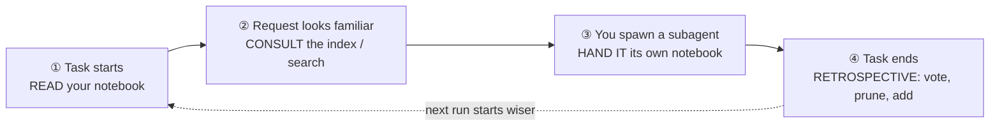

# AGENTS.md — the operating guide for `agent-notebook`

This file has two readers, and it is written for both.

- **If you are an AI agent** (Claude Code, Codex CLI, or any harness that wired
  a notebook into your context), §1–§4 are your *operating contract*: what to do
  with the notebook at each moment of a task. A harness often injects this file
  verbatim, so it is short and imperative on purpose.
- **If you are a human** setting this up, reading §1–§4 tells you exactly what
  behaviour you are turning on before you read [how to turn it on](docs/harness-setup.md).
- **If you are contributing to this repository**, skip to [§6](#6-if-you-are-working-on-this-repository).

New here? Start with the [plain-language guide](docs/getting-started.md) or the
[visual explainer](docs/visual-explainer.html). The full behavioural spec is
[docs/requirements.md](docs/requirements.md).

---

## 1. What the notebook is (one paragraph)

A notebook is a bounded, voted, plain-text memory for one *role* (one kind of
task). It holds at most 200 one-line lessons, ranked by the votes agents cast on
them; when it is full the lowest-scored line is evicted. You read it with
`nb show <role>`, and your harness normally *shows* it to you at the start of a
task rather than making you search — because the lesson you most need is the one
you would never think to look for. There is no server, no embedding, no network
call: every `nb` command is a fast local file edit.

## 2. The four moments — what to do, and when

Memory is only worth its tokens if you act on it at the right four moments. Your
harness wires some of these for you (a session-start injection, a retrospective
reminder); the commands below are what *you* run.



### ① At the start of a task — **read**

Your role's notebook is your accumulated experience for this kind of work. Read
it before you plan, so a past mistake is in front of you *before* you can repeat it.

```sh
nb show "<your-role>"      # your lessons, highest-scored first
nb list                    # the index of every notebook, in case a sibling role fits better
```

If the harness already injected this at session start, you do not need to re-run
it — use what you were given.

### ② When a request looks like something that has been done before — **consult**

Surfacing is the primary path, but when you are about to start a sub-task that
smells familiar (a build, a release, a tricky refactor), check whether a notebook
already covers it before you rediscover it the hard way.

```sh
nb list "<prefix>."        # scoped to a namespace, e.g. nb list review.
nb search "<keywords>"     # SECONDARY keyword fallback — only for a known-item lookup
```

### ③ When you spawn a subagent — **hand it its own notebook**

A subagent doing specialised work (reviewing, patching, reproducing a bug) has
its *own* role and its *own* notebook. Give it that role so it loads the right
lessons and writes new ones back to the same place — do not let it start blind or
mint a near-duplicate role. `nb list` shows which roles already exist; reuse one.

### ④ At the end of a task — **the retrospective** (the step that makes tomorrow faster)

This is the one that compounds. Before you finish, spend a moment maintaining the
notebook so the next run of this task starts wiser:

1. **Vote the lessons you actually used.** `+1` the ones that helped; `-1` (with a
   reason) the ones that were shown to you but misled or wasted your time.
   ```sh
   nb vote "<role>" <id> +1
   nb vote "<role>" <id> -1 --reason wrong --note "stale since the 0.2 CLI"
   ```
2. **Prune what proved incorrect or obsolete.**
   ```sh
   nb rm "<role>" <id> --reason wrong        # it was never true / it misled
   nb rm "<role>" <id> --reason obsolete      # it was true but no longer applies
   ```
3. **Tidy, if the notebook is cluttered or full.**
   ```sh
   nb merge "<role>" <idA> <idB> "<one tighter lesson>" --reason duplicate
   nb split "<role>" <id> "<lesson A>" "<lesson B>" --reason overloaded
   ```
4. **Add at most one new lesson** — the single most useful, non-obvious thing you
   learned that you would want *shown to you* next time. One line, ≤200 chars,
   concrete, no preamble. Adding nothing is a valid and honest outcome.
   ```sh
   nb add "<role>" "fresh worktree has no node_modules — run npm install before build/test"
   ```

> Never pad the notebook to hit a quota. The honesty of "I learned nothing new
> worth storing" *is* a signal the tool measures — a forced lesson pollutes a
> bounded notebook and manufactures false alarms.

## 3. How to write a lesson that earns its line

A notebook line is read by a *future* agent who has none of your current context.
Write for that reader.

| Good | Why |
|---|---|
| `run npm run build before vitest — tests exec dist/, bare vitest skips the build` | A concrete trap + the mechanism, in one line. |
| `release: push a vX.Y.Z tag; CI OIDC-publishes — there is no local npm token` | Names the non-obvious fact you'd otherwise relearn. |
| ~~`be careful with the build`~~ | Vague; the future agent can't act on it. |
| ~~`the tests pass`~~ | Not durable; true today, noise tomorrow. |

Rules the tool enforces, so you don't have to guess:

- **One line, ≤200 characters.** An over-long `add` is *rejected*, never
  truncated — rewrite it shorter and complete, don't store a cut-off fragment.
- **Near-duplicates are skipped.** If a lesson already says it, your `add` is a
  no-op; that's a signal the notebook already covered you (good), not a failure.
- **A reason is always optional.** Omit it rather than invent one; an unknown
  code is kept as free text, never rejected.

## 4. Roles, namespaces, and scoping — pick the right notebook

- A **role** is one kind of task: `reviewer`, `patcher`, `release`. Reuse an
  existing role (`nb list`) before creating a new one — role matching is exact,
  so a typo silently starts an orphan notebook.
- **Namespace** a role that grows several concerns with a `.` prefix:
  `review.tests`, `review.correctness`, `review.security`. It is a naming
  convention only — still one flat file each, no new storage.
- Scope a role **to a project** with `@`: `reviewer@my-repo`. It composes with a
  namespace: `review.tests@my-repo`.

---

## 5. The whole contract on one card

```
START       nb show <role>           # read your experience first
            nb list                  # is there a better-fitting role?
DURING      nb search <kw>           # only for a known-item lookup (secondary)
SUBAGENT    give it its own role     # it loads & writes its own notebook
END (retro) nb vote <role> <id> +1   # the lessons that helped
            nb vote <role> <id> -1 --reason wrong   # the ones that misled
            nb rm   <role> <id> --reason obsolete   # what no longer applies
            nb merge/split …         # keep it tidy
            nb add  <role> "<=200-char lesson"       # at most ONE, or none
```

---

## 6. If you are working **on** this repository

This is the `agent-notebook` source tree, not a notebook. Before changing
behaviour, read **[docs/requirements.md](docs/requirements.md)** — it is the
single source of truth, and the [Non-goals](docs/requirements.md#6-non-goals-shall-not)
(no embeddings, no server, no network, no multi-line notes) are binding.

```sh
npm install        # a fresh checkout / worktree has no node_modules
npm run build      # tsc, then chmod +x dist/cli.js
npm test           # vitest run — needs Node 20.12+ (see CONTRIBUTING.md)
```

- The tests exec the built `dist/` output, so a stale build gives misleading
  results — `npm test` runs the build first via its `pretest` hook.
- Keep `docs/requirements.md` and `CHANGELOG.md` in sync with any user-facing
  change; the [PR template](.github/PULL_REQUEST_TEMPLATE.md) has the checklist.
- The docs added for harness integration — [getting-started](docs/getting-started.md),
  [harness-setup](docs/harness-setup.md), [enterprise](docs/enterprise.md), and the
  [`examples/`](examples/) scripts — describe a layer that lives *around* the
  package (hooks, git-versioning, backup, a janitor), never inside the hot `nb`
  path, per [DP-6](docs/requirements.md#dp-6).

See [CONTRIBUTING.md](CONTRIBUTING.md) for the full contributor workflow.
