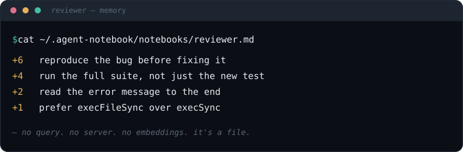
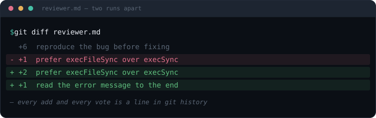

# agent-notebook

A bounded, voted, plain-text memory for AI agents — one small file per role, no embeddings, no vector DB, no network call.

<p align="center"></p>

```
$ nb add reviewer "run lint before claiming done"
added — 1 lines

$ nb show reviewer
3f9a2c  [+1]  run lint before claiming done

$ nb vote reviewer 3f9a2c +1
+1 → [+2] run lint before claiming done
```

## Why

Most "agent memory" tooling reaches for a vector database the moment anyone says the word "memory." Most agents don't need one. If what you actually want is "let this agent remember a handful of short, durable lessons across runs," a notebook is enough: a capped, append-and-vote text file that a human can `cat`, `grep`, and diff in git.

`agent-notebook` is the whole mechanism, nothing more:

- **One entry = one line.** `<score>\t<lesson>`, at most 200 characters, no multi-paragraph notes.
- **Bounded.** At most 200 lines per role. When full, the lowest-scored line is evicted first — harmful or useless lessons leave, useful ones survive.
- **Voted, not aged.** An agent votes +1/-1 on a lesson it used. No decay curve, no relevance scoring, no scheduler.
- **Plain text.** `~/.agent-notebook/notebooks/<role>.md`. Readable, diffable, greppable, backed up by whatever already backs up your home directory.

The cap and the vote are the whole mechanism. A new lesson enters at the `+1` floor; a vote lifts it past its neighbours by score; and when the file is full the *lowest-scored* line is evicted — never the oldest:

<p align="center"></p>

## What it deliberately does not do

Naming the non-goals matters more than listing features — if any of this is what you need, this is the wrong tool:

- No embeddings, no semantic search, no similarity ranking.
- No long-form notes, summaries, or documents — one line, period.
- No network calls, no server, no sync between machines.
- No multi-field schema — a lesson is a string, a score is an integer.

If you need retrieval over large unstructured context, use a real vector store. This solves a narrower problem: a short list of hard-won, durable lessons an agent should keep seeing.

Because a notebook is a plain file in a git-backed directory, everything your agent learns is a line you can review — an added lesson is a green `+`, a recorded vote a `-`/`+` score change. You cannot `git diff` a vector DB:

<p align="center"></p>

## Install

```
npm install -g agent-notebook
```

Or run it straight from a clone, without installing globally:

```
git clone https://github.com/jeanibarz/agent-notebook.git
cd agent-notebook
npm install
npm run build
npm link   # puts `nb` on your PATH, pointing at this clone
```

## Usage

```
nb show   <role>                        print the notebook (highest-scored first)
nb add    <role> "<lesson>"             add a lesson (dedup-skipped; rejected if too long, never truncated)
nb vote   <role> <id|query> +1|-1       upvote/downvote an entry you used
nb merge  <role> <idA> <idB> "<merged>" consolidate two entries into one
nb rm     <role> <id|query>             delete an entry
nb stats  [<role>] [--since 7d] [--json] usage analytics + anomaly flags (--json emits the raw StatsReport)
nb path   [<role>]                      print the notebooks dir, or a role's resolved file path
nb roles                                list the roles that have a notebook (one per line, sorted)
nb --help                               show this help
```

Every `show` line starts with a short stable id — pass that id (or a unique prefix, or a unique text substring) to `vote`/`rm`/`merge`. An over-long `add` is rejected outright, never silently truncated, so you rewrite it shorter instead of storing a cut-off, useless lesson.

`NB_DIR` overrides the storage directory (default `~/.agent-notebook/notebooks`); `NB_MAX_LINES` and `NB_MAX_CHARS` override the caps, if you need something other than 200/200. You never have to reconstruct that layout by hand — `nb path` prints the notebooks directory and `nb path <role>` the resolved file, so `cat "$(nb path reviewer)"` or `git diff "$(nb path reviewer)"` just works. `nb roles` lists the roles that already have a notebook (one stem per line, sorted, with the `.nb-usage.log`/`.nb.lock` sidecars filtered out) so the set of memories is discoverable from the tool instead of an `ls`; it prints a friendly note to stderr and exits 0 when none exist yet.

### Machine-readable `nb stats`

`nb stats --json` prints the raw `StatsReport` to stdout as a single JSON object instead of the human table, so a supervising agent can act on a `loop` / `went-silent` / `high-error-rate` anomaly without regex-parsing formatted text. The shape is the exported `StatsReport` interface (`{ window, totalCalls, perCommand[], anomalies[] }`) and is a stable contract. It composes with `[<role>]` and `--since`; a bad `--since` window still warns on stderr (stdout stays pure JSON) and falls back to 7d.

### Tuning `nb stats`

The anomaly detection in `nb stats` (loop / went-silent / high-error-rate flags) is tunable via env vars — out-of-range values are clamped to the stated bounds, and an unset or unparseable value falls back to the default:

- `NB_USAGE_RING` — how many recent calls are kept for `nb stats` to analyze (default `5000`, range `100`–`100000`).
- `NB_LOOP_N` — a loop is this many or more calls of the same command by the same role (default `10`, range `2`–`1000`).
- `NB_LOOP_WINDOW_S` — window those calls must fall within, in seconds (default `120`, range `5`–`86400`).
- `NB_SILENT_H` — hours since a command's last call before it is flagged went-silent (default `48`, range `1`–`8760`).
- `NB_ERR_MIN` — minimum calls before a command's error rate is judged (default `5`, range `1`–`10000`).
- `NB_ERR_RATE` — fraction of a command's calls that failed, above which it is flagged (default `0.3` = 30%, range `0`–`1`).

## Programmatic use

```ts
import { addEntry, readEntries, vote, render } from 'agent-notebook';

await addEntry(dir, 'reviewer', 'run lint before claiming done');
const entries = readEntries(dir, 'reviewer');
```

The CLI is a thin wrapper over this library — `src/notebook.ts` is the whole mechanism, with zero runtime dependencies.

## Status

Early. This started as an internal tool for a multi-agent orchestrator and is being published to see whether the underlying idea — bounded, voted, one-line memory — is useful outside that specific context. It's on npm, but there's no marketing push behind it: if you find it because you were already looking for something like this, that's the signal this is worth taking further. Issues and forks are welcome either way.

## Changelog

Notable changes per release are recorded in [CHANGELOG.md](CHANGELOG.md).

## Contributing

The entire point is that this stays small. A PR that adds a feature should make the case for why the bounded/voted/one-line model needs it, not just that it would be nice to have. Bug fixes, docs, and test coverage are always welcome.

Please add a one-line entry under the `Unreleased` section of [CHANGELOG.md](CHANGELOG.md) for any user-facing change.

## License

MIT
