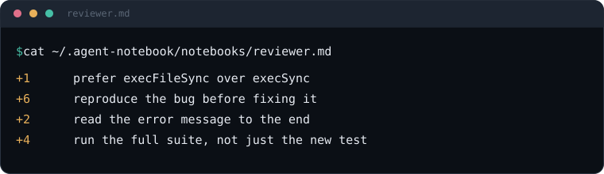
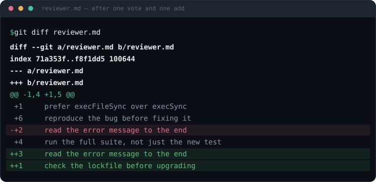

# agent-notebook

**Small memory, on purpose.** A plain-text memory for AI agents: a capped file of voted one-line lessons. No embeddings, no vector DB, no network call.

**Who this is for:** developers who run AI agents and want them to carry a few durable lessons across runs.

Monday, your agent hits a trap. Tuesday, a fresh session hits the same trap: nothing it learned outlived the run.

**A notebook is a page of lessons:** one plain text file (a *shelf*), one lesson per line. When a task starts, your harness (Claude Code, Codex CLI, or your own runner) has the agent open that file and read it whole; when the task ends, the agent votes on what helped.

**The file is capped.** A full shelf never refuses a new lesson for lack of room: the lowest-scored line drops out instead.

**Shown, not searched.** The lesson that matters most is the one your agent would never think to search for, so the whole shelf is put in front of it. And it is plain text: you can read it, fix it, and, if you keep the notebooks folder in git (optional), review every change.

**It's a store, not a loop.** Installing `nb` changes nothing between runs on its own: your harness has to run it at the start and end of each task — [wire it up](#wire-it-up). Once it does, by Thursday your agent reads the note first.

```
npm install -g agent-notebook
```

Node.js 18+, no runtime dependencies.

```
$ nb add build-and-test "run lint before claiming done"
added — 1 line
note: created new shelf "build-and-test"; it has no description, so the index shows its top lesson. Say when to open the shelf: nb describe build-and-test "<when to open this shelf>"

$ nb show build-and-test
acf179  [+1]  run lint before claiming done
# vote by id: nb vote build-and-test <id> +1|-1  ·  several at once: nb vote build-and-test <id1,id2,…> +1

$ nb vote build-and-test acf179 +1
+1 → [+2] run lint before claiming done
```

That is the loop by hand: show at the start, vote at the end. Once you [wire it up](#wire-it-up), your harness does the same around every task.

**See it in 49 seconds** (with sound): one notebook being added to, voted on and capped.

<video><a href="https://github.com/user-attachments/assets/cee86591-2c29-429f-b36d-e98c07d31cc4"></a></video>

https://github.com/user-attachments/assets/cee86591-2c29-429f-b36d-e98c07d31cc4

<sub>The `nb` commands and output in the film come from a real run of nb 0.10.0, abridged and laid out for the screen; the failing and passing test at its start and end are an illustration, not a measurement. Synthetic narration and music. [Film source](https://github.com/jeanibarz/agent-notebook/tree/main/media/launch-video).</sub>

Need search over a large corpus, or long-form notes? [Pick something else](#when-to-pick-something-else). **Status:** early (0.x), MIT — [details](#status).

## How it works

<a id="why"></a>If what you want is for an agent to keep a handful of short lessons across runs, you do not need a database. A notebook is enough: a capped text file that grows by adds, re-ranks by votes, and that you can `cat`, `grep` and diff.

- **One entry = one line.** `<score>\t<lesson>`, at most 200 characters. No multi-paragraph notes.
- **Bounded.** At most 50 lines per shelf by default (raise it with `NB_MAX_LINES`). A full shelf never refuses a lesson for lack of room: the lowest-scored line is evicted instead. Only bad input is refused: an exact duplicate ([what counts](#what-it-deliberately-does-not-do)) or a blank lesson is skipped, and a lesson over 200 characters is rejected, never cut.
- **Voted, with recency-aware eviction.** An agent votes +1 or -1 on a lesson it used, and a vote also marks the lesson as recently used. There is no decay curve and no scheduler. The only aging is one point docked from the *stalest* line when a full shelf takes a new lesson, so a once-useful lesson that goes quiet eventually makes way. ([How, and why.](https://github.com/jeanibarz/agent-notebook/blob/main/docs/eviction-and-aging.md))
- **Plain text.** `~/.agent-notebook/notebooks/<shelf>.md`. Readable, diffable, greppable, backed up by whatever already backs up your home directory.

What it costs your agent's context: a full shelf is at most 50 lines of at most 200 characters. With the id and score on each line, `nb show` of a full shelf of 200-character lessons prints about 11,000 characters, for each shelf the agent opens; `nb list` adds one line per shelf. Raising `NB_MAX_LINES` or `NB_MAX_CHARS` raises that ceiling.

A new lesson starts at score `+1`. A vote lifts it past its neighbours. When the file is full, the *lowest-scored* line is evicted — never the newcomer, and never by age alone:

<p align="center"></p>

On disk the file is kept in recency order, not score order: the line touched longest ago is at the top. `nb show` sorts by score for you; `cat` shows the file as it is.

<p align="center"></p>

If you keep the notebooks folder in git (optional; [here is how](https://github.com/jeanibarz/agent-notebook/blob/main/docs/harness-setup.md#git-versioning)), every lesson your agent keeps is a line you can review. An add is a green `+` line. A vote removes the line and adds it back at the end with its new score. You cannot `git diff` a vector DB:

<p align="center"></p>

## What it deliberately does not do

If any of this is what you need, this is the wrong tool:

- No embeddings, no semantic search, no vector similarity. Duplicate *blocking* is exact on a normal form: lower-cased, with every character other than a–z and 0–9 read as a word break. So `shell-safety` matches `shell safety`, and lessons written entirely in a non-Latin script all look alike to it. A lexical check (`NB_NEAR_DUP`) prints a note when a new lesson resembles an existing one and suggests `nb merge`, but it never blocks or ranks.
- No long-form notes, summaries, or documents — one line, period.
- No network calls, no server, no sync between machines.
- No multi-field schema — a lesson is a string, a score is an integer.
- No trust boundary. A lesson is text your agent reads as an instruction, so review a shared shelf like code. ([Enterprise notes](https://github.com/jeanibarz/agent-notebook/blob/main/docs/enterprise.md).)

If you need retrieval over large unstructured context, use a real vector store. This solves a narrower problem: a short list of hard-won, durable lessons an agent should keep seeing.

## When to pick something else

- **You curate the lessons by hand.** A few rules you write and edit yourself fit in your `CLAUDE.md` or `AGENTS.md`; use that. Pick `nb` when the agent adds the lessons, votes on them, and the cap does the pruning.
- **You need retrieval over a large corpus, or long notes.** Use a vector store or a docs search tool.
- **You need live sync across machines or people.** Use a hosted memory service. `nb` does not sync; putting the notebooks folder in git is the route it supports.

## How it fits into your agent

`nb` is a **store, not a loop.** It never runs itself: install it and walk away, and nothing happens: no lesson is retrieved, none is recorded. The compounding only happens when your agent *harness* — the runner or framework around the model, such as Claude Code, Codex CLI, or your own agent loop — drives two steps around each task, one to get lessons out and one to put lessons back:

- **Retrieve** — at the **start** of a task, list the notebooks so the agent can choose by description (`nb list`), then open what fits (`nb show <shelf>`). Those lessons ride along in context while the agent works.
- **Reflect** — at the **end** of a task, `nb vote <shelf> <id> +1|-1` on the lessons that helped or misled, and `nb add <shelf> "<lesson>"` for at most one new, durable lesson. Several lessons with the same verdict go in one call: `nb vote <shelf> <id1,id2,id3> +1`.

After the first session above, the index the agent reads at task start is (folder path shortened):

```
$ nb list
agent-notebook notebooks — 1 in /home/you/.agent-notebook/notebooks
  build-and-test  1  run lint before claiming done  (auto)
```

One line per shelf: name, lesson count, description (here none is set, so the top lesson stands in, marked `(auto)`). The optional session-start hook injects the same lines under a short instruction.

<a id="the-loop-end-to-end"></a>Omit retrieve and the agent never sees its own past lessons; omit reflect and the store never grows.

| When | What runs | What drives it |
|---|---|---|
| **Task start** | `nb list`, then `nb show <shelf>` on what fits | a start-of-task instruction, or a SessionStart hook |
| **Agent works** | *(ordinary reasoning — the lessons are already in context)* | — |
| **Task end** | `nb vote` on lessons used, `nb add` for a new one | the same instruction, or a Stop / completion hook |

### Why a hook — recommended, not required

The instruction is the one required piece: *"list the notebooks, open the ones that fit, and run a retrospective before you finish."* For a short task that is enough. On a long task the instruction sits far back in the context by the time the agent wraps up, and it may simply forget to reflect. A completion hook fires at the agent's stop and asks for the retrospective right then.

### Wire it up

Give your agent the standing instruction. The block ships with the package, in a file under `codex-cli/`, but it works in either harness's instruction file. Each command below appends it once (the `grep` skips a file that already has it), and its `sed` drops the file's opening comment, a note for Codex users. Run the one for your harness, in your project; if your `CLAUDE.md` is a link to `AGENTS.md`, run only one.

**Claude Code** reads `CLAUDE.md`:

```sh
grep -qs '^## Memory: agent-notebook' CLAUDE.md || sed '/^<!--/,/^-->/d' "$(npm root -g)/agent-notebook/examples/hooks/codex-cli/AGENTS.snippet.md" >> CLAUDE.md
```

**Codex CLI** reads `AGENTS.md` (in your project, or `~/.codex/AGENTS.md` for every project):

```sh
grep -qs '^## Memory: agent-notebook' AGENTS.md || sed '/^<!--/,/^-->/d' "$(npm root -g)/agent-notebook/examples/hooks/codex-cli/AGENTS.snippet.md" >> AGENTS.md
```

The commands are for macOS, Linux, WSL or Git Bash (on Windows, see [Windows](https://github.com/jeanibarz/agent-notebook/blob/main/docs/harness-setup.md#windows)); if `npm root -g` does not point at your install, copy the block from [`examples/hooks/codex-cli/AGENTS.snippet.md`](examples/hooks/codex-cli/AGENTS.snippet.md) by hand.

For a guided, checked setup of lessons, ideas or both, an agent can follow [`examples/SETUP.md`](examples/SETUP.md).

**Check it worked:** start a fresh session and give it a task. The agent should run `nb list` and open a notebook that fits. After the task, `nb show <shelf>` should show its votes and any lesson it added. For the hooks, see [Verify it's working](https://github.com/jeanibarz/agent-notebook/blob/main/docs/harness-setup.md#verify-its-working) and `nb stats`.

**Optional hooks for Claude Code** inject the index at session start, hand the same index to each subagent, and nudge the retrospective at the stop. They ship in the package. Copy them somewhere stable (the three `.sh` scripts run `nb-claude-hook.mjs`, so keep the four files together), then print a hooks block with your paths filled in:

```sh
mkdir -p ~/.agent-notebook/hooks
cp "$(npm root -g)/agent-notebook/examples/hooks/claude-code/"nb-* ~/.agent-notebook/hooks/
chmod +x ~/.agent-notebook/hooks/*.sh
sed -e '/^  "\/\//d' -e "s|/ABSOLUTE/PATH/examples/hooks/claude-code|$HOME/.agent-notebook/hooks|" "$(npm root -g)/agent-notebook/examples/hooks/claude-code/settings.json"
```

Merge the printed `hooks` block into `.claude/settings.json` (or `~/.claude/settings.json` for every project) and restart Claude Code. To check the session-start hook, run `bash ~/.agent-notebook/hooks/nb-session-start.sh | head`: it should print a `## Your agent-notebook index` block that lists your shelves (or says there are none yet). The [hooks README](examples/hooks/claude-code/README.md) explains each script, and the [harness setup guide](https://github.com/jeanibarz/agent-notebook/blob/main/docs/harness-setup.md) walks through them OS by OS, with git history, backup and a diagnostics janitor. To run the loop in some repositories and not others, see [per-repository on/off](https://github.com/jeanibarz/agent-notebook/blob/main/docs/harness-setup.md#per-repository-onoff).

These are **reference integrations to adapt and test in your own setup**, not a certified, supported matrix. **Claude Code is the primary target**: the hooks are written against it. The Codex CLI pieces and any other harness are a lighter-touch starting point to verify in place. There is **no MCP server** and no network call — `nb` is a plain offline CLI.

## Two use cases: lessons and ideas

The same storage serves two jobs. Each has its own folder, so one never crowds the other.

| | Lessons | Ideas |
|---|---|---|
| Records | what a later agent should remember | what in the project should be deleted, merged, shortened, split, corrected or made to fail loudly |
| Read | at task start, from `nb list` | never at task start; a periodic curator reads it |
| Written | at task end, by the agent; voted by the agents that use it | at task end, at most one per task, only when the task showed something; voted by the curator |
| Folder | `~/.agent-notebook/notebooks` | `~/.agent-notebook/ideas`, with its own line length (400 characters) |
| Ends as | the line stays or ages out | a work item, after a curator checks it against the code |

Lessons are what this page describes; nothing about them changes. Ideas are an opt-in **trial**: a folder, a one-line `.nb.json` for its line length, a prompt the Stop hook appends to its nudge, and a two-line `nb-ideas` shim that runs plain `nb` on that folder. `nb` has no notion of a kind of notebook.

To set up lessons, ideas or both, follow the [setup guide](examples/SETUP.md). The design, the curator recipe and how the trial is judged are in [Two use cases: lessons and ideas](https://github.com/jeanibarz/agent-notebook/blob/main/docs/ideas-store.md).

## Install

### Claude Code: one command (beta)

1. Install Node.js 18 or later: the LTS version from [nodejs.org](https://nodejs.org). Check it with `node --version`.
2. Open a terminal (Terminal on macOS, PowerShell on Windows) and paste:

   ```
   claude plugin install agent-notebook --marketplace https://raw.githubusercontent.com/jeanibarz/agent-notebook/main/.claude-plugin/marketplace.json
   ```

   You need neither git nor Node.js for this step. It was tested with Claude Code 2.1.332 (check yours with `claude --version`).
3. Start a new chat, and ask "is agent-notebook working?". If Node.js is missing, the assistant says so in its first reply.

- **What it changes:** nothing you need to edit. Claude Code adds its own entries to `~/.claude/settings.json`.
- **Update:** `claude plugin marketplace update agent-notebook`, then `claude plugin update agent-notebook@agent-notebook`. If it says "already at the latest version", wait a few minutes and run both again. Then start a new chat.
- **Remove:** `claude plugin uninstall agent-notebook@agent-notebook`. Your notes in `~/.agent-notebook` (`%USERPROFILE%\.agent-notebook` on Windows) stay.
- **On a company computer** where the install is refused, ask your administrator to read [the company-machines guide](https://github.com/jeanibarz/agent-notebook/blob/main/docs/enterprise.md#claude-code-plugin).
- **Hooks copied by hand before:** see [moving to the plugin](https://github.com/jeanibarz/agent-notebook/blob/main/docs/harness-setup.md#moving-to-the-plugin).

### The `nb` command alone, or another agent

```
npm install -g agent-notebook
```

Requires Node.js 18+. That installs the `nb` command and nothing else: no agent reads or writes a notebook until you [wire it up](#wire-it-up). The first `nb` command creates `~/.agent-notebook/notebooks` (with a small usage log); nothing else needs setting up to use `nb` by hand.

<a id="for-contributors"></a>To work on `nb` itself, see [CONTRIBUTING.md](https://github.com/jeanibarz/agent-notebook/blob/main/CONTRIBUTING.md).

## Your first lesson

The block at the top is a whole first session. The commands in it are `nb <command> <shelf> …`, where a **shelf** is a notebook name you pick: short, no spaces. Keep the quotes around the lesson.

Each `nb show` line is `<id>  [<score>]  <lesson>`. A new lesson starts at `+1`. `acf179` is its short stable id, derived from the text, so yours will match. You pass it to `vote`, `rm` and `merge`.

Next: [wire it up](#wire-it-up), so your agent does this on its own.

## Guides

- **Evaluating it?** [How it works](#how-it-works), [what it does not do](#what-it-deliberately-does-not-do), and [when to pick something else](#when-to-pick-something-else).
- <a id="turn-it-on-or-off-per-repository"></a>**Wiring it into an agent?** [Harness setup](https://github.com/jeanibarz/agent-notebook/blob/main/docs/harness-setup.md) — the instruction, optional hooks, git history, backup and a janitor, for Claude Code and Codex CLI on Linux, macOS and Windows. Agents not biting? [Diagnosing low engagement](https://github.com/jeanibarz/agent-notebook/blob/main/docs/harness-setup.md#diagnosing-low-engagement).
- <a id="selecting-an-entry--id-vs-query"></a><a id="discovering-notebooks--nb-list"></a><a id="grouping-notebooks--the--namespace-convention"></a><a id="searching--the-demoted-fallback"></a>**Every command in detail?** [CLI reference](https://github.com/jeanibarz/agent-notebook/blob/main/docs/cli-reference.md) — selectors, merge and split, descriptions, `nb list`, namespaces, search, completion.
- <a id="activity-sparkline"></a><a id="free-diagnostic-signals"></a><a id="surfacing-metrics"></a><a id="what-the-usage-log-records"></a><a id="diagnosing-errors-by-class"></a><a id="tuning-nb-stats"></a><a id="other-environment-variables"></a><a id="inspecting-the-effective-configuration--nb-config"></a>**Looking after a store?** [Operating `nb`](https://github.com/jeanibarz/agent-notebook/blob/main/docs/operating.md) — `nb stats`, the usage log, error classes, every knob, `nb config`.
- **Setting it up step by step?** The [setup guide](examples/SETUP.md): lessons, ideas or both.
- **Keeping ideas as well as lessons?** [Two use cases: lessons and ideas](https://github.com/jeanibarz/agent-notebook/blob/main/docs/ideas-store.md) — why a separate folder, and the curator recipe.
- **Using it as a library?** [Programmatic use](https://github.com/jeanibarz/agent-notebook/blob/main/docs/programmatic-use.md).
- **Contributing?** [CONTRIBUTING.md](https://github.com/jeanibarz/agent-notebook/blob/main/CONTRIBUTING.md).

More background:

- [Getting started](https://github.com/jeanibarz/agent-notebook/blob/main/docs/getting-started.md) — the plain-language intro, no AI or DevOps background needed. There is also a one-page [visual explainer](https://github.com/jeanibarz/agent-notebook/blob/main/docs/visual-explainer.html).
- <a id="a-full-shelf-is-the-normal-state"></a>[Eviction & aging](https://github.com/jeanibarz/agent-notebook/blob/main/docs/eviction-and-aging.md) — how a full notebook decides what to keep, and why a full shelf is the normal state.
- [Memory layers](https://github.com/jeanibarz/agent-notebook/blob/main/docs/memory-layers.md) — a naming convention for agents that work across several repos: project, domain and global shelves. Documentation only; `nb` itself does not know about layers.
- [Enterprise integration](https://github.com/jeanibarz/agent-notebook/blob/main/docs/enterprise.md) — rolling it out under data-sovereignty, security and compliance constraints.
- [AGENTS.md](https://github.com/jeanibarz/agent-notebook/blob/main/AGENTS.md) — the full operating contract an agent follows. Copy-paste integration pieces live in [`examples/`](examples/).

## Status

Early. This started as an internal tool for a multi-agent orchestrator and is being published to see whether the underlying idea — bounded, voted, one-line memory — is useful outside that specific context. It's on npm, but there's no marketing push behind it: if you find it because you were already looking for something like this, that's the signal this is worth taking further. Issues and forks are welcome either way.

## Usage

```
nb show   <shelf>... [--json]            print one or more notebooks (highest-scored first; --json emits {shelf,description,entries} — a lone object for one shelf, an array for several; each entry carries a dedup key)
nb stale  <shelf> [--limit N] [--json]   list cull candidates to downvote/rm, most disposable first (lowest score, then stalest; default 10)
nb add    <shelf> "<lesson>"             add a lesson (exact dup skipped; a near-dup still adds but warns; rejected if too long, never truncated)
nb add    <shelf> -                      read the lesson from stdin (one line; multi-line is refused)
nb vote   <shelf> <id|query> +1|-1       upvote/downvote an entry you used
nb vote   <shelf> <id1,id2,…> +1|-1      batch: vote several ids at once with one delta (one lock, one write)
nb merge  <shelf> <idA> <idB> "<merged>" consolidate two entries into one
nb split  <shelf> <id|query> "<a>" "<b>" cut one overloaded entry into two (reverse of merge)
nb rm     <shelf> <id|query>             delete an entry
nb move   <from> <to> <id|query>         move an entry to another shelf, keeping its score (consolidate shelves)
nb describe <shelf> ["<text>"]           set the notebook's one-line description (no text → print the current one)
nb describe <shelf> -                    read the description from stdin (one line; multi-line is refused)
nb search <query> [prefix] [--any] [--limit N]  SECONDARY keyword fallback — scan all notebooks (surfacing is the primary path)
nb stats  [<shelf>] [--since 7d] [--json] [--exit-code] usage analytics + anomaly & diagnostic-signal flags (--json emits the raw StatsReport)
nb doctor [--json] [--exit-code]         read-only check of the notebooks dir for structural problems (conflict markers, lines without a score, control chars, case-colliding shelves, over-cap, 0-byte files, leftover temps, stale lock); --exit-code exits 3 if any are found
nb path   [<shelf>] [--json]             print the notebooks dir, or a shelf's resolved file path (--json emits a {dir, shelf, path} object)
nb path   --usage [--json]               print the resolved usage-log path (to tail -F or back it up)
nb config [--json]                       print the effective (post-clamp) NB_* tunables + the NB_DIR/NB_SESSION/NB_ASCII string env vars as name=value (--json: tunables keyed by name, string vars under `environment`)
nb enabled [--why] [--json]              print `on` or `off`: whether the agent-facing loop (hooks, retrospective, text `nb list`) is on in this directory
nb project [--why] [--json]              print the project name of this directory (empty line when there is none)
nb place  [--json]                       say where this directory's lessons live and why, and list the project folders under ~/.agent-notebook/projects
nb place  own [--json]                   give this project its own notebook: create ~/.agent-notebook/projects/<project>/ and move its shelves there
nb place  shared [--json]                move this project's shelves back to the shared notebook and remove its folder
nb place  default [shared|own|ask] [--json]  say, or record, where the notes of every project are kept (never moves notes)
nb brief  [--max-chars N] [--session <id>] [--hook <label>] [--welcome] [--json]  print what an assistant should see at the start of a session: instructions, the notebook index (default budget 9000 characters)
nb retro  --session <id> [--work-dir <dir>] [--hook <label>] [--json]  print the end-of-task retrospective text the first time it is called for a session, nothing afterwards
nb status [--json]                       say whether chats start the notebook here: two plain lines, then the details (read-only; exit 0 only when it is running)
nb list   [prefix] [--limit N]          index notebooks richest-first: one line each (name, lesson count, description)
nb ls     [prefix] [--limit N]          alias of `nb list`
nb shelves [prefix] [--limit N]         alias of `nb list`
nb roles  [prefix] [--limit N]          deprecated alias of `nb list` (still works)
nb completion <bash|zsh>                print a shell-completion script to source (eval "$(nb completion bash)")
nb --help                               show this help
nb --version                            print the tool version
```

Exit codes: `0` ok, `1` a handled error, `2` an unknown command, `3` a health gate tripped (`nb stats --exit-code` found an anomaly, or `nb doctor --exit-code` found a problem).

Every `show` line starts with a short stable id — pass that id (or a unique prefix, or a unique text substring) to `vote`/`rm`/`merge`/`split`/`move`. An over-long `add` is rejected outright, never silently truncated, so you rewrite it shorter instead of storing a cut-off, useless lesson.

`<angle brackets>` mark a value you replace and `[square brackets]` an optional argument; a bare `--` ends option parsing. The [CLI reference](https://github.com/jeanibarz/agent-notebook/blob/main/docs/cli-reference.md) explains the notation and walks through selectors, vote, merge, split, rm, describe, `nb path`, `nb list`, search and completion. `nb stats` and `nb config` are in [Operating `nb`](https://github.com/jeanibarz/agent-notebook/blob/main/docs/operating.md), `nb move` in [Eviction & aging](https://github.com/jeanibarz/agent-notebook/blob/main/docs/eviction-and-aging.md#a-full-shelf-is-the-normal-state), and `nb enabled` in [Harness setup](https://github.com/jeanibarz/agent-notebook/blob/main/docs/harness-setup.md#per-repository-onoff).

### Shell completion

`eval "$(nb completion bash)"` in `~/.bashrc`, or `eval "$(nb completion zsh)"` in `~/.zshrc`, completes commands and shelf names. The scripts also ship in [`examples/completion/`](examples/completion/).

### Machine-readable `nb stats`

`nb stats --json` prints the raw report as one JSON object. The shape is the exported `StatsReport` interface (`{ schemaVersion, window, generatedAt, windowStart, totalCalls, perCommand[], errorCauses[], anomalies[], notebooks[], notebookTotals, skipped[], conflicts[], signals[], surfacing, activity[], usageRing, crashRecovery }`): a stable contract that grows additively, with `schemaVersion` going up only on a breaking change. What each field means is in [Operating `nb`](https://github.com/jeanibarz/agent-notebook/blob/main/docs/operating.md#machine-readable-nb-stats).

## Configuration

`nb` reads these environment variables. `nb config` prints the values it actually runs with, after clamping. The rows from `NB_LOOP_N` down only tune what `nb stats` flags; [Operating `nb`](https://github.com/jeanibarz/agent-notebook/blob/main/docs/operating.md#tuning-nb-stats) explains each and has the ranges.

| Variable | Default | What it does |
|---|---|---|
| `NB_DIR` | `~/.agent-notebook/notebooks` | where the notebooks and the usage log live; set, it is used for every project, and the project folders under `~/.agent-notebook/projects/` are not used (`nb place`) |
| <a id="nb-max-lines"></a>`NB_MAX_LINES` | `50` | lines per shelf, the cap (1–5000) |
| `NB_MAX_CHARS` | `200` | characters per lesson (20–2000); a `maxChars` in `<notebooks folder>/.nb.json` wins over it |
| `NB_NEAR_DUP` | `0.5` | how similar an add must be to an existing lesson to print a merge note; `0` turns it off |
| `NB_SESSION` | unset | a session id logged with each call; four of the five `nb stats` signals and the surfacing metrics need it |
| `NB_ENABLED` | unset | `0`/`false`/`no`/`off` switches the agent loop off for one process, over `git config nb.enabled` |
| `NB_RETRO_EXTRA_PROMPT` | unset | `nb retro`: absolute path of a text file (at most 64 KiB) appended to the retrospective, with `{project}` and `{session}` filled in |
| `NB_RETRO_TTL_DAYS` | `7` | `nb retro`: days before an old `.retro-<session>` marker is removed |
| `NB_PROJECT_SLUG` | unset | the project name (`nb project` shows it); unset, it comes from the git `origin` remote as `owner-repo`, else the repository's folder. `nb brief` groups the index into this project's, domain and global shelves; `nb retro` fills `{project}` |
| `NB_GLOBAL_SHELF` | `global` | `nb brief` with a layered index: the bare shelf shown as the global layer |
| `NB_ASCII` | unset (locale decides) | ASCII digits instead of Unicode blocks in the `nb stats` sparkline |
| `NB_USAGE_RING` | `5000` | usage-log rows kept |
| `NB_STALE_LOCK_MS` | `10000` | milliseconds before a crashed process's lock is taken over |
| `NB_LOCK_GRACE_MS` | `2000` | extra wait for a stale lock before giving up |
| `NB_LOOP_N` | `10` | calls of one command on one shelf that `nb stats` flags as a loop |
| `NB_LOOP_WINDOW_S` | `120` | seconds those calls must fall within |
| `NB_SILENT_H` | `48` | hours without a call before `nb stats` flags a command as gone silent |
| `NB_ERR_MIN` | `5` | calls before an error rate is judged |
| `NB_ERR_RATE` | `0.3` | error rate at or above which a command is flagged |
| `NB_ADD_BURST_N` | `15` | adds by one session into one shelf before `nb stats` flags an add burst |
| `NB_COVERAGE_HI` | `0.5` | share of add attempts that are new lessons, at or above which `nb stats` reads coverage as high |
| `NB_RECALL_MISS_HI` | `0.2` | share of add attempts blocked as duplicates (a stored lesson did not reach the agent), at or above which `nb stats` reads it as high |

The example tools in [`examples/`](examples/README.md) read their own: `NB_BIN` (which `nb` the hooks run), `NB_GIT_AUTOCOMMIT` and `NB_GIT_SESSION_TRAILER` (git wrapper), `NB_BACKUP_PUSH_TIMEOUT` and `NB_BACKUP_GIT_LOCK_WAIT` (backup script). `nb` itself ignores them. The hooks' remaining variables are in [their README](examples/hooks/claude-code/README.md#configuration-environment).

## Programmatic use

```ts
import {
  addEntry,
  vote,
  move,
  setDescription,
  getDescription,
  showJson,
  stats,
  notebooksDir,
  type AddResult,
} from 'agent-notebook';

const dir = notebooksDir(); // $NB_DIR, else ~/.agent-notebook/notebooks: the CLI's folder

// A rejected lesson resolves with added: false and a reason. Nothing is truncated.
const r: AddResult = await addEntry(dir, 'build-and-test', 'run lint before claiming done');
if (!r.added) console.warn(`not stored: ${r.reason}`);

await vote(dir, 'build-and-test', 'run lint before', +1); // by id, id prefix or unique text
await setDescription(dir, 'build-and-test', 'what to check before claiming a task done');
console.log(getDescription(dir, 'build-and-test'));

// move keeps the score; an add would restart it at +1.
await move(dir, 'build-and-test', 'ci-hygiene', 'run lint before');

console.log(showJson(dir, 'ci-hygiene').entries); // [{ id, score, text, … }]
// stats counts `nb` CLI calls from the usage log; library calls are not logged.
console.log(stats(dir, { windowMs: 24 * 60 * 60 * 1000 }).totalCalls);
```

The CLI is a thin wrapper over this library, with zero runtime dependencies. The main calls, each explained, are in [Programmatic use](https://github.com/jeanibarz/agent-notebook/blob/main/docs/programmatic-use.md).

## Changelog

Notable changes per release are recorded in [CHANGELOG.md](CHANGELOG.md).

## Contributing

See [CONTRIBUTING.md](https://github.com/jeanibarz/agent-notebook/blob/main/CONTRIBUTING.md) for how to build and test (note: `npm test` needs Node 20.12+) and what to read first.

The entire point is that this stays small. A PR that adds a feature should make the case for why the bounded/voted/one-line model needs it, not just that it would be nice to have. Bug fixes, docs, and test coverage are always welcome.

The essential features, design choices, and the rationale behind them are specified in [docs/requirements.md](https://github.com/jeanibarz/agent-notebook/blob/main/docs/requirements.md) — read it before proposing a change, and keep it in sync (the PR template has a checklist item for this). It's also the place to find out why something works the way it does (for example, why the notebook file is stored in recency order rather than sorted — see also [docs/eviction-and-aging.md](https://github.com/jeanibarz/agent-notebook/blob/main/docs/eviction-and-aging.md)).

Please add a one-line entry under the `Unreleased` section of [CHANGELOG.md](CHANGELOG.md) for any user-facing change.

## License

MIT
