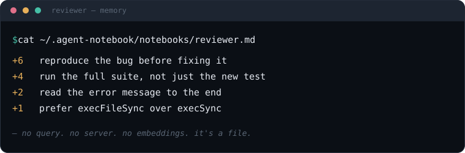
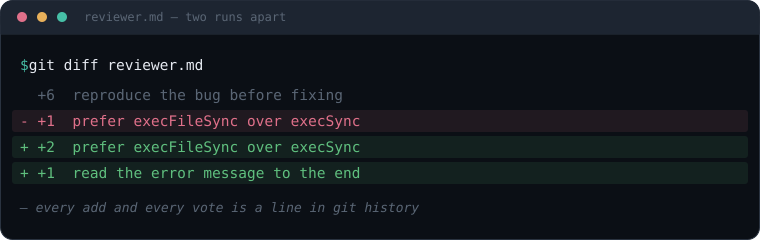
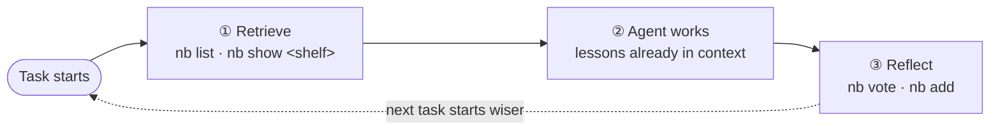

# agent-notebook

A bounded, voted, plain-text memory for AI agents — one small file (a *shelf*) per group of related lessons, no embeddings, no vector DB, no network call.

**Who this is for:** developers who run AI agents and want them to carry a few durable lessons across runs.

**What you get:** the agent remembers hard-won lessons, avoids repeating the same mistakes, and improves over the experience it has chosen to keep — voted by usefulness, bounded in size.

A **shelf** is one `<name>.md` notebook file: a group of lessons an agent needs in the same situations. Shelves group lessons by *co-access* (needed together), not by agent role, so an agent that opens a shelf can get the lessons it looks for plus ones it might not think to search for. (Earlier versions called this unit a "role"; `role` keys, `listRoles`, `assertSafeRole` and `nb roles` remain as deprecated aliases.)

<p align="center"></p>

```
$ nb add build-and-test "run lint before claiming done"
added — 1 line

$ nb show build-and-test
acf179  [+1]  run lint before claiming done

$ nb vote build-and-test acf179 +1
+1 → [+2] run lint before claiming done
```

## Why

Most "agent memory" tooling reaches for a vector database the moment anyone says the word "memory." Most agents don't need one. If what you actually want is "let this agent remember a handful of short, durable lessons across runs," a notebook is enough: a capped, append-and-vote text file that a human can `cat`, `grep`, and diff in git.

The point of durable memory isn't to answer the questions an agent knows to ask — it's to put the hard-won lesson it would otherwise forget to look for back in front of it. So a notebook is *shown* to the agent, not searched; the lessons it needs arrive without it having to name them.

`agent-notebook` is the whole mechanism, nothing more:

- **One entry = one line.** `<score>\t<lesson>`, at most 200 characters, no multi-paragraph notes.
- **Bounded.** At most 50 lines per shelf by default (raise with `NB_MAX_LINES`). A new lesson is *always* admitted; when full, the lowest-scored line is evicted — harmful or useless lessons leave, useful ones survive.
- **Voted, with recency-aware eviction.** An agent votes +1/-1 on a lesson it used, and a vote also marks the lesson as recently used. No wall-clock decay curve, no relevance scoring, no scheduler — the only aging is one point docked from the *stalest* line when a full notebook takes a new lesson. That line then goes to the back of the queue, so a once-useful lesson that goes quiet eventually makes way instead of being immortal, and a run of adds takes its points from the quiet lessons in turn instead of draining one. ([How, and why.](docs/eviction-and-aging.md))
- **Plain text.** `~/.agent-notebook/notebooks/<shelf>.md`. Readable, diffable, greppable, backed up by whatever already backs up your home directory.

The cap and the vote are the whole mechanism. A new lesson enters at the `+1` floor; a vote lifts it past its neighbours by score; and when the file is full the *lowest-scored* line is evicted — never the newcomer, and never by age alone:

<p align="center"></p>

## What it deliberately does not do

Naming the non-goals matters more than listing features — if any of this is what you need, this is the wrong tool:

- No embeddings, no semantic search, no vector similarity. (Duplicate *blocking* stays exact-normal-form; a dependency-free lexical check may add a non-blocking "looks like an existing lesson — merge?" advisory, but never blocks or ranks.)
- No long-form notes, summaries, or documents — one line, period.
- No network calls, no server, no sync between machines.
- No multi-field schema — a lesson is a string, a score is an integer.

If you need retrieval over large unstructured context, use a real vector store. This solves a narrower problem: a short list of hard-won, durable lessons an agent should keep seeing.

Because a notebook is a plain file in a git-backed directory, everything your agent learns is a line you can review — an added lesson is a green `+`, a recorded vote a `-`/`+` score change. You cannot `git diff` a vector DB:

<p align="center"></p>

## How it fits into your agent

`nb` is a **store, not a loop.** It never runs itself: install it and walk away, and it stays an empty folder of plain-text files — nothing retrieves a lesson, nothing records one. The compounding only happens when your agent *harness* — the runner or framework around the model, such as Claude Code, Codex CLI, or your own agent loop — drives two steps around each task, one to get lessons out and one to put lessons back:

- **Retrieve** — at the **start** of a task, surface the shelf that fits and inject it into the agent's context. List the notebooks so the agent can choose by description (`nb list`), then open what fits (`nb show <shelf>`). Those lessons ride along in context while the agent works — the point of the tool is that the lesson is *shown*, so the agent gets the one it would never have thought to search for.
- **Reflect** — at the **end** of a task, fold back what the work taught: `nb vote <shelf> <id> +1|-1` on the lessons that helped or misled, and `nb add <shelf> "<lesson>"` for at most one newly learned, durable lesson (the shelf is bounded, so one sharp line is worth more than three padded ones). When several lessons earned the same verdict, vote them in one call — `nb vote <shelf> <id1,id2,id3> +1` (a comma-separated list of ids; best-effort, one lock, one write). This is what lets the store grow and re-rank itself instead of staying frozen at whatever you first seeded it with.

Omit retrieve and the agent never sees its own past lessons; omit reflect and the store never grows. With neither, `nb` is just an unused folder — which is why a fresh install looks empty and unread until the loop is wired in.

### The loop, end to end



| When | What runs | What drives it |
|---|---|---|
| **Task start** | `nb list`, then `nb show <shelf>` on what fits | a SessionStart hook, or a start-of-task instruction |
| **Agent works** | *(ordinary reasoning — the lessons are already in context)* | — |
| **Task end** | `nb vote` on lessons used, `nb add` for a new one | a Stop / completion hook, or the same instruction |

### Why a hook — recommended, not required

Both steps can run from a plain **instruction** in the agent's system prompt or `AGENTS.md`: *"list the notebooks, open the ones that fit, and run a retrospective before you finish."* For a short task that is enough — the instruction is still near the top of the context when the agent wraps up, so it remembers to reflect.

The reflect step is the fragile half. **The longer the task runs, the more context accumulates between that up-front instruction and the moment it matters — and the likelier the agent is to simply finish, having lost track of a retrospective it was told about only once, long ago.** A **completion-time hook** removes that dependence on memory: it fires at (or just before) the agent's stop and re-injects the reflect prompt exactly when it is needed, no matter how long the task ran or how full the context grew. That is why a hook is *recommended* rather than *required* — the loop runs without one, but a hook is the reliable way to keep the reflect step from degrading on long tasks. (A SessionStart hook that front-loads `nb list` is a smaller convenience on the retrieve side.)

### Wire it up

The copy-paste **reference integration** — SessionStart + retrospective hooks for **Claude Code**, and the contract + PATH wrapper for **Codex CLI** — lives in [`examples/`](examples/) (and ships in the npm package, so `npm install -g agent-notebook` puts the files on disk too). The **[Harness setup guide](docs/harness-setup.md)** walks through it OS by OS, and **[AGENTS.md](AGENTS.md)** is the one-paragraph instruction itself.

These are **reference integrations to adapt and test in your own setup**, not a certified, supported matrix. **Claude Code is the primary target**: the hooks are written against it. The Codex CLI pieces and any other harness are a lighter-touch starting point to verify in place. There is **no MCP server** and no network call — `nb` is a plain offline CLI, and the harness drives it through the hooks or the AGENTS.md instruction.

## Install

Requires Node.js 18+.

```
npm install -g agent-notebook
```

That's the whole install. No setup needed — the first `nb add` creates the notebook folder at `~/.agent-notebook/notebooks`.

### For contributors

Only needed to develop from source. Instead of installing globally, run it straight from a clone:

```
git clone https://github.com/jeanibarz/agent-notebook.git
cd agent-notebook
npm install
npm run build
npm link   # puts `nb` on your PATH, pointing at this clone
```

## Your first lesson

New to `nb`? Add one lesson and read it back — that is the whole loop. Every command is `nb <command> <shelf> …`, where a **shelf** is just a notebook name you pick.

1. **Add a lesson** to a shelf called `reviewer`:

   ```
   $ nb add reviewer "run lint before claiming done"
   added — 1 line
   ```

2. **Show the shelf** to read it back:

   ```
   $ nb show reviewer
   acf179  [+1]  run lint before claiming done
   ```

   Each line is `<id>  [<score>]  <lesson>`. The lesson enters at the `+1` floor, and `acf179` is its short stable id — derived from the text, so yours will match — which you pass to `vote`, `rm`, and `merge` later.

Replace `reviewer` with any short shelf name (letters, no spaces); keep the quotes around the lesson. There is nothing to set up first: the shelf and its folder (`~/.agent-notebook/notebooks`) are created on the first `nb add`.

**Reading the command reference.** Throughout this README and `nb --help`, `<angle brackets>` mark a value you must replace (`<shelf>`, `<lesson>`), and `[square brackets]` mark an optional argument you can leave out (`[--since 7d]`). Type the value or flag — never the brackets themselves. A bare `--` ends option parsing: every token after it is a literal operand, so a lesson/description/query that is itself flag-shaped is passed verbatim (`nb add glossary -- --json` stores the line `--json`).

## Guides

New here, or wiring it into a real agent? These pick up where the reference below leaves off:

- **[Getting started](docs/getting-started.md)** — the plain-language intro (no AI/DevOps background needed), with diagrams. There's also a one-page [visual explainer](docs/visual-explainer.html).
- **[Harness setup](docs/harness-setup.md)** — make your agent use the notebook: the one "list the notebooks, open what fits, retrospect at the end" instruction that does it, plus optional convenience hooks, per-change git-versioning, daily backup, and a diagnostics janitor — for **Claude Code** and **Codex CLI**, on Linux/macOS/Windows. Agents not biting? The [Diagnosing low engagement](docs/harness-setup.md#diagnosing-low-engagement) runbook tells a mis-wired hook from genuine quiet.
- **[Enterprise integration](docs/enterprise.md)** — rolling it out under data-sovereignty, security, and compliance constraints.
- **[Memory layers](docs/memory-layers.md)** — a naming convention for agents that work across several repos: project (`shelf@repo`), domain (bare) and global shelves, which one wins on conflict, where a new lesson goes, and how `nb move` promotes it. Documentation only; `nb` itself does not know about layers.
- **[Eviction & aging](docs/eviction-and-aging.md)** — how a *full* notebook decides what to keep: recency-ordered storage and the staleness decay that keeps a once-useful lesson from becoming immortal.
- **[AGENTS.md](AGENTS.md)** — the operating contract an agent follows (also the `CLAUDE.md` your harness loads). Copy-pasteable integration pieces live in [`examples/`](examples/).

## Usage

```
nb show   <shelf>... [--json]            print one or more notebooks (highest-scored first; --json emits {shelf,description,entries} — a lone object for one shelf, an array for several; each entry carries a dedup key)
nb stale  <shelf> [--limit N] [--json]   list cull candidates to downvote/rm, most disposable first (lowest score, then stalest; default 10)
nb add    <shelf> "<lesson>"             add a lesson (exact dup skipped; a near-dup still adds but warns; rejected if too long, never truncated)
nb add    <shelf> -                      read the lesson from stdin (one line; multi-line is refused)
nb vote   <shelf> <id|query> +1|-1       upvote/downvote an entry you used
nb vote   <shelf> <id1,id2,…> +1|-1      batch: vote several ids at once with one delta (one lock, one write)
nb merge  <shelf> <idA> <idB> "<merged>" consolidate two entries into one
nb split  <shelf> <id|query> "<a>" "<b>" cut one overloaded entry into two (reverse of merge)
nb rm     <shelf> <id|query>             delete an entry
nb move   <from> <to> <id|query>         move an entry to another shelf, keeping its score (consolidate shelves)
nb describe <shelf> ["<text>"]           set the notebook's one-line description (no text → print the current one)
nb describe <shelf> -                    read the description from stdin (one line; multi-line is refused)
nb search <query> [prefix] [--any] [--limit N]  SECONDARY keyword fallback — scan all notebooks (surfacing is the primary path)
nb stats  [<shelf>] [--since 7d] [--json] [--exit-code] usage analytics + anomaly & diagnostic-signal flags (--json emits the raw StatsReport)
nb doctor [--json] [--exit-code]         read-only check of the notebooks dir for structural problems (conflict markers, lines without a score, control chars, case-colliding shelves, over-cap, 0-byte files, leftover temps, stale lock); --exit-code exits 3 if any are found
nb path   [<shelf>] [--json]             print the notebooks dir, or a shelf's resolved file path (--json emits a {dir, shelf, path} object)
nb path   --usage [--json]               print the resolved usage-log path (to tail -F or back it up)
nb config [--json]                       print the effective (post-clamp) NB_* tunables + the NB_DIR/NB_SESSION/NB_ASCII string env vars as name=value (--json: tunables keyed by name, string vars under `environment`)
nb list   [prefix] [--limit N]          index notebooks richest-first: one line each (name, lesson count, description)
nb ls     [prefix] [--limit N]          alias of `nb list`
nb shelves [prefix] [--limit N]         alias of `nb list`
nb roles  [prefix] [--limit N]          deprecated alias of `nb list` (still works)
nb completion <bash|zsh>                print a shell-completion script to source (eval "$(nb completion bash)")
nb --help                               show this help
nb --version                            print the tool version
```

Exit codes: `0` ok, `1` a handled error, `2` an unknown command, `3` a health gate tripped (`nb stats --exit-code` found an anomaly, or `nb doctor --exit-code` found a problem).

Every `show` line starts with a short stable id — pass that id (or a unique prefix, or a unique text substring) to `vote`/`rm`/`merge`/`split`/`move`. An over-long `add` is rejected outright, never silently truncated, so you rewrite it shorter instead of storing a cut-off, useless lesson.

### Shell completion

`nb` is run dozens of times a session, so it ships tab-completion for **bash** and **zsh**. `nb completion <bash|zsh>` prints a static, dependency-free script to stdout; source it to complete the command set and — where a command takes a shelf — existing shelf names:

```bash
# bash — add to ~/.bashrc:
eval "$(nb completion bash)"

# zsh — add to ~/.zshrc (after `autoload -U compinit && compinit`):
eval "$(nb completion zsh)"
```

Then `nb <TAB>` completes to the commands, and `nb show <TAB>` completes to your existing shelf names (looked up with `nb list`). The shelf lookup is guarded — it discards errors and never hangs or breaks your shell, just offering no suggestions if anything goes wrong.

Prefer installing the script instead of sourcing it each shell start? The emitted files are also shipped with the package under [`examples/completion/`](examples/completion/) (e.g. `nb completion bash > /etc/bash_completion.d/nb`).

### Selecting an entry — `id` vs. `query`

Every command that acts on one entry — `vote`, `rm`, `merge`, `split`, `move` — takes a **selector** that is either:

- an **`id`** — the short stable code at the start of each `nb show` line (e.g. `acf179`), or a unique prefix of it (a short prefix made of digits or a-f, like `18` or `add`, is refused as ambiguous when it is also text in another lesson — use the full id); or
- a **`query`** — any unique text substring of the lesson (e.g. `lint before`).

Either way the selector must match **exactly one** entry. If it matches none, or more than one, the command changes nothing and lists the candidates so you can pick the one you mean.

Picking up the `reviewer` shelf from [Your first lesson](#your-first-lesson), add a second, near-duplicate lesson so there is something to select between:

```
$ nb add reviewer "run the linter first"
added — 2 lines

$ nb show reviewer
acf179  [+1]  run lint before claiming done
dce866  [+1]  run the linter first
```

**Vote** an entry up or down — a vote also marks it recently used, which is what keeps it from aging out:

```
$ nb vote reviewer acf179 +1
+1 → [+2] run lint before claiming done
```

**Merge** two near-duplicate entries into one line (here one selected by `id`, one by `query`); the survivor inherits the higher of the two scores:

```
$ nb merge reviewer acf179 "linter first" "run lint before every commit"
merged two entries into one — 1 line

$ nb show reviewer
8ddce2  [+2]  run lint before every commit
```

**Remove** an entry you no longer want:

```
$ nb rm reviewer "lint before every commit"
removed — [+2] run lint before every commit
```

`rm` takes effect immediately and there is **no in-tool undo** — the line is gone from the notebook. Because a notebook is just a plain text file, though, a deleted lesson is recoverable with `git checkout`/`git revert` when the notebooks directory is under git (the [per-change git-versioning hook](docs/harness-setup.md) sets that up).

**Splitting an overloaded entry.** `nb split` is the reverse of `merge`: it replaces one entry with two, each inheriting the original's score — for when a line turned out to be two lessons crammed together. Each half is rejected (not truncated) if too long, and a split never creates a duplicate: the two halves must differ from each other and from every surviving entry, or the split is refused and nothing changes.

```
$ nb split build-and-test build "run the build first" "run vitest after the build" --reason overloaded
split one entry into two — 2 lines
```

The optional `--reason <code>` (and `--note "<text>"`) is recorded in the usage log only — never in the notebook — so each op's rate-by-reason becomes a diagnostic signal. It is accepted by **every** mutating op, each with its own *seed-and-grow* vocabulary:

- `merge` — `duplicate` (the two entries say the same thing — one is a reworded copy of the other) · `other`
- `rm` — `wrong` (the lesson is incorrect or misleading) · `obsolete` (it was true but no longer applies) · `other`
- `split` — `overloaded` (the entry crammed two distinct lessons into one line) · `other`
- `move` — `consolidate` (folding a thin or redundant shelf into a broader one — two situations turned out to be one) · `other`
- `add` — no enum yet: free text only via `--note`, so `add`'s codes can emerge from mined notes rather than be guessed up front
- `describe` — no enum yet (free text only, like `add`); the flags are accepted and stripped so a code learned from the other write commands is never stored as the description

The reason is always optional (omit it rather than invent one). An unrecognized code is accepted as `other` with the code kept in the note, never rejected — the `other` rate is the thermostat that tells us when a new reason code should be minted. Codes are per-op: a code valid for one op buckets to `other` on another.

**Describing a notebook.** `nb describe <shelf> "<text>"` gives a notebook a one-line *description* — a **trigger** that says "the situation in which you should open me", so an agent (or a plain list of notebooks) can decide whether to open it without reading its lessons. It is stored as a leading `# desc:` comment at the top of the `<shelf>.md` file:

```
$ nb describe build-and-test "building or testing this repo, or working in a fresh worktree"
description set for shelf "build-and-test": building or testing this repo, or working in a fresh worktree
$ nb describe build-and-test           # no text → print the current one
building or testing this repo, or working in a fresh worktree
$ nb show build-and-test               # the description leads the output as a header
# desc: building or testing this repo, or working in a fresh worktree
acf179  [+1]  run lint before claiming done
```

The description is capped like a lesson (rejected, not truncated, if too long), and an empty text (`nb describe build-and-test ""`) clears it. The `# key: value` block round-trips through every mutation and is never turned into a lesson; unknown keys are preserved verbatim, so the file format stays forward-compatible. This stays within the no-schema non-goal — metadata is optional comment lines in the *file*, not a field on a lesson.

**Piping a lesson in.** Pass `-` as the lesson to read it from stdin, so an agent that just wrote a lesson into a pipe can hand it over without shell-quoting:

```
$ printf '%s\n' 'run lint first' | nb add build-and-test -
added — 1 line
```

It reads exactly one line: a single trailing newline is stripped, and **multi-line** input is refused (exit 1) rather than silently flattened into one run-together entry — one entry is one line. Because `-` means stdin, the one-character lesson `-` can't be stored through this form; use a non-dash quoted argument, or call the library's `addEntry` directly, if you ever need a literal hyphen. Everything else is unchanged — the piped line still goes through the same caps, dedup, and eviction as a quoted argument.

**Storage order vs. display order.** `nb show` sorts highest-scored first, but the `<shelf>.md` file on disk is stored in *recency order* — least-recently-touched first — not sorted by score, so a raw `cat` of the file looks unordered, and that is intentional, not a bug. A *touch* (a vote of either sign, an add, or a merge/split's new lesson) moves its line to the end, and so does the aging dock, so the top of the file is the stalest lesson: the one that has gone longest since it was touched or docked. That ordering is the recency signal eviction needs (at zero character cost — no timestamp), carried only in line position: ids are content-derived so they stay stable across reordering, and when the notebook is full the lowest-scored line is evicted (ties → stalest) and the stalest survivor is aged a point and moved to the end. The one cost is that a vote is now a line *move* (a ~2-line git diff) rather than a one-line in-place edit. Read a notebook with `nb show`, not by eyeballing the file. ([Full rationale.](docs/eviction-and-aging.md))

<a id="nb-max-lines"></a>
`NB_DIR` overrides the storage directory (default `~/.agent-notebook/notebooks`); a leading `~` (or `~/…`) in `NB_DIR` is expanded by `nb` itself to your home directory — so `NB_DIR=~/notes` works even when the value comes from a source with no shell (`settings.json` `env`, systemd, cron, `.env`). `~user/…`, absolute and relative paths are used verbatim (pass an absolute path if you want no ambiguity). `NB_MAX_LINES` and `NB_MAX_CHARS` override the caps, if you need something other than the 50-line / 200-char defaults. You never have to reconstruct that layout by hand — `nb path` prints the notebooks directory, `nb path <shelf>` the resolved file, and `nb path --usage` the usage-log path, so `cat "$(nb path reviewer)"`, `git diff "$(nb path reviewer)"`, or `tail -F "$(nb path --usage)"` just works. (Use `tail -F`, not `-f`: the usage log is periodically compacted by writing a new file and renaming it into place, so a `-f` tail following the old inode would silently go stale.) The usage-log filename may change, so resolve it through `nb path --usage` rather than hard-coding it.

### Discovering notebooks — `nb list`

`nb list` is the **notebook index**: one richest-first line per notebook — its name, lesson count, and one-line description — so an agent can decide *which* notebook to open without reading any of them (level 1 of progressive disclosure). `ls` and `shelves` are aliases (`roles`, the old name, still works but is deprecated).

```
$ nb list
agent-notebook notebooks — 3 in /home/you/.agent-notebook/notebooks
  build-and-test   12  building or testing this repo, or working in a fresh worktree
  bug-fixing        8  when fixing a reproduced bug in this codebase
  repo-onboarding   3  mapping an unfamiliar repo: build/test entry points   (auto)
```

Notebooks are ordered **richest-first** (most lessons first — the ones most worth reusing), ties broken by name. A notebook with no `# desc:` falls back to its top-scored lesson, marked `(auto)`. A bare `prefix` filters by name using the `.` namespace convention (`nb list review.` shows just `review.*`), and `--limit N` bounds the rows (default 50) so the index stays a flat, cheap read as notebooks accumulate — the header then reads `N of total` (e.g. `50 of 53`) and, unless you passed `--limit` yourself, a final `#` line says how many notebooks were left out (the ones with the fewest lessons) and the `--limit` that lists them. `nb list --json` emits the raw `NotebookListing` (`{ dir, total, rows[] }`) for a supervising agent. An empty (zero-lesson, no-description) notebook is hidden — it is phantom debris with nothing to discover — while a described-but-empty notebook is kept, because its description is still a deliberate trigger. It prints a friendly note to stderr and exits 0 when no notebook (or none matching the prefix) exists yet.

### A full shelf is the normal state

A shelf at its cap is not a problem to fix. Eviction and aging only run on a full shelf: each new lesson pushes out the lowest-scored one, and the stalest survivor loses a point and goes to the back of the queue, so lessons nobody votes for leave over time. That pressure is what keeps a shelf focused, and it is why the default cap is a tight 50 lines.

Do not divide a shelf into two shelves because it is full. (This is not about `nb split`, which cuts one overloaded lesson in two.) Dividing makes two half-empty shelves where nothing is evicted, so stale lessons pile up again, and every new shelf lengthens the index that agents read to choose one. Many small shelves with overlapping descriptions are harder to choose from than one full shelf.

**How long does a lesson get?** On a full shelf each add evicts one line, so a lesson that never gets a vote lasts about `cap ÷ adds per day` at most. A vote buys a lesson time: each point is one more pass of the aging it can absorb before it reaches the bottom score. With a cap of ten, on a shelf of unvoted lessons where nothing else is voted, a lesson is evicted by the 10th add after its last touch at +1, the 19th at +2 and the 37th at +4. A vote on another lesson can shorten a pass, so on a busy shelf a voted lesson can still leave within `cap` adds. `nb stats` prints each shelf's accepted adds in the window and, for a full shelf, that estimate (`~10d retention`): it is the most time a new lesson has to earn its first vote. It can get much less on a shelf where most lessons are voted, because the unvoted ones are evicted first. Read it before reading "FULL" as healthy: a window of days means the shelf forgets unvoted lessons quickly. The first remedy is **fewer adds per session** (the `add-burst` signal names the sessions that wrote more than `NB_ADD_BURST_N` lessons into one shelf), before dividing the shelf or raising the cap. The estimate is calendar days over the `--since` window, and a shelf younger than the window reads longer than it is.

Act only when a full shelf loses lessons that agents still use:

- **Signal:** `nb stats` reports `eviction-while-still-voted` for the shelf repeatedly: a lesson was evicted after being upvoted in the window (and not below 0), or with a score above the +1 a new lesson starts at. The [example janitor](docs/harness-setup.md#the-janitor) flags a shelf with 2 or more such evictions, or evicted lessons that were added again, within its window (30 days by default).
- **If the shelf holds two groups of lessons needed in different situations**, divide it by situation into two shelves (see the namespace convention below).
- **Otherwise**, merge near-duplicates (`nb merge`) to free lines, or raise `NB_MAX_LINES`.

When the evicted lessons were never voted, or had fallen back to +1 or below through down votes or aging, eviction is working as intended: leave the shelf as it is. Merging small shelves whose lessons are needed together is also fine: it shortens the index.

**Consolidating shelves without losing vote capital.** When you fold one shelf into another, move each lesson with `nb move <from> <to> <id|query>` rather than re-adding it. `add` always enters at the `+1` floor, so a hard-won `+7` lesson would land at `+1`, bottom of the target and eviction-bait, with its vote history thrown away. `move` carries the score across intact:

```
$ nb move repo-onboarding build-and-test "build/test entry points" --reason consolidate
moved [+7] build/test entry points — "repo-onboarding" now 2 lines, "build-and-test" now 13 lines
```

The entry is admitted into the target like a newcomer, so a full target ages and evicts its *stalest other* line, never the lesson you just moved. A move is refused — writing nothing to either shelf — if the source and target are the same shelf, the selector is absent or ambiguous (the same unique-match rule as `vote`/`rm`), or the target already holds a near-duplicate (the same dedup rule as `add`, so a move never creates a duplicate).

### Grouping notebooks — the `.` namespace convention

When one shelf collects lessons needed in different situations, split it into **namespaced shelves** named with a `.`-delimited prefix — `review.tests`, `review.correctness`, `review.security` — instead of one overloaded `review`, so each shelf again holds lessons used together and the prefix keeps the family together. It is a **naming convention only**: nothing new to configure.

```
$ nb list review.
agent-notebook notebooks — 2 matching "review." in /home/you/.agent-notebook/notebooks
  review.correctness   9  reviewing a diff for logic bugs
  review.tests         4  reviewing test coverage and quality
```

- **Lexical clustering, no engine.** Related notebooks sort together and `nb list review.` / `nb search "flaky" review.` scope straight to the group — plain prefix matching on the name, never embeddings or similarity ([NG-001](docs/requirements.md#ng-001)).
- **No prefix, or one level at most.** Most shelves need no prefix. When the index gets hard to scan, add one level (`family.situation`, e.g. `release.tagging`, `release.changelog`) and stop there. The dot builds no tree: no command groups, counts or opens a level. Deeper names (`ci.flaky.e2e.retries`) split lessons that are needed together across small shelves, lengthen the index every agent reads, and are hard to rename later because shelf names match exactly.
- **Keep the trailing dot.** `review.` matches the namespace but *not* a bare sibling that merely shares the stem (`reviews`), so the group stays exactly what you meant.
- **No new storage.** A namespaced shelf is still one flat `<shelf>.md` file — `review.tests.md`, `review.correctness.md` — never a directory. `.` is already a legal shelf character, so there is nothing to enable.
- **`@` is separate.** It stays reserved for the existing `shelf@project` scoping and composes with a namespace (`review.tests@your-repo`).
- **`README` is reserved.** A `README.md` in the notebooks dir (common when the dir is a git repo that backs up your notebooks) is *not* a notebook — it is never listed, searched, counted, or writable as a shelf (case-insensitive). Name a real notebook something else (`readme-notes` is fine).
- **Case-variants of an existing shelf are refused.** Creating `foo` when `Foo` exists exits 1 naming `Foo` — they are one file on macOS/Windows, which breaks a git-synced notebook. Existing shelves and colliding pairs are left alone.

See [FR-NAMESPACE-001](docs/requirements.md#fr-namespace-001).

### Searching — the demoted fallback

`nb search <query>` exists, but it is deliberately the **secondary** path. The point of this tool is that a notebook is *shown* to you — injected at session start, picked from the [`nb list`](#discovering-notebooks--nb-list) index — because the lesson you most need is the one you would never think to search for ([DP-8](docs/requirements.md), [NG-007](docs/requirements.md#ng-007)). Reach for `search` only for a genuine known-item lookup.

It is **keyword-only** — a plain case-insensitive substring over the query's terms, no embeddings or similarity ranking — and scans every notebook's lessons *and* descriptions. By default it is AND-over-terms (an entry must contain every term); `--any` makes it OR. Hits group by notebook, most-relevant-first, and each lesson line leads with its stable id so you can `vote` it afterwards:

```
$ nb search "build vitest"
agent-notebook search — "build vitest" (AND over 2 terms): 1 hit in 1 notebook (secondary fallback — lessons are normally surfaced to you, not searched)
  build-and-test
    d7497d  [+1]  run the build before vitest
```

A bare `prefix` scopes by name (`nb search lock review.`). `--limit N` bounds the notebook groups (default 50, like [`nb list`](#discovering-notebooks--nb-list)) so a common term can't dump every notebook — the header then reads `N of total notebooks`, and a bad value warns on stderr and falls back to the default. The limit shapes only what is shown: the `failed-search` coverage-gap signal and the surfaced-id provenance are always computed on the full result, so a small `--limit` never turns a real match into a recorded gap. `--json` emits the raw `SearchResult` (`{ terms, groups[], total, surfacedIds[] }`), where `groups` is the bounded set and `total` / `surfacedIds` are the full pre-limit result.

**A failed search is itself a signal.** When a search finds nothing it is not an error (exit 0) — it is logged (with your query), so that if you then `add` a lesson in the same session, `nb stats` reads the pair back as a **`failed-search`** diagnostic signal: a coverage gap the notebook did not hold, labelled by your own query. High search volume for a topic is exactly where *surfacing* is failing for that topic, and you flag it for free just by using the tool.

### Machine-readable `nb stats`

`nb stats --json` prints the raw `StatsReport` to stdout as a single JSON object instead of the human table, so a supervising agent can act on a `loop` / `went-silent` / `high-error-rate` anomaly without regex-parsing formatted text. The shape is the exported `StatsReport` interface (`{ schemaVersion, window, generatedAt, windowStart, totalCalls, perCommand[], errorCauses[], anomalies[], notebooks[], notebookTotals, skipped[], conflicts[], signals[], surfacing, activity[], usageRing, crashRecovery }`) : a stable contract that grows additively. `schemaVersion` is an integer (currently `1`, exported as `STATS_SCHEMA_VERSION`) that lets a consumer detect a breaking wire-format change cheaply. It goes up by exactly 1 on any **breaking** change — removing or renaming a field, changing a field's type or meaning, or changing an array's ordering that a consumer relies on — and does **not** change for a purely **additive** one, such as adding a field or a new `anomalies`/`signals` kind (how the report has grown through issues #18, #40, #72, #81, #106, #132). `generatedAt` and `windowStart` are the window's absolute bounds as ISO-8601 instants (e.g. `"2026-05-01T12:00:00.000Z"`, added in #132): `generatedAt` is the report's `now` (the instant it was generated) and `windowStart` is when the window opens (`generatedAt` minus `window`) — so a consumer can anchor the window to wall-clock time without re-deriving it from `window` and its own clock. `errorCauses` is the per-command error-cause breakdown (issue #223), dominant-first and only for commands with a handful of errors in the window: each entry is `{ command, errors, breakdown: [{ cause, pct }] }`, where `cause` is an `errorClass` token (e.g. `add`'s `too_long`, `vote`'s `no_match`/`ambiguous_selector`) — or `unclassified` when the log predates the error-class column, a cue to upgrade `nb`. It surfaces the two most actionable rates (over-cap `add`s and `vote` selector misses) in the header instead of leaving them buried behind the high-error-rate anomaly threshold. For `vote`, `errors` and the `no_match` share also fold in batch-vote **partial** misses — stale ids skipped by a batch that still landed at least one vote and so exited `0` (issue #310) — so these do not quietly escape the readout; the per-command error *rate* still counts only whole failed calls, so a partly-successful batch stays a success there. `activity` is the per-day ops count (see [below](#activity-sparkline)). `notebooks` is the per-shelf inventory — `{ shelf, role, lines, cap }` for each shelf's notebook (`role` is a deprecated copy of `shelf`), where `lines` is the stored-lesson count and `cap` is `maxLines()` — so a supervisor can see that a shelf is at (or near) its cap and about to evict a lesson; `notebookTotals` aggregates it as `{ shelves, roles, lines, cap }` (`roles` is a deprecated copy of `shelves`). The inventory is the current on-disk state, not a slice of the usage window. `skipped` lists any shelf the inventory could not read (issue #332) — the same `{ shelf, code }` skip `nb list`/`nb search` report, also printed as one stderr line — so a damaged store still yields a full health report instead of aborting (#332). `conflicts` lists any shelf whose file holds an unresolved git merge-conflict marker (issue #333, `{ shelf, marker }`), also printed as one stderr line: the shelf is still counted, but a mutation will refuse it until the conflict is resolved (see below). `usageRing` is the monitoring log's own occupancy — `{ rows, cap }`, where `rows` is the total row count on disk and `cap` is `usageRing()` (the `NB_USAGE_RING` bound) — so a supervisor can see the log is near its compaction point and about to drop the oldest history, the analogue for the log of the `notebooks` cap-pressure readout (issue #206). It is **total** occupancy, independent of `--since` (unlike `totalCalls`), and read from the same ring scan the report already does. When the ring is full and its oldest row is newer than the `--since` window start, `usageRing` also carries `oldest` (ISO timestamp) and `coversWindow: false`, and the text report adds one line saying how far back the log reaches — the per-day add rates and retention estimates then span more days than are recorded (#406); otherwise it is exactly `{ rows, cap }`. It composes with `[<shelf>]` and `--since`; a bad `--since` window still warns on stderr (stdout stays pure JSON) and falls back to 7d. `crashRecovery` is the window's **crash-recovery readout** — `{ lockSteals, tempReaps }`, where `lockSteals` is how many stale `.nb.lock`s a mutation stole (a prior `nb` crashed while holding the lock) and `tempReaps` is how many leftover `*.md.<pid>.tmp` / `.nb-usage.log.<pid>.tmp` files it reaped (a prior `nb` crashed mid atomic-write), both previously-silent evidence that agents are dying mid-write and may be losing updates (issue #309). It is summed from the usage log's trailing `recovered` column, and — like `usageRing` — is **deployment-wide**, so a `[<shelf>]` scope narrows the rest of the report but not this (the lock and temp debris are shared across every shelf); only the window applies. A clean deployment reports `{ 0, 0 }`, shown rather than omitted so "measured, healthy" is never confused with "not measured".

### Activity sparkline

`nb stats` prints a one-line **ops-per-day activity sparkline** right under its header, so "when did this store go quiet?" is answerable at a glance:

```
nb usage — window 7d, 41 calls
  activity  ▂▁▅█▇▃▁  (7d, 41 ops)
```

Each of the eight Unicode block glyphs (`▁▂▃▄▅▆▇█`) is one bucket, scaled against the window's busiest bucket — zero-based, so a **silent (0-op) bucket always reads as the floor glyph `▁`** and the busiest as `█`. Buckets are **rolling 24-hour windows counting back from now** (not calendar days, so there is no timezone question): the leftmost glyph is the oldest 24h of the window and the rightmost is the 24h ending now. The bucket count follows `--since` (`7d` → 7 glyphs, a sub-day window → 1), and it is scoped to `[<shelf>]` like the rest of the report. In `--json` the same counts are the `activity` array (oldest bucket first; `activity.length` is the bucket count and `sum(activity) === totalCalls`). Zero dependencies — no chart library, no network.

### Free diagnostic signals

`nb stats` also surfaces a handful of **free diagnostic signals** — memory-quality observations read straight from the usage log, costing no new agent action because each is already implied by behaviour the agent performs for its own reasons. They appear in the human table under a `signals:` section and in `--json` as `signals[]` (each a `DiagnosticSignal` = `{ kind, shelf, role, detail, session?, entry? }`). The kinds:

- **browse-without-use** — a notebook was `show`n in a session but nothing in it was voted that session → its description may over-promise (it drew a look that didn't pay off). The human table folds it to one line per shelf with the number of sessions (`shelf s: shown without a vote in 29 sessions`), busiest first; `--json` still lists every (session, shelf) pair.
- **eviction-while-still-voted** — the cap evicted an entry (the `evicted` column of an `add`, `merge` or `split`) that was upvoted in the usage window (and left at 0 or above), or whose score was still above the +1 a new lesson starts at → a lesson agents found useful was lost. One occurrence is normal churn; repeated ones on the same shelf mean the cap is too tight for it (see [A full shelf is the normal state](#a-full-shelf-is-the-normal-state)).
- **vote-reversal** — the same entry was upvoted in one session and downvoted in another → the lesson may be correct but *mis-aimed* (right in one context, wrong in another).
- **failed-search** — a [`nb search`](#searching--the-demoted-fallback) returned nothing and a lesson was then `add`ed in the same session → a coverage gap the notebook did not hold, labelled by the agent's own query.
- **add-burst** — one session accepted more than `NB_ADD_BURST_N` (default 15) adds into a single shelf → on a full shelf each add evicts a line, so the burst shortens how long the other lessons survive. Fix it with fewer, better lessons per session.

All five are **session-aware**, so set `NB_SESSION` (a hook or supervising agent does this) for them to attribute calls to a session — browse-without-use, vote-reversal, failed-search and add-burst need it, and skip calls with a blank session. Like the anomalies, they are computed over the windowed, shelf-scoped usage rows (so `--since` and `[<shelf>]` apply). They are deliberately heuristic *hints*, not verdicts: a glance that didn't lead to a vote isn't proof a description is bad, just a place worth a look.

### Surfacing metrics

Beside the free signals, `nb stats` reports the named **surfacing metrics** (`StatsReport.surfacing`, a `SurfacingMetrics` object) — the rates that say whether the notebook is *covering* and *surfacing* at all. They turn the usage log into the numbers the [design rationale](docs/self-observing-notebook.md) §4 defines:

- **coverage** (novel-add rate) — `accepted` adds ÷ add attempts. High early (a young notebook filling gaps) is expected, not a fault.
- **recall-miss** (the headline alarm) — `dedup-blocked` adds ÷ add attempts: the agent re-derived something the notebook *already held*, so a stored lesson failed to reach it.
- **precision-miss** — downvotes ÷ votes on *pushed* lessons, read right beside recall-miss so chasing recall ("surface everything") can't look free.
- **readout** — where (coverage, recall-miss) lands on a 2×2: `healthy` (covers and surfaces), `surfacing-failure` (content present but not reaching the agent), `coverage-building` (a young notebook filling gaps), or `churny` (gaps *and* poor surfacing). A heuristic hint, not a verdict.

Votes are counted **per lesson**: a batch `nb vote <shelf> id1,id2 +1` counts one vote per landed id. Two properties keep the rates honest. They are conditioned on **attempts** (add/vote *events*), so a lazy agent is just a small sample, never a deflated "healthy 0%". And they are gated on **engagement**: only sessions that show a vote are scored — a vote-less session is a setup/plumbing gap, excluded rather than mistaken for "healthy quiet". A rate with no data is `null` (shown `—` in the table), never a misleading `0`. They need `NB_SESSION` set to attribute calls to sessions. (Every delivered lesson is currently treated as *pushed* for precision-miss; now that [`nb search`](#searching--the-demoted-fallback) exists, narrowing this to non-search-delivered lessons is a possible future refinement.)

### What the usage log records

Every `nb` call appends one tab-delimited row to the usage ring (`.nb-usage.log`). Beyond the base `timestamp · shelf · command · ok|err · duration`, each row also records, per call:

- the **entry id(s)** the call touched — the added/voted/removed entry, (for `merge`) the two sources plus the merged result, or (for `split`) the source plus the two produced entries;
- a **session id** read from the `NB_SESSION` environment variable (a hook or supervising agent sets it so calls can be grouped; absent → blank, and co-access simply isn't computed);
- the **outcome** — for `add`, `accepted` or `dedup-blocked` (and on a block, the colliding entry's id); for `vote`, `up` or `down`; `removed` / `merged` / `split` for `rm` / `merge` / `split`; `match` / `no-match` / `no-terms` / `no-shelf` for `search` (`no-shelf`: the prefix operand matched no shelf, so nothing was searched; with the query kept in the note, so a failed search becomes a gap signal); plus, when an `add` evicts, which entry left and its final score;
- the optional **operation reason** — a per-op enum code and free-text note attached to any mutating op (`add`/`merge`/`rm`/`split`/`describe`, via `--reason`/`--note`); it lives in the log, never in a lesson;
- an **error class** when the call exited non-zero — one terse token from a fixed, small enum so a high-error-rate anomaly can be split by cause (see [below](#diagnosing-errors-by-class)). A successful call leaves it blank.
- a **crash-recovery** count when the call cleaned up after a *previous* `nb` that died mid-write — `<lock-steals>:<temp-reaps>`, the stale `.nb.lock`s it stole and leftover `*.tmp` files it reaped while acquiring the lock (issue #309). Blank in the common case; `nb stats` sums it window-wide into the `crashRecovery` readout so "are my agents crashing mid-write?" is answerable.
- a **batch-vote miss count** when a batch `vote` (`nb vote <shelf> id1,id2,id3 +1`) landed at least one id but some ids did not resolve — the number of stale ids skipped (issue #310). That call still exits `0` (a success), so its misses would otherwise be invisible to the error-rate table; recording the count lets `nb stats` fold them into the `vote` error causes as `no_match`, so stale-selector misses inside a partly-successful batch are no longer laundered out of the "voting on ids that no longer exist" signal. Blank in the common no-miss case.

This is richer *logging* only — the notebook file and the one-line lesson are untouched (it adds no field to an entry). Older rows written before this change are still read correctly; their extra columns are simply blank. Logging stays best-effort: a logging failure never fails a real `nb` operation, and the ring stays bounded by `NB_USAGE_RING`.

### Diagnosing errors by class

Every non-zero `nb` call records a terse **error class** (issue #176) so a `high-error-rate` anomaly becomes *actionable* instead of a dead-end flag. The classes are a fixed, small enum — a code-chosen token, never free text, user input, a lesson, or any PII, consistent with the log's terse TSV contract:

| class | meaning |
|---|---|
| `too_long` | a lesson / description / merge / split result over the char cap was rejected |
| `ambiguous_selector` | a selector matched more than one entry — pick the one you mean by its id |
| `no_match` | a selector matched no entry (or the shelf/notebook to act on was empty) |
| `multiline_refused` | `nb add … -` was piped more than one line (one entry = one line) |
| `bad_args` | a missing / malformed argument or flag, or an invalid shelf name |
| `corrupt` | a mutation refused because the shelf holds an unresolved git merge-conflict marker (issue #333) |
| `unknown_subcommand` | an unknown `nb` command (commonly an agent guessing a name, e.g. `nb upvote`) |
| `other` | anything not yet classified — the escape hatch and the growth thermostat |

With this, `nb stats` breaks a `high-error-rate` anomaly down by class, naming the single likely cause so the operator has a lever:

```
[high-error-rate] add: 41% errors over 250 calls — too_long 78%, bad_args 14%, other 8%
```

Percentages are of the command's error total, rounded (so they need not sum to exactly 100%), most-common first. Rows written before this change carry no class and are bucketed as `unclassified` (kept distinct from a genuine `other`, so a freshly-upgraded window reads honestly rather than as a misleading "other 100%"). One exception: an over-length `add` from before the change still recorded its `too-long` outcome, so it is counted as `too_long` — the same rule the `error causes:` block uses, so the two lines give the same split for the same error rows.

If a git-versioned notebook hits an unresolved `git merge`/`pull` conflict, its `<<<<<<<`, `=======` and `>>>>>>>` marker lines stay in `<shelf>.md` until you resolve them. `nb` recognizes those shapes: `show`, `list`, `search` and `stale` still read the shelf (printing a one-line stderr warning naming the shelf and marker) so nothing is silently dropped, but **every mutation** (`add`, `vote`, `merge`, `split`, `rm`, `move`, `describe`) refuses with exit 1 and a `corrupt` error, leaving the file byte-identical — so a stray write can never bake the markers in as lessons. Run `git merge`/fix the file and `nb` reads and writes it normally again.

### Tuning `nb stats`

The anomaly detection in `nb stats` (loop / went-silent / high-error-rate flags) is tunable via env vars — out-of-range values are clamped to the stated bounds, and an unset or unparseable value falls back to the default:

- `NB_USAGE_RING` — how many recent calls are kept for `nb stats` to analyze (default `5000`, range `100`–`100000`).
- `NB_LOOP_N` — a loop is this many or more calls of the same command on the same shelf and, when the call logs a session, the same session (default `10`, range `2`–`1000`).
- `NB_LOOP_WINDOW_S` — window those calls must fall within, in seconds (default `120`, range `5`–`86400`).
- `NB_SILENT_H` — hours since a command's last call before it is flagged went-silent (default `48`, range `1`–`8760`).
- `NB_ERR_MIN` — minimum calls before a command's error rate is judged (default `5`, range `1`–`10000`).
- `NB_ADD_BURST_N` — a session that accepts more than this many adds into one shelf raises an `add-burst` signal (default `15`, range `1`–`100000`).
- `NB_ERR_RATE` — fraction of a command's calls that failed, above which it is flagged (default `0.3` = 30%, range `0`–`1`).
- `NB_COVERAGE_HI` — coverage at/above which the surfacing readout reads novel-adds as HIGH (default `0.5`, range `0`–`1`).
- `NB_RECALL_MISS_HI` — recall-miss at/above which the surfacing readout reads dedup-blocks as HIGH (default `0.2`, range `0`–`1`).
- `NB_NEAR_DUP` — trigram-Jaccard similarity at/above which an accepted `nb add` also prints a non-blocking merge suggestion (default `0.5`, range `0`–`1`; `0` disables the advisory).

### Other environment variables

A few more env vars tune rendering and concurrency rather than `nb stats`. Like the knobs above, the lock timings are clamped to their stated bounds, and an unset or unparseable value falls back to the default:

- `NB_ASCII` — force the [activity sparkline](#activity-sparkline)'s glyph ramp to ASCII digits instead of the Unicode blocks, for accessibility or a non-UTF-8 terminal. Any **truthy** value forces ASCII; any **falsey** one (`''`, `0`, `false`, `no`, `off`) forces Unicode; both override locale autodetection. **Unset**, the effective locale (`LC_ALL` → `LC_CTYPE` → `LANG`, first set wins) decides — a locale that is set but does not name UTF-8 (e.g. `C`, `POSIX`) selects ASCII, while an unset or UTF-8 locale keeps the Unicode default.
- `NB_STALE_LOCK_MS` — milliseconds a `.nb.lock` may go untouched before it is treated as abandoned by a crashed `nb` process and stolen, so a crash can't wedge the notebook (default `10000`, range `100`–`600000`).
- `NB_LOCK_GRACE_MS` — extra time, past the stale threshold, a caller waits to notice and steal an abandoned lock before giving up with `notebook is locked`; the acquire budget is derived as `NB_STALE_LOCK_MS + NB_LOCK_GRACE_MS`, never set independently (default `2000`, range `0`–`600000`).

### Inspecting the effective configuration — `nb config`

Every knob above is read at call time and *clamped* to its range, so the value `nb` actually runs under is not always the one you exported — an out-of-range or non-numeric value is silently corrected to a bound or the default. Rather than re-derive that by hand from the env var, its default, and its clamp, ask `nb` for the effective (post-clamp) values:

```sh
$ nb config
maxLines=50         (default)
maxChars=200        (default)
nearThreshold=0.5   (default)
usageRing=5000      (default)
usageRingSlack=312  (derived from usageRing)
staleLockMs=10000   (default)
lockGraceMs=2000    (default)
loopN=10            (default)
loopWindowSec=120   (default)
silentHours=48      (default)
errMin=5            (default)
addBurstN=15        (default)
errRate=0.3         (default)
coverageHi=0.5      (default)
recallMissHi=0.2    (default)
```

Each line is one effective tunable as `name=value`, read from the same getter the hot path uses — so what `nb config` prints is exactly what the caps, the near-dup advisory, the lock timings, and the `nb stats` anomaly/readout thresholds run with. The tag names the source: `(default)` when the env var is unset, `(env NB_*)` when it is set (the printed value is still the post-clamp effective one, so a value you set out of range shows up corrected), or `(derived …)` for a value computed from another (`usageRingSlack`).

A set env var is further annotated with how its value was actually resolved, so a setting that was silently rewritten or thrown away can never read as if it were in force:

- `(env NB_MAX_LINES)` — **honored**: the value you set is in force.
- `(env NB_NEAR_DUP: clamped to 1 from 2)` — **clamped**: you set a value outside the range, and `nb` used the nearest bound (the raw value you exported is quoted).
- `(env NB_MAX_LINES: ignored "abc", not an integer; using default)` — **ignored**: the value was unparseable, so `nb` used the built-in default. Integer knobs must be a whole integer: a partially-numeric value like `1e3` or `12.9` is ignored (not silently truncated to `1`/`12`).

Output with no problems is byte-identical to the pre-annotation form. Any `NB_*` variable that `nb` does not read (e.g. a typo like `NB_MAX_LINE`) is listed at the end as `not read by nb`, with a `did you mean …?` hint when a real variable is close. This is **informational only** — other tools may legitimately set `NB_*` variables, so it is never an error and the exit code stays `0`. The knobs read by the tooling this repo ships under [`examples/`](examples/README.md) (`NB_BIN`, `NB_RETRO_TTL_DAYS`, `NB_GIT_AUTOCOMMIT`, `NB_GIT_SESSION_TRAILER`, `NB_BACKUP_PUSH_TIMEOUT`, `NB_BACKUP_GIT_LOCK_WAIT`) are not listed: they belong to those tools, not to `nb`.

`nb config --json` emits one object keyed by tunable name — `{ "maxLines": { "value": 50, "source": "default", "env": "NB_MAX_LINES", "status": null, "rawValue": null }, … }` — for a supervisor to read without parsing the lines. `status` is `"honored"`/`"clamped"`/`"ignored"` when the var is set (`null` when it is unset or for the derived row), and `rawValue` is the raw env string (`null` when unset). An `unrecognized` array — `[{ "name": "NB_MAX_LINE", "suggestion": "NB_MAX_LINES" }, …]` — lists the same unknown variables. Both are **additive**: the existing `{ value, source, env }` fields and the `source` values (`env`/`default`/`derived`) are unchanged. It is read-only, and scoped to *configuration* (the knobs), distinct from `nb stats` (usage, anomalies, engagement).

## Programmatic use

```ts
import {
  addEntry,
  readEntries,
  vote,
  merge,
  split,
  remove,
  move,
  setDescription,
  getDescription,
  showJson,
  stats,
  render,
  search,
  listShelves,
  listNotebooks,
  notebooksDir,
  type AddResult,
  type SearchResult,
  type MoveResult,
  type ShowResult,
  type StatsReport,
} from 'agent-notebook';

// `dir` is the storage directory. Any path works; notebooksDir() resolves the
// default — $NB_DIR if set, else ~/.agent-notebook/notebooks — the same
// location the `nb` CLI uses.
const dir = notebooksDir();

// addEntry never throws on a *content* rejection and never silently truncates:
// it resolves to an AddResult. Check `added`; when it is false, `reason` says
// why — 'duplicate' (an equivalent line already exists), 'empty' (nothing left
// after sanitizing), or 'too-long' (over NB_MAX_CHARS; `length` carries the
// submitted size so you can report it). The success case is 'added' — a newcomer
// is ALWAYS admitted, even into a full notebook (the lowest-scored line is evicted,
// the stalest survivor aged and moved to the end; see docs/eviction-and-aging.md), so `evicted` may
// name a removed entry. (An invalid shelf name or an I/O error still throws —
// those are faults, not rejected content.)
const r: AddResult = await addEntry(dir, 'build-and-test', 'run lint before claiming done');
if (!r.added) console.warn(`not stored: ${r.reason}`);
await addEntry(dir, 'build-and-test', 'run the linter first'); // a near-duplicate
await addEntry(dir, 'build-and-test', 'obsolete note to drop');

const entries = readEntries(dir, 'build-and-test'); // Entry[] = { score, text }

// vote/merge/remove select an entry by stable id, unique prefix, or unique text
// substring — and throw if the selector matches no entry, or more than one.
await vote(dir, 'build-and-test', 'run lint before', +1);

// merge folds two entries into a single line, inheriting the higher of their
// two scores; remove deletes one. Both rewrite the notebook under the same lock
// as addEntry and vote.
await merge(dir, 'build-and-test', 'run lint before', 'linter first', 'run lint before every commit');

// split is the reverse of merge: it replaces one overloaded entry with two,
// each inheriting the original's score. It throws (writing nothing) on an empty
// or over-long half, on two halves that are duplicates of each other, or on a
// half that would duplicate a surviving entry — so a split never creates a dup.
await split(dir, 'build-and-test', 'run lint before every commit', 'run lint before every commit', 'also run the type-checker before every commit');

await remove(dir, 'build-and-test', 'obsolete note');

listShelves(dir); // string[] — shelves that already have a notebook, sorted (`listRoles` is a deprecated alias)

// listNotebooks is the richest-first index behind `nb list` (name, lesson count,
// description, with a top-lesson `auto` fallback). Phantom empty notebooks are
// hidden; `total` counts every match so a caller can render "shown of total".
listNotebooks(dir, { prefix: 'review.', limit: 50 });
// → { dir, total, rows: [{ shelf, role, lessons, desc, auto }, ...], skipped: [{ shelf, code }] }
// (`role` is a deprecated copy of `shelf`, kept so existing callers keep working;
// `skipped` lists shelves whose file could not be read — `[]` on a healthy store.)

// move relocates one entry to another shelf WITH ITS SCORE INTACT — the
// score-preserving consolidation that add+rm cannot express (add always starts a
// new entry at score +1, so earned votes are lost). Reach for it when two shelves
// turn out to be the same situation. The selector (a text fragment, here
// 'type-checker before') must match exactly one source entry, as in
// vote/merge/remove. move refuses — writing nothing to either shelf — when the
// selector is ambiguous or the target already holds a near-duplicate (the same
// check `add` uses); then `reason` is 'duplicate' and nothing moves.
const moved: MoveResult = await move(dir, 'build-and-test', 'ci-hygiene', 'type-checker before');
if (moved.reason === 'duplicate') console.warn(`already on target: ${moved.collidedId}`);

// setDescription/getDescription write and read a shelf's one-line description —
// the `# desc:` summary of when to use the shelf that `nb list` shows.
// setDescription is sanitized and length-limited like a lesson (the same cap as
// `add`) — an over-length description is rejected, not truncated — and an empty
// text clears it. getDescription returns null when none is set.
await setDescription(dir, 'build-and-test', 'what to check before claiming a task done');
const desc: string | null = getDescription(dir, 'build-and-test');

// showJson is the machine-readable sibling of render(): the shelf, its
// description, and every entry's id (a short hash of the text), score and text in
// the same highest-score order render() prints — so you recover ids without
// regex-parsing the human output.
const shown: ShowResult = showJson(dir, 'build-and-test');

// stats reads the recent-usage log (a bounded buffer of recorded calls) and rolls
// it up per command over a window (default 7 days), flagging anomalies — a
// command looping, no longer being called, or erroring often. Pass windowMs (in
// milliseconds) to set the window; pass { shelf } to scope to one shelf, or
// omit it for a deployment-wide view. getDescription, showJson and stats are
// synchronous reads (no await).
const report: StatsReport = stats(dir, { windowMs: 24 * 60 * 60 * 1000 });
console.log(report.totalCalls, report.anomalies);

console.log(render(dir, 'build-and-test')); // highest-scored first
```

The CLI is a thin wrapper over this library — `src/notebook.ts` is the whole mechanism, with zero runtime dependencies.

## Status

Early. This started as an internal tool for a multi-agent orchestrator and is being published to see whether the underlying idea — bounded, voted, one-line memory — is useful outside that specific context. It's on npm, but there's no marketing push behind it: if you find it because you were already looking for something like this, that's the signal this is worth taking further. Issues and forks are welcome either way.

## Changelog

Notable changes per release are recorded in [CHANGELOG.md](CHANGELOG.md).

## Contributing

See [CONTRIBUTING.md](CONTRIBUTING.md) for how to build and test (note: `npm test` needs Node 20.12+) and what to read first.

The entire point is that this stays small. A PR that adds a feature should make the case for why the bounded/voted/one-line model needs it, not just that it would be nice to have. Bug fixes, docs, and test coverage are always welcome.

The essential features, design choices, and the rationale behind them are specified in [docs/requirements.md](docs/requirements.md) — read it before proposing a change, and keep it in sync (the PR template has a checklist item for this). It's also the place to find out why something works the way it does (for example, why the notebook file is stored in recency order rather than sorted — see also [docs/eviction-and-aging.md](docs/eviction-and-aging.md)).

Please add a one-line entry under the `Unreleased` section of [CHANGELOG.md](CHANGELOG.md) for any user-facing change.

## License

MIT
