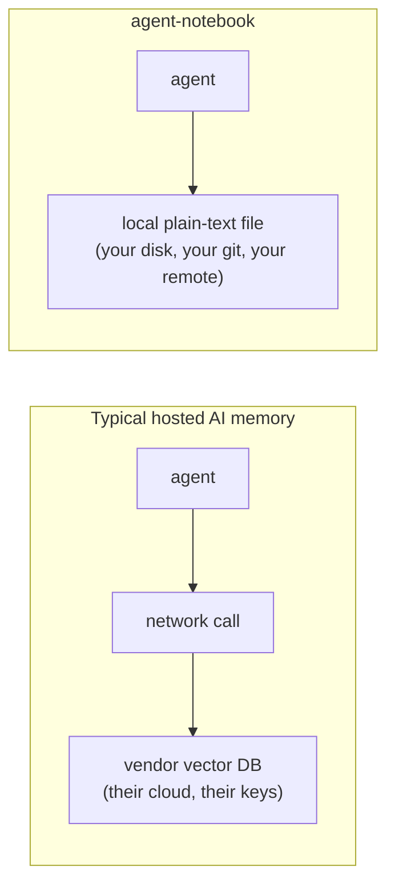
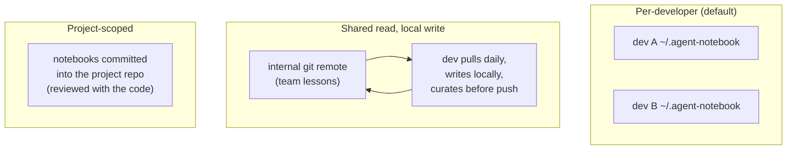

# Enterprise integration guide

*For the IT / platform / security engineer evaluating `agent-notebook` for a team
or an organisation with data-sovereignty, security, or compliance constraints.*

The short version: this tool's architecture is unusually easy to clear review,
because it has no server, no network calls, and no dependencies. Its entire data
footprint is a directory of plain-text files you already know how to govern.

---

## Why this is easy to approve

Hosted "AI memory" means your data leaves the machine for a vendor's store, and
you inherit their security posture. `agent-notebook` is the opposite by design
([non-goals](requirements.md#6-non-goals-shall-not)):



| Review question | Answer |
|---|---|
| Does data leave the machine? | **No**, unless *you* add a git remote and point it where you choose. |
| Third-party runtime dependencies? | **Zero** (`package.json` has no `dependencies`; dev-only build/test tools). |
| Network listeners / open ports? | **None.** It is a CLI that edits a file and exits. |
| Telemetry / phone-home? | **None.** |
| What is the data, physically? | UTF-8 text files under `NB_DIR` (default `~/.agent-notebook/notebooks`). |
| How do we audit what an agent "knows"? | `cat` / `grep` the files, or `git log` the store. Memory is code-reviewable. |
| How do we delete something? | Delete the line (`nb rm`) or the file. No tombstones, no vendor deletion request. |

Supply chain: pin the version you vetted (`agent-notebook@<x.y.z>`), and because
there are no transitive runtime deps, the audit surface is one small package you
can read end to end. `src/notebook.ts` is the whole mechanism. `src/usage.ts` writes the
usage log (one row per call, which can hold search query text and the `NB_SESSION`
value; every row of `nb brief` and `nb retro` also carries the `nb` version, and those run
with `--hook` carry the project: its name when it comes from `NB_PROJECT_SLUG` or the git
remote, otherwise a hash of its folder, or a hash of the name when it is over 64 characters.
A hash is not anonymous: anyone who knows the folder can recompute it) and `src/stats.ts` reads it for `nb stats`. A review of what the package records
should read all three.

---

## Data sovereignty

The data never moves unless you move it, and *you* own every hop.

- **Local-only (default).** No remote configured → memory lives on the developer's
  machine and that's the end of it. Nothing to approve beyond "a CLI writes files
  in the home directory."
- **Self-hosted git remote.** To share or back up memory, point the
  [backup job](harness-setup.md#backup) at a remote *you* control — your internal
  GitLab/Gitea, an on-prem bare repo, an SMB/NFS path with `git` over the
  filesystem. Nothing requires a public forge.
- **Region / jurisdiction.** Because the remote is your choice, data residency is
  whatever your git host's residency is. There is no vendor region to negotiate.
- **Air-gapped.** Everything works with no internet: install the package once from
  an internal npm mirror (or a vendored tarball), skip the remote, and memory
  stays on the host. The only features that touch a network are the *optional*
  `git push` in the backup job and the initial `npm install`.

### Where the remote lives

The daily [`nb-backup.sh`](../examples/nb-backup.sh) pushes to whatever `origin`
you set — this is the one sovereignty decision to make deliberately:

| Option | When it fits |
|---|---|
| No remote | strict local-only; rely on the host's existing home-dir backup |
| Internal GitLab/Gitea/Bitbucket | team sharing within your network boundary |
| On-prem bare repo (`git init --bare` on a fileserver) | simplest self-hosted; no forge to run |
| Private cloud forge (GitHub/GitLab SaaS) | acceptable residency *and* you accept that host |

Use `git push` over SSH with a deploy key scoped to that one repo. The backup
script never force-pushes: a rejected push means out-of-band history and it bails
for a human, rather than clobbering the shared record.

---

## Security

### Threat model (what to actually worry about)

The data is *text an AI agent wrote about how to do tasks*. Treat it with the
same care as the agent's other outputs. The concrete risks:

- **Secrets leaking into a lesson.** An agent could paste a token or internal
  hostname into a lesson. Mitigations: lessons are capped at 200 chars (a whole
  credential rarely survives summarisation, but don't rely on that); the store is
  plain text, so a pre-push `git` hook or the [janitor](harness-setup.md#the-janitor)
  output can be scanned with your existing secret scanner (gitleaks, trufflehog)
  before anything is pushed; and because every change is a reviewable diff, a leak
  is visible, not buried in a binary blob.
- **Prompt-injection via a shared notebook.** If notebooks are shared across a
  team, a lesson is *instruction-shaped text injected into an agent's context*. A
  malicious or careless lesson can try to steer an agent. Mitigations: the store
  is code-reviewed like any other shared artefact (that is the point of git
  history); restrict write access to the remote; and keep untrusted or
  externally-sourced notebooks out of the injected set.
- **Path traversal / unsafe shelf names.** Handled by the package: a shelf must
  match a strict pattern, cannot contain `..`, is length-bounded, and `README` is
  reserved ([FR-SAFE-001](requirements.md#fr-safe-001)). A hostile shelf name
  cannot escape `NB_DIR`.
- **Tampering.** Filesystem permissions on `NB_DIR` and branch protection on the
  remote are your controls; a signed-commit policy (`git commit -S`) works because
  it's ordinary git.

### Your own start and end text (`~/.agent-notebook/messages/`)

The files in `~/.agent-notebook/messages/` are shown to the assistant as the user's own instructions, so treat the folder like `~/.claude/CLAUDE.md`.

- **It is outside every notebooks folder.** The shipped sync and backup scripts never copy it, and `nb` never writes it. Back it up yourself. `nb` refuses a folder that lies inside `NB_DIR`, because the shipped scripts would then sync it.
- **An agent with a shell could write it.** One that read a hostile page could add a line to `brief.txt` for the next session. Add user-level deny rules for the file tools in `~/.claude/settings.json`:

  ```json
  { "permissions": { "deny": ["Edit(~/.agent-notebook/messages/**)", "Write(~/.agent-notebook/messages/**)"] } }
  ```

  A `Bash` rule cannot fence this the same way: a shell command can write the file in too many ways to list. `nb config` shows when each file last changed, so an unexpected change is visible.
- **A project file must never grant permissions or hold secrets.** The project name is not tied to a host, so a clone whose `origin` claims the same `owner/repo` on another host gets that project's text.
- A project's own `.claude/settings.json` can declare hooks, so trusting a project already means trusting it; message files add no new way in.

### What `nb status` reads, writes and runs

`nb status` ([FR-STATUS-001](requirements.md#fr-status-001)) says whether chats in a project start the notebook. It is read-only.

| | `nb status` |
|---|---|
| Reads | The tail of the usage log(s), at most 8 MiB, through a bounded reader (a regular file after `lstat`, a non-blocking open, a size cap, so a FIFO or a link to a device is refused at once). The names of the shelf files (one directory listing, no shelf is opened). `~/.agent-notebook/projects/`, as every command does. The message files, as `nb config` does. `package.json` and `CHANGELOG.md` beside `cli.js` (bounded). |
| Writes | Nothing. It appends no usage row, creates no folder, takes no lock. |
| Processes | `git config --get nb.enabled` and the read-only git calls that find the project name, with fixed argument lists and no shell. `git` is found on `PATH`, and git follows `include.path`, so a repository can set the switch from a file it names. |
| Network | None. |
| Cost | About one `nb` start plus up to three short `git` runs. It runs no `nb doctor` and reads no shelf. |
| Output | Two fixed sentences, then facts. It never prints lesson text, shelf names or the remote URL. The last group holds names and paths (your home folder shown as `~`), so remove it before posting publicly if the names are private. `--json` holds no path. |

What it proves, and what it does not: a start row exists for this project, with this version, at this time. That
shows `nb brief --hook` ran, not that the assistant received or used the text. A managed policy that blocks
hooks leaves no row, so `nb status` reads "not seen" there, not "blocked"
([the causes](harness-setup.md#when-nb-status-has-not-seen-a-chat)).

### Hardening checklist

```text
[ ] Pin agent-notebook to a vetted version (no caret range) in your install tooling.
[ ] NB_DIR on a path with least-privilege permissions (the developer, not world).
[ ] If pushing: a PRIVATE remote, SSH deploy key, branch protection, no force-push.
[ ] A secret scanner in the backup path (pre-push hook or CI on the notebooks repo).
[ ] Decide shared vs per-developer notebooks (see Multi-user below) and set ACLs to match.
[ ] Treat injected lessons as untrusted input to the agent; review shared ones.
[ ] If you use message files: back up ~/.agent-notebook/messages/ and deny Edit/Write on it.
```

---

## Claude Code plugin

*For the IT administrator who decides whether the plugin may be installed, and for the security reviewer who reads what it does.* The plugin is the same `nb` as the npm package, packed with Claude Code's hooks and a skill, so a person can install it with one command and no `npm`. Nothing here changes the answers in [Why this is easy to approve](#why-this-is-easy-to-approve): `nb` and the hooks make no network call and have no dependencies. This section is about what is new: the files Claude Code downloads, and the commands it runs for you at the start of a session.

The plugin is a beta (`0.13.0-beta.x`) until a stable release is named in the marketplace file. It was tested with Claude Code 2.1.332.

### What runs at session start

Claude Code runs the plugin's `hooks/hooks.json`. `<root>` is the folder the plugin was unpacked into (inside Claude Code's plugin cache, in a folder named after the version).

| When | Command | What it does |
|---|---|---|
| A session starts | `node <root>/examples/hooks/claude-code/nb-hook-entry.cjs session-start` | Checks that Node.js is 18 or later (an older one gets one notice and nothing else), then runs the hook adapter, which runs `nb brief` and prints the notebook index for the assistant. |
| A session starts | `sh -c '...'` | A node-check twin for macOS and Linux. It keeps only absolute `PATH` entries, then tests whether `node` exists (`command -v node`); if not, it prints one notice telling the user to install Node.js. It never runs `node`. |
| A session starts | `powershell.exe -NoProfile -NonInteractive -Command '...'` | The same node-check twin for Windows (`Get-Command node`). |
| A subagent starts | `node <root>/examples/hooks/claude-code/nb-hook-entry.cjs subagent-start` | Gives the subagent the same index. |
| The first stop with no subagent still running | `node <root>/examples/hooks/claude-code/nb-hook-entry.cjs stop` | Asks the assistant once per session to record what it learned (`nb retro`). |

Each system can start only two of the three session-start commands: the twin of the other system cannot start (`powershell.exe` on macOS and Linux, `sh` on Windows without Git), and Claude Code records one "Executable not found" error event for it in every session. It does not block anything and is not shown on the first screen. A computer with no Node.js also gets that event from the `node` command.

| | What |
|---|---|
| **Reads** | the environment variable `NB_DIR` (and `NB_*` settings); the git setting `nb.enabled` of the project (`git config`, which starts `git`); the notebooks under `~/.agent-notebook/` (`notebooks/`, and `projects/` for per-project notebooks); your message files in `~/.agent-notebook/messages/`; the hook's JSON on its standard input (the session id) |
| **Writes** | in the notebook folder: the usage log `.nb-usage.log` (one row per `nb` call; a session start is a row with the `nb` version and a project key), its older half `.nb-usage.log.1` (when the log fills it is renamed to this name, so the folder keeps up to about twice `NB_USAGE_RING` rows (`NB_USAGE_RING` is 5,000 by default); delete `.nb-usage.log*` to remove them all), its row counter `.nb-usage.log.count`, and one empty `.retro-<session>` file, so that the end-of-task question is asked once. Under `~/.agent-notebook/projects/`, and only for a person who has not set the notebook up (the next section): `.first-start` (one small file, once), `.layout` (the answer, written by `nb place default` only), `.seen-<project>` (one empty file per project already settled) and, when the answer is "a separate notebook for each project", the project's empty folder. Nothing else is written outside the notebook folder by the hooks; `nb` writes lessons only when the assistant calls it |
| **Sends** | nothing. Neither `nb` nor the hooks make a network call. Claude Code itself downloads the marketplace file and the zip when someone installs or updates, see [Allowing the plugin](#allowing-the-plugin) |
| **Reaches the model** | at most about 9,000 characters at each session start and for each subagent (the `nb brief` budget, `--max-chars`), plus the one-line notices above |
| **Uninstall leaves** | Claude Code's own `extraKnownMarketplaces` entry in the user's `settings.json` and the old version folders in its plugin cache (marked as orphaned). The user's notes in `~/.agent-notebook` stay: they are not the plugin's files |

### The first chat: one question, and the one file the adapter reads

On the first chat of someone who has not set the notebook up, `nb brief --welcome` puts a short set-up note first in the text: it says the notebook is on and asks where notes are kept ([FR-SETUP-003](requirements.md#fr-setup-003)). Who counts as new, and the files that remember it, are in [FR-SETUP-001](requirements.md#fr-setup-001) and [FR-SETUP-002](requirements.md#fr-setup-002). Nobody with `NB_DIR` or `NB_PROJECT_SLUG` set, a notebook that already holds a shelf, a git folder or a `.nb.json`, a messages folder, or a project folder sees it, and it is printed once.

The plugin's hook adapter adds `--welcome` on a fresh start (`session-start` with the payload's `source` equal to `startup`) when it runs from the plugin, and only if one more check passes. That check is the only place an adapter reads a file of the user's:

| | The settings-file check |
|---|---|
| **What file** | `$CLAUDE_CONFIG_DIR/settings.json` when `CLAUDE_CONFIG_DIR` is an absolute local path, else `<home>/.claude/settings.json`. Never `settings.local.json`, a project's settings or the managed settings. |
| **When** | once per chat start of the kind above (a fresh start, run from the plugin). Not on resume, clear, compact, a subagent or a stop. |
| **How** | `lstat` (a regular file, not a link), at most 1 MiB, a non-blocking open, one read, and a test for four fixed names: `nb-claude-hook`, `nb-session-start`, `nb-retrospective`, `nb-hook-entry`. Nothing is parsed or written. A file that does not exist counts as "no mention"; any other error means no `--welcome`. |
| **Leaves the adapter** | nothing. No byte of the file reaches the output, the error output, the usage log or `nb`. |
| **Its only effect** | whether `--welcome` is added. It can withhold the note from someone whose settings show hooks copied by hand; it can never cause an answer or an action. A project's settings can set `CLAUDE_CONFIG_DIR`, so a repository can at most show or hide that one note. |
| **Network paths** | refused without being opened: a `CLAUDE_CONFIG_DIR` that is relative, or starts with two backslashes or two slashes (`\\server\share`, `\\?\UNC\...`). On Windows, opening such a path can hand the user's credential to that server. |

The adapter reads the file once per chat start of that kind, not once per machine: it cannot know whether `nb` would print the note.

### Allowing the plugin

On a managed computer, restrict where plugins may come from with `strictKnownMarketplaces` in the managed settings. Allow exactly the marketplace file:

```json
{
  "strictKnownMarketplaces": [
    { "source": "url", "url": "https://raw.githubusercontent.com/jeanibarz/agent-notebook/main/.claude-plugin/marketplace.json" }
  ]
}
```

Use this exact form. It was measured with Claude Code 2.1.332: it allows that URL and the archive download it names, and it blocks another path on the same host, the same URL with `?x=1` and the `http://` form. Do not use `hostPattern`: it allows every repository on the host. A user who runs `marketplace add jeanibarz/agent-notebook` (a git source) is blocked by this entry, so the URL form is the only way in, and the README's install command uses it.

Hosts Claude Code contacts at install and at each update: `raw.githubusercontent.com` (the marketplace file), `github.com` (the release asset address), and `release-assets.githubusercontent.com`, the host GitHub redirects the asset download to (measured on the 0.13.0-beta.2 release). Open them for the machines that install or update the plugin.

The marketplace file names one zip and its sha256, and Claude Code refuses a zip with another sha256. A person merges every change to that file, after a check that downloads the zip, rebuilds the tag and installs it on three systems (FR-PLUGIN-006).

### With `allowManagedHooksOnly: true`

That setting turns the plugin's hooks off, silently: the plugin's skill still loads and tells the user that no notebook index reached the session. To have the hooks anyway, the administrator installs the same files outside Claude Code's plugin cache and registers them as managed hooks. Claude Code does not let a managed hook name `${CLAUDE_PLUGIN_ROOT}`, and the cache folder is writable by the user and named after the version, so the hooks must point at a copy the administrator controls.

1. Download `agent-notebook-plugin-<v>.zip` from the GitHub release `v<v>`.
2. Check its sha256 against **the one in `.claude-plugin/marketplace.json` on `main`**, which a person merged (not only against the release's own `.sha256` file, which comes from the same place as the zip), and against `SHA256SUMS`:

   ```sh
   sha256sum agent-notebook-plugin-<v>.zip     # macOS: shasum -a 256 ...
   # Windows PowerShell: (Get-FileHash agent-notebook-plugin-<v>.zip -Algorithm SHA256).Hash.ToLower()
   ```
3. Unpack it into a folder only administrators can write: `/opt/agent-notebook`, `/Library/Application Support/agent-notebook` or `C:\Program Files\agent-notebook`.
4. Choose an absolute `node` of version 18 or later, and check it: `<node> --version`. The hooks run exactly this program, so it must not be one a user can replace.
5. Put this block in the managed settings. POSIX, with `/usr/local/bin/node` and `/opt/agent-notebook` as the examples:

   ```json
   {
     "allowManagedHooksOnly": true,
     "hooks": {
       "SessionStart": [
         { "hooks": [ { "type": "command", "command": "/usr/local/bin/node", "args": ["/opt/agent-notebook/examples/hooks/claude-code/nb-hook-entry.cjs", "session-start", "--managed"] } ] }
       ],
       "SubagentStart": [
         { "hooks": [ { "type": "command", "command": "/usr/local/bin/node", "args": ["/opt/agent-notebook/examples/hooks/claude-code/nb-hook-entry.cjs", "subagent-start", "--managed"] } ] }
       ],
       "Stop": [
         { "hooks": [ { "type": "command", "command": "/usr/local/bin/node", "args": ["/opt/agent-notebook/examples/hooks/claude-code/nb-hook-entry.cjs", "stop", "--managed"] } ] }
       ]
     }
   }
   ```

   Windows, with forward slashes (they work in a JSON string and need no escaping):

   ```json
   {
     "allowManagedHooksOnly": true,
     "hooks": {
       "SessionStart": [
         { "hooks": [ { "type": "command", "command": "C:/Program Files/nodejs/node.exe", "args": ["C:/Program Files/agent-notebook/examples/hooks/claude-code/nb-hook-entry.cjs", "session-start", "--managed"] } ] }
       ],
       "SubagentStart": [
         { "hooks": [ { "type": "command", "command": "C:/Program Files/nodejs/node.exe", "args": ["C:/Program Files/agent-notebook/examples/hooks/claude-code/nb-hook-entry.cjs", "subagent-start", "--managed"] } ] }
       ],
       "Stop": [
         { "hooks": [ { "type": "command", "command": "C:/Program Files/nodejs/node.exe", "args": ["C:/Program Files/agent-notebook/examples/hooks/claude-code/nb-hook-entry.cjs", "stop", "--managed"] } ] }
       ]
     }
   }
   ```

`--managed` makes the entry ignore one variable, `NB_BIN`, which otherwise chooses the `nb` program the adapter runs. It does not shut out a project's environment: Claude Code also passes the `env` of a project's settings to hooks, and other variables still reach the hook.
- **`NODE_OPTIONS`** can make your `node` load a file of the project's before the entry runs.
- **`PATH`** decides which `git` the notebook starts, to read `nb.enabled` and the project name.

Setting those two in the managed settings' own `env` (`NODE_OPTIONS` to an empty string, `PATH` to the system folders) narrows what a project can do, but does not close it. Loader variables such as `LD_PRELOAD` (Linux) and `DYLD_INSERT_LIBRARIES` (macOS) pass too, and no list of pinned variables covers them all. On machines that open projects you do not trust, a managed hook still trusts each project's settings, as any hook does.

The block has no node-check twin: you chose the `node` and checked it.

- **An existing managed `hooks` block:** keep it, and append each of the three entries above to the list under the same event name (`SessionStart`, `SubagentStart`, `Stop`) instead of replacing the list.
- **Only with `allowManagedHooksOnly: true`.** Without it the plugin's own hooks run too, and the notebook index would appear twice.
- **The admin copy and a user's plugin copy at different versions.** The hooks use the admin copy. The user's shell may run the plugin's `nb` (the plugin's skill picks it when `nb --version` differs from the plugin's). Both read and write the same notebooks, so nothing is split, but keep them on the same version: update the admin copy when you allow an update.

### Verifying a release from its tag

You do not have to trust the zip: build it from the tag and compare.

```sh
git clone https://github.com/jeanibarz/agent-notebook.git && cd agent-notebook
git checkout v<v>
npm ci --ignore-scripts
npm run build
node scripts/build-plugin.mjs        # prints "<sha256>  agent-notebook-plugin-<v>.zip"
```

The sha256 must equal the one in `marketplace.json`. The build is reproducible: the same sha256 was measured on Linux and macOS. The build converts the line endings of its text inputs to LF, because a Windows checkout turns them into CRLF; that makes the bytes independent of the checkout, but the same sha256 has not yet been measured on Windows. The marketplace check performs this rebuild on every change to the file, and the release job compares the zip with the npm package of the same version.

### Updates and pinning

- **What changes on update:** the release notes start with a generated block, the sha256 of the files that run at session start (`hooks.json`, the entry, the adapter) and of the zip. When those hashes change, the session-start behaviour changed.
- **To pin:** keep the administrator copy above and do not allow the plugin to update (the allowlist names one marketplace file, and whoever merges it decides which version users get). Or install through the allowlist and tell users not to run `plugin update`. Users get a new version only when a person merges a new `marketplace.json` and the user runs the update.
- **Rolling back:** a pull request points the entry at an older zip, with a `Rollback:` line in its description; a lower version installs. See [releasing](releasing.md#rollback).

---

## Multi-user / team topologies

Pick the smallest topology that meets your need:



- **Per-developer (default).** Each engineer's agent learns on their machine.
  Zero coordination, zero shared-trust surface. Lose nothing but that person's
  memory if the machine dies (mitigated by their home backup).
- **Shared team notebooks.** One internal remote is the source of truth; the
  daily job pushes, developers pull. Because it's git, review and conflict
  resolution are the workflows you already have. Name shelves with a `.` group
  prefix (`review.tests`) so `nb list review.` lists one group, and add an
  `@project` suffix (`review.tests@billing`) for project-specific lessons. Gate
  pushes (CI secret scan plus human review) if the shelves are widely injected.
- **Project-scoped.** Commit a project's notebooks *into the project repo* under
  a known dir and point `NB_DIR` at it, so memory ships and is reviewed with the
  code. (Keep the `.nb-usage.log` and `.nb.lock` git-ignored — see the
  [`.gitignore` in the setup guide](harness-setup.md#git-versioning).)

---

## Compliance, audit, and retention

- **Audit trail.** With [git-versioning](harness-setup.md#git-versioning) on, the
  commit history *is* the audit log: who/what changed which lesson, when, as a
  diff. Author identity is whatever git identity the wrapper runs under. Task attribution
  needs the opt-in `NB_GIT_SESSION_TRAILER=1` (adds `Nb-Session: <id>` to each commit;
  `git log --grep '^Nb-Session: <id>$'`); it is off by default since session ids then
  enter history that may be pushed to a shared remote.
- **Retention / right-to-delete.** Deleting a lesson is `nb rm` (one line gone) or
  deleting the file. To purge from history as well, it's an ordinary
  `git filter-repo` on a small text repo — no vendor involved.
- **PII.** Lessons should describe *how to do tasks*, not hold personal data. If
  your policy requires it, add a lesson-content check to the backup path; the
  plain-text format makes that a one-line grep rather than a vendor feature
  request.
- **Licensing.** MIT ([LICENSE](../LICENSE)) — no copyleft obligation, vendor
  lock-in, or usage reporting.

---

## A reference deployment

A conservative, sovereign-by-default rollout:

1. Install a pinned `agent-notebook` from your internal npm mirror onto developer
   machines (or bake it into the dev image).
2. Enable [git-versioning](harness-setup.md#git-versioning) with the PATH wrapper;
   `NB_DIR` on a least-privilege path.
3. Point the [backup](harness-setup.md#backup) at a **private internal** remote
   over SSH; branch-protected; a pre-push secret scan.
4. Wire the harness hooks ([Claude Code](../examples/hooks/claude-code/) or
   [Codex](../examples/hooks/codex-cli/)) via your config management, with
   `NB_SESSION` set so `nb stats` surfacing metrics work.
5. Schedule the [janitor](harness-setup.md#the-janitor) weekly (read-only) and
   review its report in your normal ops cadence.

No service to run, no data processor to contract, no region to negotiate — a
directory of text files you already know how to secure, back up, and audit.
