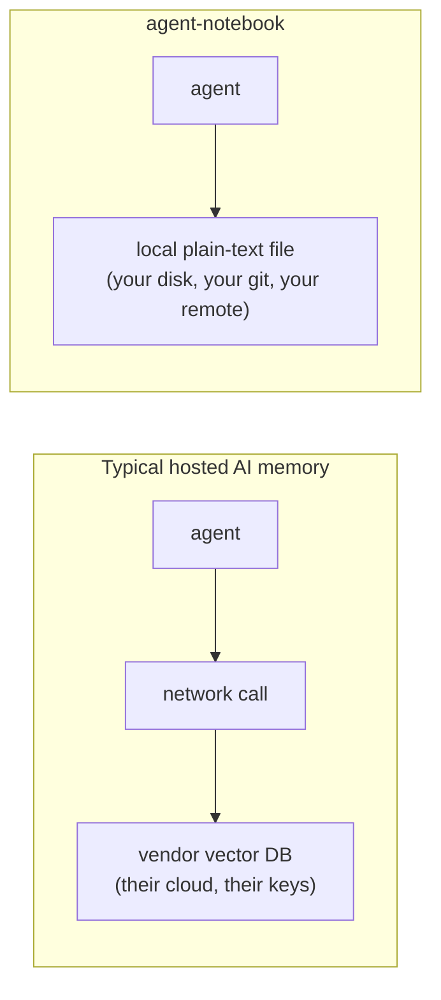
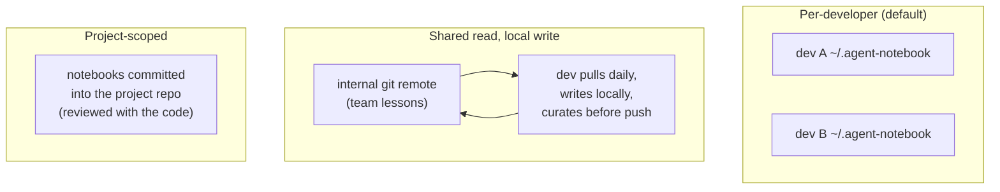

# Enterprise integration guide

*For the IT / platform / security engineer evaluating `agent-notebook` for a team
or an organisation with data-sovereignty, security, or compliance constraints.*

The short version: this tool's architecture is unusually easy to clear review,
because it has no server, no network calls, and no dependencies. Its entire data
footprint is a directory of plain-text files you already know how to govern.

---

## Why this is easy to approve

Hosted "AI memory" means your data leaves the machine for a vendor's store, and
you inherit their security posture. `agent-notebook` is the opposite by design
([non-goals](requirements.md#6-non-goals-shall-not)):



| Review question | Answer |
|---|---|
| Does data leave the machine? | **No**, unless *you* add a git remote and point it where you choose. |
| Third-party runtime dependencies? | **Zero** (`package.json` has no `dependencies`; dev-only build/test tools). |
| Network listeners / open ports? | **None.** It is a CLI that edits a file and exits. |
| Telemetry / phone-home? | **None.** |
| What is the data, physically? | UTF-8 text files under `NB_DIR` (default `~/.agent-notebook/notebooks`). |
| How do we audit what an agent "knows"? | `cat` / `grep` the files, or `git log` the store. Memory is code-reviewable. |
| How do we delete something? | Delete the line (`nb rm`) or the file. No tombstones, no vendor deletion request. |

Supply chain: pin the version you vetted (`agent-notebook@<x.y.z>`), and because
there are no transitive runtime deps, the audit surface is one small package you
can read end to end (`src/notebook.ts` is the whole mechanism).

---

## Data sovereignty

The data never moves unless you move it, and *you* own every hop.

- **Local-only (default).** No remote configured → memory lives on the developer's
  machine and that's the end of it. Nothing to approve beyond "a CLI writes files
  in the home directory."
- **Self-hosted git remote.** To share or back up memory, point the
  [backup job](harness-setup.md#backup) at a remote *you* control — your internal
  GitLab/Gitea, an on-prem bare repo, an SMB/NFS path with `git` over the
  filesystem. Nothing requires a public forge.
- **Region / jurisdiction.** Because the remote is your choice, data residency is
  whatever your git host's residency is. There is no vendor region to negotiate.
- **Air-gapped.** Everything works with no internet: install the package once from
  an internal npm mirror (or a vendored tarball), skip the remote, and memory
  stays on the host. The only features that touch a network are the *optional*
  `git push` in the backup job and the initial `npm install`.

### Where the remote lives

The daily [`nb-backup.sh`](../examples/nb-backup.sh) pushes to whatever `origin`
you set — this is the one sovereignty decision to make deliberately:

| Option | When it fits |
|---|---|
| No remote | strict local-only; rely on the host's existing home-dir backup |
| Internal GitLab/Gitea/Bitbucket | team sharing within your network boundary |
| On-prem bare repo (`git init --bare` on a fileserver) | simplest self-hosted; no forge to run |
| Private cloud forge (GitHub/GitLab SaaS) | acceptable residency *and* you accept that host |

Use `git push` over SSH with a deploy key scoped to that one repo. The backup
script never force-pushes: a rejected push means out-of-band history and it bails
for a human, rather than clobbering the shared record.

---

## Security

### Threat model (what to actually worry about)

The data is *text an AI agent wrote about how to do tasks*. Treat it with the
same care as the agent's other outputs. The concrete risks:

- **Secrets leaking into a lesson.** An agent could paste a token or internal
  hostname into a lesson. Mitigations: lessons are capped at 200 chars (a whole
  credential rarely survives summarisation, but don't rely on that); the store is
  plain text, so a pre-push `git` hook or the [janitor](harness-setup.md#the-janitor)
  output can be scanned with your existing secret scanner (gitleaks, trufflehog)
  before anything is pushed; and because every change is a reviewable diff, a leak
  is visible, not buried in a binary blob.
- **Prompt-injection via a shared notebook.** If notebooks are shared across a
  team, a lesson is *instruction-shaped text injected into an agent's context*. A
  malicious or careless lesson can try to steer an agent. Mitigations: the store
  is code-reviewed like any other shared artefact (that is the point of git
  history); restrict write access to the remote; and keep untrusted or
  externally-sourced notebooks out of the injected set.
- **Path traversal / unsafe shelf names.** Handled by the package: a shelf must
  match a strict pattern, cannot contain `..`, is length-bounded, and `README` is
  reserved ([FR-SAFE-001](requirements.md#fr-safe-001)). A hostile shelf name
  cannot escape `NB_DIR`.
- **Tampering.** Filesystem permissions on `NB_DIR` and branch protection on the
  remote are your controls; a signed-commit policy (`git commit -S`) works because
  it's ordinary git.

### Hardening checklist

```text
[ ] Pin agent-notebook to a vetted version (no caret range) in your install tooling.
[ ] NB_DIR on a path with least-privilege permissions (the developer, not world).
[ ] If pushing: a PRIVATE remote, SSH deploy key, branch protection, no force-push.
[ ] A secret scanner in the backup path (pre-push hook or CI on the notebooks repo).
[ ] Decide shared vs per-developer notebooks (see Multi-user below) and set ACLs to match.
[ ] Treat injected lessons as untrusted input to the agent; review shared ones.
```

---

## Multi-user / team topologies

Pick the smallest topology that meets your need:



- **Per-developer (default).** Each engineer's agent learns on their machine.
  Zero coordination, zero shared-trust surface. Lose nothing but that person's
  memory if the machine dies (mitigated by their home backup).
- **Shared team notebooks.** One internal remote is the source of truth; the
  daily job pushes, developers pull. Because it's git, review and conflict
  resolution are the workflows you already have. Name shelves with a `.` group
  prefix (`review.tests`) so `nb list review.` lists one group, and add an
  `@project` suffix (`review.tests@billing`) for project-specific lessons. Gate
  pushes (CI secret scan plus human review) if the shelves are widely injected.
- **Project-scoped.** Commit a project's notebooks *into the project repo* under
  a known dir and point `NB_DIR` at it, so memory ships and is reviewed with the
  code. (Keep the `.nb-usage.log` and `.nb.lock` git-ignored — see the
  [`.gitignore` in the setup guide](harness-setup.md#git-versioning).)

---

## Compliance, audit, and retention

- **Audit trail.** With [git-versioning](harness-setup.md#git-versioning) on, the
  commit history *is* the audit log: who/what changed which lesson, when, as a
  diff. Author identity is whatever git identity the wrapper runs under.
- **Retention / right-to-delete.** Deleting a lesson is `nb rm` (one line gone) or
  deleting the file. To purge from history as well, it's an ordinary
  `git filter-repo` on a small text repo — no vendor involved.
- **PII.** Lessons should describe *how to do tasks*, not hold personal data. If
  your policy requires it, add a lesson-content check to the backup path; the
  plain-text format makes that a one-line grep rather than a vendor feature
  request.
- **Licensing.** MIT ([LICENSE](../LICENSE)) — no copyleft obligation, vendor
  lock-in, or usage reporting.

---

## A reference deployment

A conservative, sovereign-by-default rollout:

1. Install a pinned `agent-notebook` from your internal npm mirror onto developer
   machines (or bake it into the dev image).
2. Enable [git-versioning](harness-setup.md#git-versioning) with the PATH wrapper;
   `NB_DIR` on a least-privilege path.
3. Point the [backup](harness-setup.md#backup) at a **private internal** remote
   over SSH; branch-protected; a pre-push secret scan.
4. Wire the harness hooks ([Claude Code](../examples/hooks/claude-code/) or
   [Codex](../examples/hooks/codex-cli/)) via your config management, with
   `NB_SESSION` set so `nb stats` surfacing metrics work.
5. Schedule the [janitor](harness-setup.md#the-janitor) weekly (read-only) and
   review its report in your normal ops cadence.

No service to run, no data processor to contract, no region to negotiate — a
directory of text files you already know how to secure, back up, and audit.
