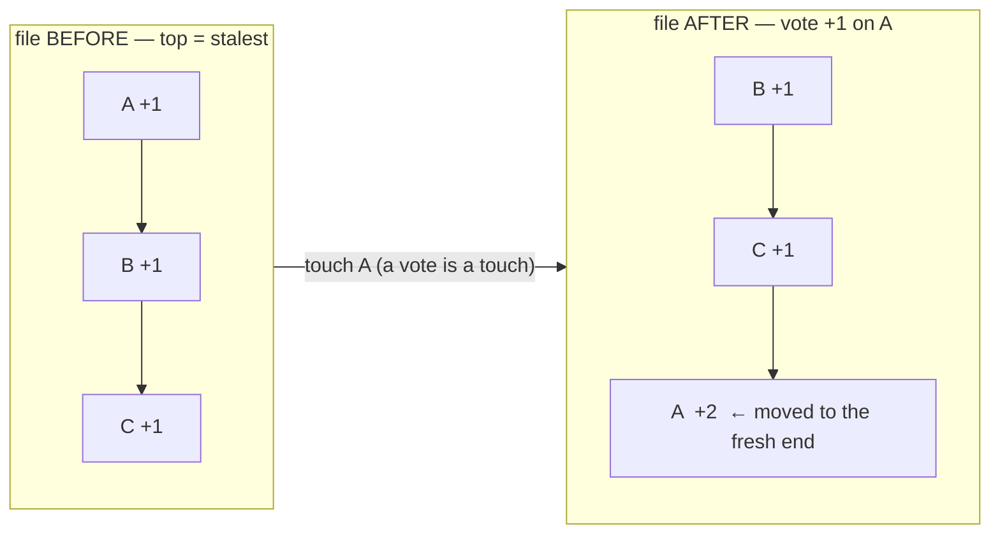
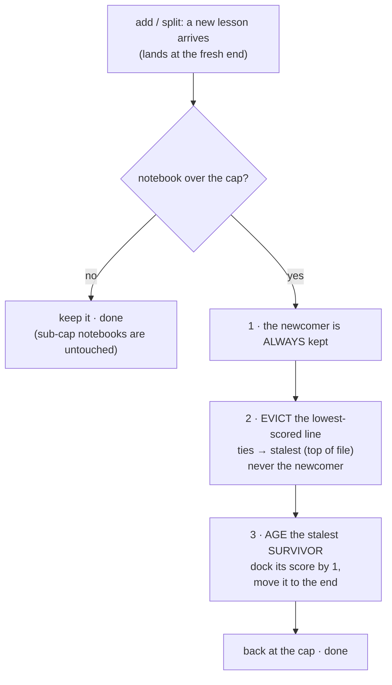

# Eviction & aging: recency-ordered storage with staleness decay

> Design rationale for how a **full** notebook decides what to keep. This is the
> one place the "cap + vote" mechanism needed more than a cap and a vote, and the
> reasoning is subtle, so it is recorded in full. For the normative statements see
> [`requirements.md`](./requirements.md) (DP-1, DP-3, FR-ADD-006, FR-EVICT-001).

## 1. The problem

Three facts about real notebooks (measured across 28 live notebooks, ~212
lessons) set the problem:

1. **Votes are almost entirely positive.** 0 of 212 lessons had ever been
   downvoted to a score ≤ 0; ~60 % sat at the entry score (+1), never moved. A
   downvote is a signal the tool should not *rely* on arriving.
2. **A new lesson entered at a fixed score** and, once a notebook was full, could
   be rejected before it was ever surfaced or voted on (the old `rejected-full`
   outcome). Newcomers could not get a foothold — the **freeze**.
3. **A once-upvoted lesson could never leave.** Eviction removes the lowest score;
   anything that had climbed to ≥ 2 always had something lower beneath it, so it
   was effectively **immortal** even after it went stale or wrong — and with no
   downvotes arriving, "never leaves" was literal.

So a full notebook calcified: incumbents frozen at the top, newcomers unable to
enter, nothing ever aging out.

## 2. Constraints (the box the solution had to fit in)

- **C1 — Standalone core.** The CLI must work with no git, no janitor, no
  external process. Those are optional harness *around* the tool; the mechanism
  lives entirely in the CLI.
- **C2 — Simple, hand-editable line format.** One lesson is one line
  `"<score>\t<lesson>"`. A per-line timestamp was rejected: ugly, and it wastes
  characters (= context) for every reader. A format change was permitted only if
  it stayed this simple — ideally none at all.
- **C3 — Clean git diffs.** A mutation should touch as few lines as possible. A
  global rewrite of every line (e.g. "subtract the minimum from all scores") was
  rejected as diff noise, even though git itself is not required (C1).
- **C4 — Bounded scores, no endless inflation.** Numbers stay small over a
  notebook's life. (This is what ruled out LFU-DA style *global inflation*, where
  newcomers enter at an ever-rising floor `L` and every score grows without
  bound.)
- **C5 — Determinism is optional, not required.** Reproducibility is nice, but it
  is not the axis that matters here; *targeting* is (see §4). Seedable randomness
  would have been acceptable.
- **C6 — Dumb, offline hot path.** Still "cap + vote" in spirit (DP-1): minimal
  code, a millisecond per call, no scheduler.

## 3. Goals (what a full notebook's policy must achieve)

- **G1 — Newcomers always get in and get a trial.** No instant rejection when
  full; a new lesson must survive long enough to be surfaced and voted on.
- **G2 — No true immortality.** A lesson that climbed high but is no longer being
  re-voted must *eventually* become evictable.
- **G3 — Proportional protection.** Higher score ⇒ harder to evict. Hard-earned
  lessons are evicted **last**, never first.
- **G4 — Self-supply the missing downward pressure.** Because downvotes rarely
  arrive (§1.1), the tool must create its own, or G2 is impossible.
- **G5 — Decay the *stale*, spare the *active*.** Pressure should fall on lessons
  that have gone quiet, not on ones still being used.
- **G6 — Bounded blast radius.** A run of adds must not single out a proven
  lesson. The evictions fall on the lowest-scored lines first, and no lesson
  loses a second point until the decay has passed over every other lesson that was on the shelf
  when it lost the first: each of them has since been docked, voted on, or
  removed.

### The tension we had to resolve

G2 + G3 + G5 cannot all hold if the only thing the core knows about a lesson is
its **score**: two lessons with the same score are indistinguishable, so you
cannot decay "the stale one" and spare "the active one". Satisfying G5 therefore
requires a **recency signal** — some record of when each lesson was last engaged
with. The whole design turns on getting that signal *without* violating C2–C4.

## 4. Why the obvious options fail

| Option | Fails on |
| --- | --- |
| Per-line timestamp column | C2 (ugly, char cost) + forward-compat (old parser folds the extra column into the lesson text) |
| Monotonic "last-touched tick" column | C4 — the tick inflates forever, same unbounded-number problem, moved to a new column |
| LFU-DA global inflation `L` | C4 — scores grow without bound; countering it needs a global rebase = C3 diff noise |
| Uniform-random `−1` on eviction | **mis-targeted**: a high line is hit with prob ∝ 1/N, so it takes ~`score`·N evictions to fall — i.e. high lines stay *near-immortal* (the opposite of G2). The problem was never "random"; it was *uniform*. |
| Round-robin `−1` | its interaction with vote timing is hard to predict, and it is score-agnostic |
| Decrement-the-max on eviction | works, bounded, deterministic — but taxes the genuine best line (no recency ⇒ no G5) |

The lesson from the mis-targeted options: to satisfy G2+G4 the decay pressure
must **rise with score / staleness**, not be uniform — and to satisfy G5 it needs
a recency signal.

The policy in §6 does take turns, like the round-robin above, but over the
recency order of §5 and not over a fixed one: a vote takes a lesson out of its
turn, so a lesson that keeps being voted is passed over. That is the part a
plain round-robin cannot do.

## 5. The decision: storage order *is* the recency signal

The recency signal we need costs **zero characters** if we stop storing entries
in insertion order and store them in **least-recently-touched-first** order
instead (classic LRU layout):

- **A "touch" moves the entry to the end of the file.** A touch is any engagement
  with a specific lesson: a **vote of either sign** (up *or* down — both mean "an
  agent surfaced this and judged it"), an `add`, and the new lesson(s) a `merge`
  or `split` produces. A plain `show`/`search` is **not** a touch (a read is not a
  vote; otherwise recency would mean nothing).
- **The aging dock of §6 also moves its line to the end.** A dock is not an
  engagement, but a lesson that has just paid a point goes to the back of the
  queue, so the next dock falls on the next lesson in line (§6, step 3).
- **Therefore the top of the file is the stalest lesson** — the one that has
  gone longest since anyone engaged it or since it last paid a point — and the
  bottom is the freshest. "Stalest" means this everywhere below.

This overturns the old **DP-3** ("storage is insertion order, never re-sorted on
vote"). DP-3's rationale was that insertion order was "the only record of age" —
but insertion age is exactly the *wrong* signal (a frequently-reused lesson looks
as old as a dead one; the FIFO trap). Last-touch order is the *right* one, and a
vote genuinely touches it. It satisfies the constraints:

- **C2:** no format change at all — the recency lives in line *order*.
- **C3:** a vote becomes a line *move* (a delete + an append, which git renders as
  a ~2-line move) instead of a 1-line in-place edit. This is the one cost we
  accepted. Everything else stays a small diff. The dock is a move too, at no
  extra cost: it already rewrote its line with the new score.
- **C4:** nothing inflates; scores stay pure-ish vote sums (see §6).
- **Backfill / compat:** none needed. Existing files are in insertion order, which
  is a perfectly good *initial* recency order (older inserts = staler — a fair
  prior). An older `nb` still reads a reordered file correctly (it sorts by score
  for display and addresses entries by content-hash id, so order is irrelevant to
  it); the only degradation when mixing old and new binaries is that the old one's
  votes won't update recency. A binary from before the dock moved its line
  (issue #437) docks in place; mixing the two only changes which lesson is
  docked next. Nothing breaks.

A **touch** (a vote, add, or merge/split result) moves its line to the bottom, and
so does a dock, so position encodes "how long since anyone engaged this lesson
or since it last paid a point":

Nothing is sorted on disk; `nb show` still ranks by score at display time. The
file order is *only* the recency record the eviction policy below reads.

## 6. The policy (fires only when the notebook is full)

Everything below engages **only when an add/split pushes the notebook over
`maxLines`**. A sub-cap notebook is returned untouched, so every notebook that has
never filled behaves exactly as before — the only immediate change for existing
notebooks is that a vote now moves its line to the end.

On an add/split that overflows the cap:

1. **Newcomers are always admitted (G1).** The freshly created lesson(s) this call
   produced are never the ones evicted. The old `rejected-full` outcome is gone.
2. **Eviction, by quality first (G3, G6).** Remove the lowest-scored lesson, ties
   broken by staleness (topmost first), never a newcomer, until the notebook is
   back at `maxLines`. This runs **before** the decay below, deliberately: if the
   staleness dock came first it could push a merely-quiet lesson below an
   explicitly worse-scored one (e.g. a downvoted lesson) and evict the wrong one.
   Evicting by score first keeps the quality signal authoritative.
3. **Staleness decay of the stalest *survivor* (G2, G4, G5, G6).** Dock **1** from
   the score of the stalest lesson still present — the topmost non-newcomer —
   and **move that lesson to the end of the file**, after the newcomer. Because
   an actively re-voted lesson keeps moving to the fresh end, it never sits at
   the top and is never decayed. A lesson that stops earning votes drifts to the
   top, loses a point, and goes to the back; it loses the next point only when
   the decay has come round to it again. A vote at any time lifts its score back
   up. With no vote it reaches the bottom score and is evicted. This is the
   self-supplied downward pressure that replaces the downvotes that never come —
   **targeted** at the stale — and it is what stops a once-upvoted lesson being
   immortal (without it, nothing below such a lesson ever leaves, so it never
   can).

   The move is what bounds the damage of a run of adds (G6). Until issue #437
   the docked lesson stayed at the top, so it took the next dock as well, and
   every one after, until it was evicted: a score of +4 bought a quiet lesson
   three adds, and one session adding four lessons could remove it within a
   minute. With the move, each add docks the next quiet lesson in turn. (With a
   cap of 2 the shelf holds only one lesson that is not the newcomer, so that
   one is docked on every add.)

### Why this hits the goals

- **G1:** a newcomer can never be the victim of its own add, so it always gets
  in. How long its trial lasts depends on the shelf: see
  [The price we knowingly pay](#the-price-we-knowingly-pay).
- **G2 + G4:** a stale high lesson loses a point each time the decay comes round
  to it (step 3) — eventually evictable, with no downvote required.
- **G3:** eviction still removes the lowest score first, so a hard-earned lesson is
  the last to go, and each point buys a quiet lesson another pass of the decay.
  With a cap of ten, on a shelf of unvoted lessons that keeps taking unrelated
  adds and where nothing else is voted, a lesson is evicted by the 10th add
  after its last touch at +1, the 19th at +2, the 37th at +4 and the 91st at +10
  (pinned by a test in `src/notebook.test.ts`). Votes on other lessons shorten
  a pass, so these are the figures for a shelf with no other votes, not a
  minimum.
- **G5:** decay targets the *stalest* line (recency), so an actively-used high
  lesson is spared while a quiet one is not — the targeting score-alone could not
  do.
- **G6:** the docked lesson moves to the end, so a lesson is docked again only
  after the decay has passed over the rest of the shelf (a randomized test in
  `src/notebook.test.ts` asserts the invariant in the goal over random sequences
  of adds and votes). Two pinned cases show what that buys:
  - **A shelf with unvoted lessons on it.** Cap of fifty, twenty stale lessons at
    +4 and thirty unvoted ones, then forty unrelated adds: none of the twenty is
    evicted. They keep 50 of their 80 points, spread evenly. The forty
    evictions take the thirty unvoted lessons and ten of the new adds.
  - **A shelf where every lesson is proven.** Cap of ten, ten lessons at +3, then
    twenty unrelated adds: the original lessons left after each add are 9 for
    the first eleven adds, then 8, 8, 7, 7, 6, 6, 5, 5, 4. The first add has to
    evict one of them, because every line is proven and the newcomer is
    protected. After that none is lost until the twelfth add, by which time
    each has been docked at least once. Until then the newcomers pay instead:
    each of the first ten is evicted by the add that follows it. The first nine
    are the only line at the bottom score. The tenth is tied at +1 with a
    lesson that has just been docked a second time and sits behind it in the
    file, so the newcomer is the staler of the two. The eleventh newcomer is
    the first to survive the add that follows it.

  G6 bounds how fast a run of adds can hurt one lesson; it does not make proven
  lessons permanent. A shelf that takes adds and no votes for long enough still
  loses them all, which is G2. See
  [The retention window is set by the add rate](#the-retention-window-is-set-by-the-add-rate).

### The price we knowingly pay

Scores are no longer a *pure* count of human votes once decay has fired: a stale
lesson's score is "votes minus the staleness docked from it". That is deliberate —
with no downvotes arriving (§1.1), synthetic downward pressure is the *only* way
to get G2, and this is the gentlest, most targeted form of it. "Staying near the
top requires continued use" is the intended behavior, not a bug. Scores stay
bounded (C4) because decay pulls the top down as votes push it up.

Two more costs came with moving the docked line (issue #437, which measured
them on a live store). The cap is fixed, so every proven lesson that is kept
longer is an unvoted one evicted sooner. This weakens G1 on a shelf where every
other lesson is voted well above +1. In a run of adds with no votes between
them, a newcomer there is evicted by the add that follows it, unless a quiet
lesson had already been worn down to the bottom score when it arrived (so the
first ten newcomers go, in the second pinned case under G6). And file order is no longer a pure
record of engagement: a lesson near the end of the file was either engaged
recently or docked recently.

### The retention window is set by the add rate

Because eviction and aging fire once per add, a full shelf turns over at the pace of adds. A lesson that nobody votes for lasts about `cap ÷ adds per day` at most: that is the time the shelf takes to bring in `cap` new lines. A vote buys a lesson time: each point is one more pass of the decay it can absorb before it reaches the bottom score (the G3 figures above, which are for a shelf with no other votes). A vote on another lesson can shorten a pass, so on a busy shelf a voted lesson can still leave within `cap` adds. `nb stats` shows each shelf's accepted adds and, for a full shelf, that estimate, and flags a session that adds in a burst (`add-burst`). Read the estimate as the most time a new lesson has to earn its first vote; it can get much less on a shelf where most lessons are voted, because the unvoted ones are evicted first. If the window is shorter than you want, the first remedy is fewer adds per session; only then divide the shelf or raise `NB_MAX_LINES`.

## 7. Worked examples

These trace the actual bytes. The file is written **top = stalest → bottom =
freshest**; `nb show` would re-rank these by score, but here we show the *stored*
order so the mechanism is visible.

### 7.1 A touch moves a line; a full notebook still admits a newcomer

Cap = 3. Scores are the signed numbers; the arrow marks what changed.

| # | command | stored file (top → bottom) | what happened |
|---|---------|----------------------------|---------------|
| 1 | `add A`, `add B`, `add C` | `A +1` · `B +1` · `C +1` | three adds; recency = insertion order so far |
| 2 | `vote A +1` | `B +1` · `C +1` · **`A +2`** | A is *touched* → moves to the fresh end (and +1) |
| 3 | `add D` (now 4 > cap 3) | `A +2` · `D +1` · **`C 0`** | newcomer **D kept**; `B +1` was the lowest & stalest → **evicted**; `C` is the stalest survivor → **aged** +1 → 0 and moved to the end |

Step 3 is the whole policy in one line: *admit D, evict the lowest (B), age the
stalest survivor (C) and send it to the back*. Note B — not the newcomer — left,
and the aging fell on C, the line nobody had touched, not on A, which had just
been voted.

### 7.2 The life of a lesson — immortal no more, but rescued by one vote

Cap = 4. Two lessons, `S` and `T`, were upvoted to **+3** and then went quiet;
`u` and `v` are unvoted. The shelf stays busy: a new lesson `n1`, `n2`, …
arrives each round and nobody votes.

| round | stored file after the add (top → bottom) | evicted | docked |
|-------|------------------------------------------|---------|--------|
| 0 | `S +3` · `T +3` · `u +1` · `v +1` | | |
| 1 | `T +3` · `v +1` · `n1 +1` · `S +2` | `u` | `S` |
| 2 | `n1 +1` · `S +2` · `n2 +1` · `T +2` | `v` | `T` |
| 3 | `n2 +1` · `T +2` · `n3 +1` · `S +1` | `n1` | `S` |
| 4 | `n3 +1` · `S +1` · `n4 +1` · `T +1` | `n2` | `T` |
| 5 | `n4 +1` · `T +1` · `n5 +1` · `S 0` | `n3` | `S` |
| 6 | `T +1` · `n5 +1` · `n6 +1` · `n4 0` | `S` | `n4` |

`S` and `T` take the docks in turn, one point each time the decay comes round,
so neither is singled out. (A test in `src/notebook.test.ts` pins this trace.) Under plain eviction both would be immortal: a
newcomer enters at +1 and is always lower. Here `S` leaves at round 6, after
three docks, and `T` two rounds later.

**A single `vote S +1` changes the outcome.** Cast after round 3, it lifts `S`
from +1 back to +2. `S` then outlives `T` and is not evicted until round 9.
Votes keep a lesson ahead of the decay; silence lets the decay catch up.

## 8. What this is NOT

- **Not a decay curve or a scheduler (DP-1 preserved in spirit).** There is no
  timer, no background job, no half-life over wall-clock time. Decay is an
  event — one point, applied only when a full notebook accepts a new lesson, to
  exactly one line. It is "cap + vote" with the cap made fair.
- **Not embeddings or similarity (NG-001).** Still pure, offline, dumb.
- **Not dependent on git.** Git versioning and the janitor remain optional harness
  that can do *better*, recency-aware pruning out-of-band; the core needs none of
  it.
