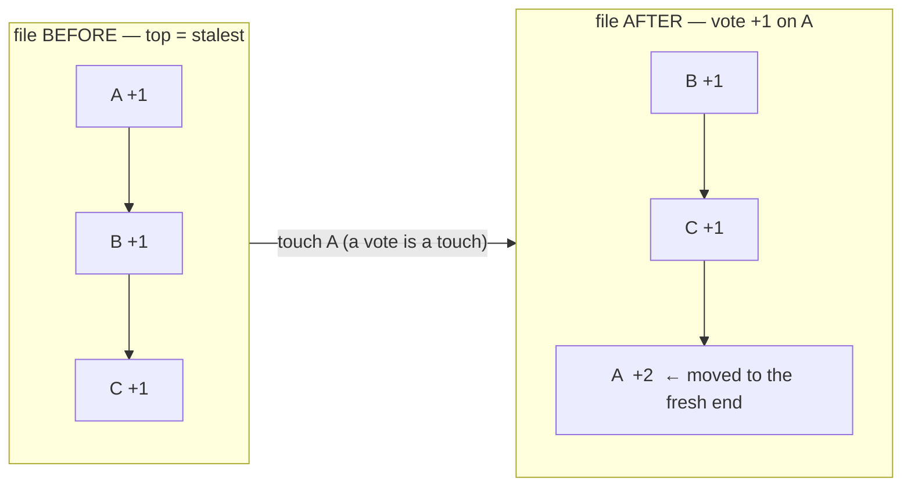
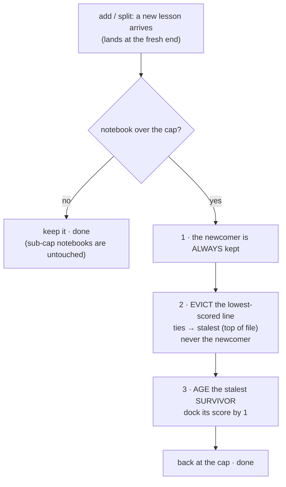

# Eviction & aging: recency-ordered storage with staleness decay

> Design rationale for how a **full** notebook decides what to keep. This is the
> one place the "cap + vote" mechanism needed more than a cap and a vote, and the
> reasoning is subtle, so it is recorded in full. For the normative statements see
> [`requirements.md`](./requirements.md) (DP-1, DP-3, FR-ADD-006, FR-EVICT-001).

## 1. The problem

Three facts about real notebooks (measured across 28 live notebooks, ~212
lessons) set the problem:

1. **Votes are almost entirely positive.** 0 of 212 lessons had ever been
   downvoted to a score ≤ 0; ~60 % sat at the entry score (+1), never moved. A
   downvote is a signal the tool should not *rely* on arriving.
2. **A new lesson entered at a fixed score** and, once a notebook was full, could
   be rejected before it was ever surfaced or voted on (the old `rejected-full`
   outcome). Newcomers could not get a foothold — the **freeze**.
3. **A once-upvoted lesson could never leave.** Eviction removes the lowest score;
   anything that had climbed to ≥ 2 always had something lower beneath it, so it
   was effectively **immortal** even after it went stale or wrong — and with no
   downvotes arriving, "never leaves" was literal.

So a full notebook calcified: incumbents frozen at the top, newcomers unable to
enter, nothing ever aging out.

## 2. Constraints (the box the solution had to fit in)

- **C1 — Standalone core.** The CLI must work with no git, no janitor, no
  external process. Those are optional harness *around* the tool; the mechanism
  lives entirely in the CLI.
- **C2 — Simple, hand-editable line format.** One lesson is one line
  `"<score>\t<lesson>"`. A per-line timestamp was rejected: ugly, and it wastes
  characters (= context) for every reader. A format change was permitted only if
  it stayed this simple — ideally none at all.
- **C3 — Clean git diffs.** A mutation should touch as few lines as possible. A
  global rewrite of every line (e.g. "subtract the minimum from all scores") was
  rejected as diff noise, even though git itself is not required (C1).
- **C4 — Bounded scores, no endless inflation.** Numbers stay small over a
  notebook's life. (This is what ruled out LFU-DA style *global inflation*, where
  newcomers enter at an ever-rising floor `L` and every score grows without
  bound.)
- **C5 — Determinism is optional, not required.** Reproducibility is nice, but it
  is not the axis that matters here; *targeting* is (see §4). Seedable randomness
  would have been acceptable.
- **C6 — Dumb, offline hot path.** Still "cap + vote" in spirit (DP-1): minimal
  code, a millisecond per call, no scheduler.

## 3. Goals (what a full notebook's policy must achieve)

- **G1 — Newcomers always get in and get a trial.** No instant rejection when
  full; a new lesson must survive long enough to be surfaced and voted on.
- **G2 — No true immortality.** A lesson that climbed high but is no longer being
  re-voted must *eventually* become evictable.
- **G3 — Proportional protection.** Higher score ⇒ harder to evict. Hard-earned
  lessons are evicted **last**, never first.
- **G4 — Self-supply the missing downward pressure.** Because downvotes rarely
  arrive (§1.1), the tool must create its own, or G2 is impossible.
- **G5 — Decay the *stale*, spare the *active*.** Pressure should fall on lessons
  that have gone quiet, not on ones still being used.
- **G6 — Bounded blast radius.** A burst of junk adds must not gut the proven
  corpus.

### The tension we had to resolve

G2 + G3 + G5 cannot all hold if the only thing the core knows about a lesson is
its **score**: two lessons with the same score are indistinguishable, so you
cannot decay "the stale one" and spare "the active one". Satisfying G5 therefore
requires a **recency signal** — some record of when each lesson was last engaged
with. The whole design turns on getting that signal *without* violating C2–C4.

## 4. Why the obvious options fail

| Option | Fails on |
| --- | --- |
| Per-line timestamp column | C2 (ugly, char cost) + forward-compat (old parser folds the extra column into the lesson text) |
| Monotonic "last-touched tick" column | C4 — the tick inflates forever, same unbounded-number problem, moved to a new column |
| LFU-DA global inflation `L` | C4 — scores grow without bound; countering it needs a global rebase = C3 diff noise |
| Uniform-random `−1` on eviction | **mis-targeted**: a high line is hit with prob ∝ 1/N, so it takes ~`score`·N evictions to fall — i.e. high lines stay *near-immortal* (the opposite of G2). The problem was never "random"; it was *uniform*. |
| Round-robin `−1` | its interaction with vote timing is hard to predict, and it is score-agnostic |
| Decrement-the-max on eviction | works, bounded, deterministic — but taxes the genuine best line (no recency ⇒ no G5) |

The lesson from the mis-targeted options: to satisfy G2+G4 the decay pressure
must **rise with score / staleness**, not be uniform — and to satisfy G5 it needs
a recency signal.

## 5. The decision: storage order *is* the recency signal

The recency signal we need costs **zero characters** if we stop storing entries
in insertion order and store them in **least-recently-touched-first** order
instead (classic LRU layout):

- **A "touch" moves the entry to the end of the file.** A touch is any engagement
  with a specific lesson: a **vote of either sign** (up *or* down — both mean "an
  agent surfaced this and judged it"), an `add`, and the new lesson(s) a `merge`
  or `split` produces. A plain `show`/`search` is **not** a touch (a read is not a
  vote; otherwise recency would mean nothing).
- **Therefore the top of the file is the stalest lesson** (longest since anyone
  engaged it) and the bottom is the freshest.

This overturns the old **DP-3** ("storage is insertion order, never re-sorted on
vote"). DP-3's rationale was that insertion order was "the only record of age" —
but insertion age is exactly the *wrong* signal (a frequently-reused lesson looks
as old as a dead one; the FIFO trap). Last-touch order is the *right* one, and a
vote genuinely touches it. It satisfies the constraints:

- **C2:** no format change at all — the recency lives in line *order*.
- **C3:** a vote becomes a line *move* (a delete + an append, which git renders as
  a ~2-line move) instead of a 1-line in-place edit. This is the one cost we
  accepted. Everything else stays a small diff.
- **C4:** nothing inflates; scores stay pure-ish vote sums (see §6).
- **Backfill / compat:** none needed. Existing files are in insertion order, which
  is a perfectly good *initial* recency order (older inserts = staler — a fair
  prior). An older `nb` still reads a reordered file correctly (it sorts by score
  for display and addresses entries by content-hash id, so order is irrelevant to
  it); the only degradation when mixing old and new binaries is that the old one's
  votes won't update recency. Nothing breaks.

A **touch** (a vote, add, or merge/split result) moves its line to the bottom, so
position encodes "how long since anyone engaged this lesson":

Nothing is sorted on disk; `nb show` still ranks by score at display time. The
file order is *only* the recency record the eviction policy below reads.

## 6. The policy (fires only when the notebook is full)

Everything below engages **only when an add/split pushes the notebook over
`maxLines`**. A sub-cap notebook is returned untouched, so every notebook that has
never filled behaves exactly as before — the only immediate change for existing
notebooks is that a vote now moves its line to the end.

On an add/split that overflows the cap:

1. **Newcomers are always admitted (G1).** The freshly created lesson(s) this call
   produced are never the ones evicted. The old `rejected-full` outcome is gone.
2. **Eviction, by quality first (G3, G6).** Remove the lowest-scored lesson, ties
   broken by staleness (topmost first), never a newcomer, until the notebook is
   back at `maxLines`. This runs **before** the decay below, deliberately: if the
   staleness dock came first it could push a merely-quiet lesson below an
   explicitly worse-scored one (e.g. a downvoted lesson) and evict the wrong one.
   Evicting by score first keeps the quality signal authoritative.
3. **Staleness decay of the stalest *survivor* (G2, G4, G5).** Dock **1** from the
   score of the stalest lesson still present — the topmost (least-recently-
   touched) non-newcomer. Because an actively re-voted lesson keeps moving to the
   fresh end, it never sits at the top and is never decayed; a lesson that stops
   earning votes drifts to the top and loses a point each time the full notebook
   takes a new lesson, until it is re-voted (instantly moved back to fresh, full
   protection) or finally evicted. This is the self-supplied downward pressure
   that replaces the downvotes that never come — **targeted** at the stale — and
   it is what stops a once-upvoted lesson being immortal (without it, nothing
   below such a lesson ever leaves, so it never can).

### Why this hits the goals

- **G1:** a newcomer can never be the victim, so it always gets its trial.
- **G2 + G4:** a stale high lesson is pulled down one point per add-when-full by
  step 3 — eventually evictable, with no downvote required.
- **G3:** eviction still removes the lowest score first, so a hard-earned lesson is
  the last to go; a +30 lesson survives ~30× longer under decay than a +1.
- **G5:** decay targets the *stalest* line (recency), so an actively-used high
  lesson is spared while a quiet one is not — the targeting score-alone could not
  do.
- **G6:** at most one lesson is evicted per add; a run of junk adds churns the
  single freshest "probation" slot rather than eroding the proven corpus, and one
  upvote rescues any lesson the decay is pushing out.

### The price we knowingly pay

Scores are no longer a *pure* count of human votes once decay has fired: a stale
lesson's score is "votes minus the staleness docked from it". That is deliberate —
with no downvotes arriving (§1.1), synthetic downward pressure is the *only* way
to get G2, and this is the gentlest, most targeted form of it. "Staying near the
top requires continued use" is the intended behavior, not a bug. Scores stay
bounded (C4) because decay pulls the top down as votes push it up.

## 7. Worked examples

These trace the actual bytes. The file is written **top = stalest → bottom =
freshest**; `nb show` would re-rank these by score, but here we show the *stored*
order so the mechanism is visible.

### 7.1 A touch moves a line; a full notebook still admits a newcomer

Cap = 3. Scores are the signed numbers; the arrow marks what changed.

| # | command | stored file (top → bottom) | what happened |
|---|---------|----------------------------|---------------|
| 1 | `add A`, `add B`, `add C` | `A +1` · `B +1` · `C +1` | three adds; recency = insertion order so far |
| 2 | `vote A +1` | `B +1` · `C +1` · **`A +2`** | A is *touched* → moves to the fresh end (and +1) |
| 3 | `add D` (now 4 > cap 3) | **`C 0`** · `A +2` · `D +1` | newcomer **D kept**; `B +1` was the lowest & stalest → **evicted**; `C` is the stalest survivor → **aged** +1 → 0 |

Step 3 is the whole policy in one line: *admit D, evict the lowest (B), age the
stalest survivor (C)*. Note B — not the newcomer — left, and the aging fell on C,
the line nobody had touched, not on A, which had just been voted.

### 7.2 The life of a lesson — immortal no more, but rescued by one vote

Cap = 2. A lesson `S` is upvoted to **+5**, then the notebook stays busy (a new
lesson arrives each round). Watch `S`'s score as the per-add aging reaches it
(it is the stalest, since nothing re-touches it):

| round | event | `S`'s score | note |
|-------|-------|-------------|------|
| 0 | `S` upvoted to +5, notebook full | **+5** | under plain eviction, immortal — newcomers enter at +1 and are always lower |
| 1 | `add` (S is stalest survivor) | +4 | docked 1 |
| 2 | `add` | +3 | docked 1 |
| 3 | `add` | +2 | … |
| 4 | `add` | +1 | … |
| 5 | `add` | — | `S` is now tied at the bottom and **evicted** |

So a once-valued lesson that goes quiet ages out in ~`score` busy rounds instead
of living forever. **But a single `vote S +1` at any round** moves `S` to the
fresh end and lifts its score — it is no longer the stalest, so the aging skips it
entirely and lands on the next-stalest line. Continued usefulness keeps a lesson
alive; only *silence* retires it.

## 8. What this is NOT

- **Not a decay curve or a scheduler (DP-1 preserved in spirit).** There is no
  timer, no background job, no half-life over wall-clock time. Decay is an
  event — one point, applied only when a full notebook accepts a new lesson, to
  exactly one line. It is "cap + vote" with the cap made fair.
- **Not embeddings or similarity (NG-001).** Still pure, offline, dumb.
- **Not dependent on git.** Git versioning and the janitor remain optional harness
  that can do *better*, recency-aware pruning out-of-band; the core needs none of
  it.
