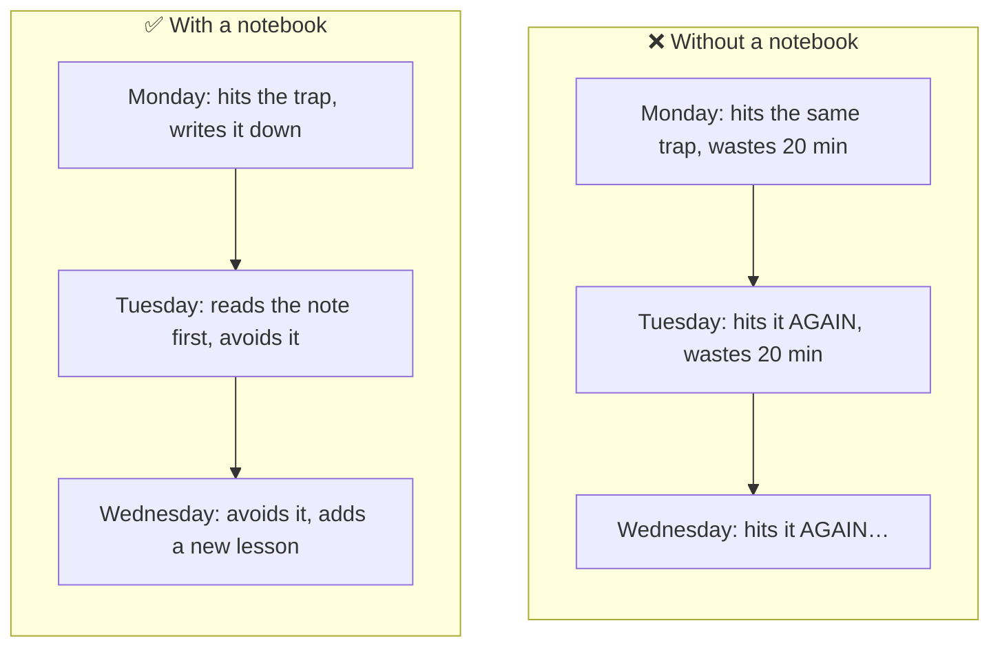
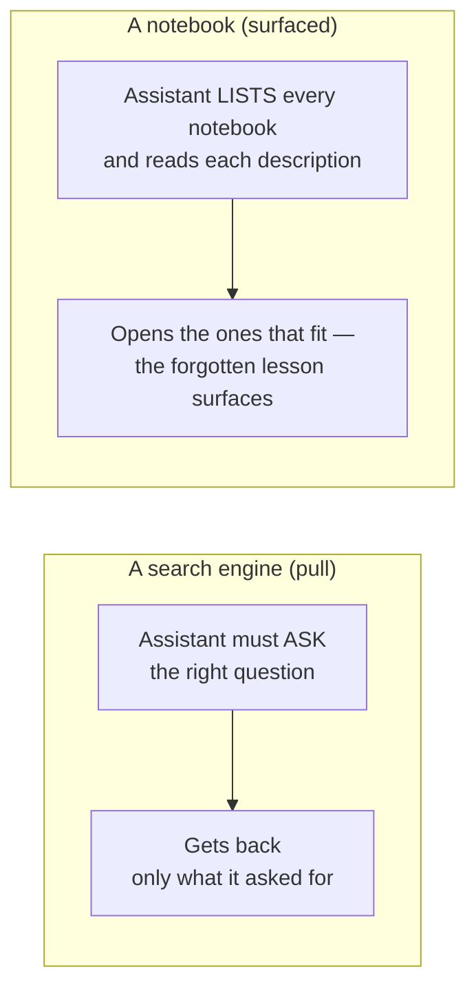
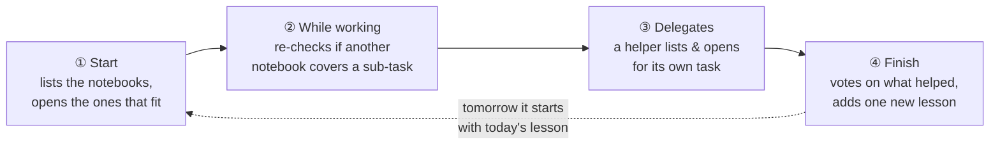

# Getting started — `agent-notebook` explained simply

*For anyone — no AI or DevOps background needed. If you are comfortable in a
terminal, you can also jump to the [harness setup guide](harness-setup.md).
Just want to try it? → [Try it in two minutes](#try-it-in-two-minutes).*

---

## The one-sentence idea

> **Give your AI assistant a small notebook where it writes down the lessons it
> learns, so the next time it does a similar job it starts off already knowing
> them.**

That's it. The rest of this page explains why that simple idea is worth setting
up, and what it looks like in practice.

---

## The problem it solves

An AI coding assistant is brilliant and forgetful. Each new conversation, it
starts from a blank slate. It cannot remember that *last Tuesday it learned the
hard way* that your test suite needs a build step first, or that your release
process has a gotcha. So it rediscovers the same traps, over and over, on your
time and your budget.



The usual "solution" is a heavy one: a *vector database* — a specialised search
engine for meaning. That is the right tool when an assistant must sift through
thousands of pages of documents. It is overkill when all you want is *"remember
these ten hard-won lessons."* A notebook is the light tool for the light job.

---

## How a notebook is different from a search engine

Here is the key insight, and it is a little counter-intuitive:

> The most valuable lesson is the one your assistant **would never think to search
> for.**

If the assistant already knew to ask *"wait, does the build need a special
step?"*, it would mostly be fine already. The danger is the trap it has
*forgotten exists*. A search engine can only find what you know to look for. A
notebook works the other way around: the assistant is told to **list its
notebooks** at the start of every task and open the ones that fit — and because
it sees *every* notebook's one-line "open me when…" description, not just what it
thought to search for, the forgotten lesson's notebook surfaces on its own.



---

## What's actually inside a notebook

A notebook is a plain text file. One per *role* — one per kind of job. You can
open it in any editor; nothing is hidden or encoded.

```
# desc: build / test / release gotchas for the website repo
+5   run npm run build before the tests — the tests use the built files
+3   release: push a version tag, the robot publishes it; there is no local login
+1   a brand-new copy of the repo has no dependencies — install them first
```

Four things to notice about the file:

1. **One lesson = one line.** No essays. If it doesn't fit on a line, it's not a
   lesson, it's a document — and documents belong elsewhere.
2. **The number is a score.** Every time the assistant finds a lesson useful, it
   gives it a **+1**; if a lesson misled it, a **−1**. Good lessons float to the
   top.
3. **It's capped.** A notebook holds at most 50 lessons by default (you can raise
   the cap). When it's full, the
   *lowest-scored* line is dropped to make room — so useless or harmful notes
   fall out, and the hard-won ones survive. It can never turn into a junk drawer.
4. **The top line is a label**, the *description*: one sentence saying "open me
   when you're doing X", so the assistant can tell at a glance whether this
   notebook is relevant.

(The three lessons above are shown highest-score-first; on disk they sit in the
order they were added, and `nb show` sorts them for you — so the most useful one
is always on top.)

---

## The rhythm of a task — four small moments

Once your assistant has the instruction (one line in its system prompt or
`AGENTS.md`), it uses the notebooks at four natural moments. It drives these
itself — there is nothing per-notebook to wire up.



Moment ④ — the little end-of-task **retrospective** — is where the magic
compounds. The assistant gives a thumbs-up to the notes that helped, a
thumbs-down to any that led it astray, and jots down the single most useful new
thing it learned. Do that after every task and the notebook quietly gets smarter
on its own.

---

## Why plain text turns out to matter

Because a notebook is just a text file, you get three things a database can
never give you:

- **You can read it.** Open it, understand exactly what your assistant "believes."
  No dashboard, no query language.
- **You can correct it.** See a wrong lesson? Delete the line. You are in control
  of your assistant's memory, in the most literal way.
- **You can track it in version control (git).** Every change — a new lesson, a
  vote — becomes a reviewable entry in a history you can scroll back through,
  like edits to any document. You can see *memory forming over time.* (Setting
  that up is [one short step](harness-setup.md#git-versioning).)

> You cannot read, correct, or `git diff` the inside of a vector database. With a
> notebook, your assistant's memory is as transparent and editable as a to-do list.

---

## Is this the right tool for you?

**Yes, if** you want an assistant to remember a modest set of durable, hard-won
lessons across sessions — and you value being able to see and edit that memory.

**No, if** you need it to recall facts from thousands of documents or long
transcripts. That is genuine large-scale retrieval; use a real vector store. This
tool deliberately does *one* small thing well. (See the
[full list of non-goals](requirements.md#6-non-goals-shall-not).)

---

## Try it in two minutes

You need [Node.js](https://nodejs.org) 18 or newer. Then:

```sh
npm install -g agent-notebook      # installs the `nb` command

nb add reviewer "run the build before the tests"
nb list                            # the index: every notebook + its description
nb show reviewer                   # each line starts with a short id, e.g.  3f9a2c  [+1]  run the build…
nb vote reviewer 3f9a2c +1         # vote by that id — a unique snippet ("run the build") works too
```

That's a working notebook. You just taught an assistant something it will keep.

---

## Where to go next

- **Set it up for real** — give your assistant the "list and open" instruction
  (plus optional convenience hooks) →
  [Harness setup guide](harness-setup.md) (Claude Code, Codex CLI; Windows, macOS,
  Linux).
- **Roll it out in a company** with security or data-sovereignty rules →
  [Enterprise integration guide](enterprise.md).
- **Watch the idea on one page** → [Visual explainer](visual-explainer.html).
- **Understand every design choice** → [Requirements & rationale](requirements.md)
  and [The self-observing notebook](self-observing-notebook.md).
