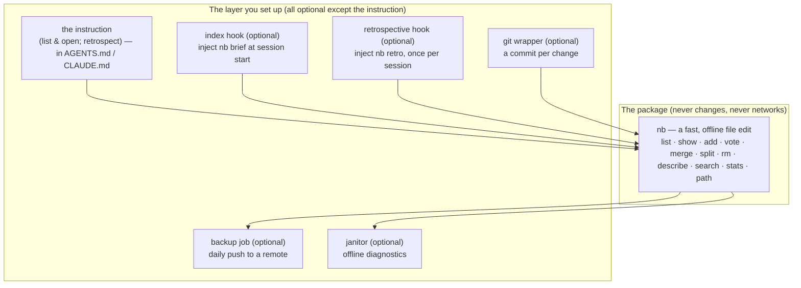

# Harness setup guide

*How to make your AI coding agent use `agent-notebook` — for Claude Code and
Codex CLI, on Linux, macOS, and Windows.*

New to the tool? Read the [plain-language intro](getting-started.md) first. The
behaviour you are turning on is specified in [AGENTS.md](../AGENTS.md).

The whole setup is one idea: **tell the agent to list the notebooks, open the
ones that fit, and run a retrospective at the end.** That instruction is
harness-agnostic — there is no per-notebook wiring and no "which notebook is this
agent?" logic to maintain. Everything else on this page (git history, backup, a
janitor, convenience hooks) is optional.

---

## Mental model: a dumb core, a thin layer around it

Keep these two layers straight and everything else follows:



Nothing in this layer runs *inside* an `nb` call; all of it reads or wraps the
plain files. The one thing that matters is the instruction; adopt the rest piece
by piece, or not at all.

**Since [issue #538](https://github.com/jeanibarz/agent-notebook/issues/538).**
The package holds the default words an agent is told at the start and at the end of a
task, and the rule that the end-of-task text is said once per session (`nb brief`,
`nb retro`, [requirements §4.17](requirements.md#fr-brief-001)). It stays harness-blind:
it never reads a hook payload or prints a vendor's reply format. What knows a harness
(which event fires, its payload, its reply format) stays in an adapter: `examples/` today,
a plugin later. The Claude Code hooks below are such an adapter
([`nb-claude-hook.mjs`](../examples/hooks/claude-code/nb-claude-hook.mjs)): the index and
the retrospective text they inject come from `nb brief` and `nb retro`.

---

## Install

| Need | How |
|---|---|
| **Node.js ≥ 18** | <https://nodejs.org> (`node --version`). The only hard dependency. |
| **`nb` on your PATH** | `npm install -g agent-notebook`, then `nb --help`. The hook adapter `nb-claude-hook.mjs` (the optional Claude Code and Codex hooks below) ships in 0.13.0-beta.1 and later: `npm install -g agent-notebook@beta`. |
| **git** (optional) | Only for versioning + backup ([Git-versioning](#git-versioning)). |
| **bash** (optional) | For the example shell scripts. Built-in on Linux/macOS; on Windows use WSL or Git Bash ([Windows](#windows)). |

The example scripts referenced below live in [`examples/`](../examples/), and
they ship in the npm package: after `npm install -g agent-notebook` they are in
`"$(npm root -g)/agent-notebook/examples/"`. No clone is needed.

---

## Give your agent the instruction

This is the only required step. The agent needs to know to run the
[four moments](../AGENTS.md#2-the-four-moments--what-to-do-and-when): **① `nb list`
→ ② open the notebooks that fit → ③ a subagent does the same → ④ retrospective.**
Put that instruction wherever your harness reads standing instructions.

### Claude Code

Claude Code auto-loads a `CLAUDE.md` from the project (and `~/.claude/CLAUDE.md`
for every project), so the instruction just needs to live there. The snippet
ships with the package; this appends it to your project's `CLAUDE.md` (the `sed`
drops the file's opening comment, a note for Codex users, and the `grep` skips a file
that already has the block):

```sh
# In your project (or ~/.claude/ for a global default):
grep -qs '^## Memory: agent-notebook' CLAUDE.md || sed '/^<!--/,/^-->/d' "$(npm root -g)/agent-notebook/examples/hooks/codex-cli/AGENTS.snippet.md" >> CLAUDE.md
```

For the full contract instead, use this repo's [AGENTS.md](https://github.com/jeanibarz/agent-notebook/blob/main/AGENTS.md)
(it is not in the npm package: download it from GitHub or copy it from a clone),
and `ln -s AGENTS.md CLAUDE.md` so one file is loaded by Claude Code and read by
Codex. That is enough: the agent will run `nb list` itself
at the start of a task and open what fits.

**Optional convenience hooks** (Claude Code has real lifecycle hooks; see
[`examples/hooks/claude-code/`](../examples/hooks/claude-code/)):

| Hook | What it adds | Moment |
|---|---|---|
| `SessionStart` → `nb-session-start.sh` | injects `nb brief` (the instruction lines and the `nb list` **index**) into context so the agent sees it without spending a call — the hook never picks a notebook, so it is the same for every project | ① |
| `SubagentStart` → `nb-subagent-start.sh` | hands the same index to each subagent, which never sees the `SessionStart` one ([Subagents](#subagents)) | ③ |
| `Stop` → `nb-retrospective.sh` | nudges the lead's retrospective once per session, at its first stop with no subagent still running (not always the end of the task: see [what the hooks do not cover](#what-the-hooks-do-not-cover)). It never nudges a subagent | ④ |

The index hook injects the *index of descriptions*, not a guessed notebook for the current project
— so it stays generic across every project and never has to answer "which notebook
is this?". It saves the agent one `nb list` call; the agent still chooses what to
open. Skip it and nothing breaks — the instruction already tells the agent to list.

### Codex CLI

Codex auto-loads `AGENTS.md` (the global `~/.codex/AGENTS.md`, the repo root, and the
working dir, merged), so the instruction goes there. Append the snippet once:

```sh
grep -qs '^## Memory: agent-notebook' ~/.codex/AGENTS.md || sed '/^<!--/,/^-->/d' "$(npm root -g)/agent-notebook/examples/hooks/codex-cli/AGENTS.snippet.md" >> ~/.codex/AGENTS.md
```

If you set `CODEX_HOME`, Codex reads `$CODEX_HOME/AGENTS.md` instead of `~/.codex/AGENTS.md`:
use that path in the command.

Now every Codex session starts with the list-and-open contract in context. That is
enough on its own: it is the route that needs no hooks, and it works with any version
of `agent-notebook`. Add the [git wrapper](#git-versioning) if you want per-change
history. Full notes in [`examples/hooks/codex-cli/`](../examples/hooks/codex-cli/).

#### Optional: Codex hooks

Codex CLI has lifecycle hooks too, and a plugin system (`codex plugin`).
agent-notebook ships no Codex plugin, and none is planned for the first release
([epic #537](https://github.com/jeanibarz/agent-notebook/issues/537), decision D5). The
hooks below are a hand-made setup, as for Claude Code: `SessionStart` injects `nb brief`
(the notebook index), and `Stop` asks once per session for the `nb retro`
retrospective. They run the Claude Code adapter
[`nb-claude-hook.mjs`](../examples/hooks/claude-code/nb-claude-hook.mjs), which ships
in `agent-notebook` 0.13.0-beta.1 and later (`npm install -g agent-notebook@beta`; 0.12.0
has neither the adapter nor `nb brief`).

Checked by the maintainer with Codex CLI 0.171.0 on Linux (WSL2), on 2026-11-26: the
adapter runs unchanged under Codex, from a path with a space in it, the model receives
the index and the retrospective text, and in a repository switched off with
`git config nb.enabled false` it receives the one "switched off" line and no
retrospective. Not checked: macOS, Windows, and Codex's `SubagentStart` event.

**1. Write the hooks file.** Codex reads hooks from `~/.codex/hooks.json` (or
`$CODEX_HOME/hooks.json` when `CODEX_HOME` is set). This writes the file with the
adapter's real path filled in, and leaves an existing file alone:

```sh
CODEX_DIR="${CODEX_HOME:-$HOME/.codex}"
HOOK="$(npm root -g)/agent-notebook/examples/hooks/claude-code/nb-claude-hook.mjs"
if [ -e "$CODEX_DIR/hooks.json" ]; then
  echo "$CODEX_DIR/hooks.json already exists: add the two entries by hand"
else
  mkdir -p "$CODEX_DIR" && cat > "$CODEX_DIR/hooks.json" <<EOF
{
  "hooks": {
    "SessionStart": [{ "hooks": [{ "type": "command", "command": "node \"$HOOK\" session-start --harness codex" }] }],
    "Stop": [{ "hooks": [{ "type": "command", "command": "node \"$HOOK\" stop --harness codex" }] }]
  }
}
EOF
fi
```

If the file already exists, add the `SessionStart` and `Stop` entries above to the
`hooks` object it holds, with the adapter's real path in place of `$HOOK`
(`npm root -g` prints the folder that holds `agent-notebook`).

Each `command` is **one string**, the program and its arguments together. Codex
ignores the `args` field that Claude Code accepts, so the `print-settings` block of
the Claude Code adapter (`"command": "node"` plus `args`) does not work in Codex: the
hook starts `node` with no script and fails. That is also why one hooks file cannot
serve both tools.

`--harness codex` makes the usage log record these runs as `codex.session-start` and
`codex.stop`, and makes `nb` run in the folder Codex reports for the session. Hooks pasted
before this change are recorded as `hook.*`, or as `claude-code.*` by an older adapter.

**2. Trust the hooks, in an interactive session.** Codex runs a hook only after you
trust it. Start `codex` (not `codex exec`) in any folder. It opens with:

```text
Hooks need review
2 hooks are new or changed.
Hooks can run outside the sandbox after you trust them.
› 1. Review hooks
  2. Trust all and continue
  3. Continue without trusting (hooks won't run)
```

Choose **2** (or **1** to read each hook first). If you skipped that screen, type
`/hooks` in the session and press `t` to trust all. Codex saves the trust at once,
in `config.toml` (`[hooks.state]`, one `trusted_hash` per hook): you can quit the
session without sending a prompt.

**3. Check that they run.** Put a word you will recognise in a lesson's text, so it
shows in the index (`nb add testing "The codeword is PELICAN."`), then, in a git
repository:

```sh
codex exec "Without running any command: if your context holds a notebook index, answer only with the codeword in it, else NONE." </dev/null
```

(The `</dev/null` matters: `codex exec` otherwise waits for more input on stdin.)
With the hooks on, the output shows:

```text
hook: SessionStart
hook: SessionStart Completed
codex
PELICAN
hook: Stop
hook: Stop Blocked
codex
...
hook: Stop
hook: Stop Completed
```

`Stop Blocked` is the retrospective request: Codex hands its text to the model, which
answers again. The second `Stop` lets the session end, because `nb retro` asks once
per session.

**How to see that the hooks are off.** `codex exec` never asks for trust: **it skips
a hook you have not trusted and says nothing**. So there is no `hook:` line for it in
the output, the answer above is `NONE`, and the session runs on the `AGENTS.md`
instruction alone. Silence looks the same as a `hooks.json` Codex never read, so
confirm in an interactive session: `/hooks` lists the hooks per event (scroll down for
`Stop`) with *Installed* and *Active* counts. When a hook needs trust, the list also
shows a *Review* column and a line such as `⚠ 2 hooks need review before they can run`.
Changing a hook's entry in `hooks.json` withdraws its trust in the same silent way,
until you trust it again (or put the entry back as it was).

This is not the same as a repository switched off with `git config nb.enabled false`.
There the hooks still run (`hook: SessionStart Completed`), but the model gets one line
saying the notebook is off, and the session ends with `hook: Stop` then
`hook: Stop Completed`, with no `Blocked`. Codex also has a
`--dangerously-bypass-hook-trust` flag for `codex exec`, which its own help reserves
for automation that already vets hook sources.

Two things to know:
- The usage log records these runs as `codex.session-start` and `codex.stop`
  (from `--harness codex`); hooks pasted without the flag are recorded as `hook.*`.
- Keep the `AGENTS.md` snippet when you add the hooks: it carries the instruction
  for a session where the hooks do not run.

> **One file for both tools.** `CLAUDE.md` can be a symlink to `AGENTS.md` (as
> this repo does: `ln -s AGENTS.md CLAUDE.md`). One contract, both harnesses.

### Subagents

When your agent spawns a specialised subagent (reviewer, patcher, repro-builder),
the subagent does the **same ① → ② → ④** for its own task. No notebook is assigned
to a subagent type. But the `SessionStart` and retrospective hooks do not reach a
subagent the way they reach the main agent, so a subagent uses the notebooks only
if you arrange it:

| The subagent needs | Why the main-session hooks do not give it | What to do |
|---|---|---|
| the index, or at least the contract, when it starts | `SessionStart` runs for the main session only. A subagent starts from its brief (the prompt it was spawned with) and never sees the injected index | have the lead put the contract in every brief, or register [`nb-subagent-start.sh`](../examples/hooks/claude-code/README.md#give-subagents-the-index-subagentstart) under `SubagentStart`, which injects the index into each subagent |
| a retrospective when it ends | the retrospective hook nudges the lead only, once per *session*. It never blocks a subagent's stop, because the subagent's answer would replace the report its lead receives | put the retrospective in the brief |

A brief that carries the contract can be one sentence: *"Run `nb list`, open the
shelves that fit your job, and before your final report run the notebook
retrospective (vote, prune, add at most one lesson to the shelf that fits, new or
existing). End with your full report."* With that in its context the subagent will:

1. run `nb list`, open the notebooks that fit *its* job, and use them;
2. **reuse an existing shelf** rather than mint a near-duplicate — shelf names
   match exactly, so `build-and-test` and `build-and-tests` become two unrelated memories
   (the [janitor](#the-janitor) flags this);
3. run its own retrospective at the end.

Do not assume a `CLAUDE.md` in the project does this for you: check it with the
[subagent audit](#check-that-subagents-take-part).

### What the hooks do not cover

The hooks are conveniences built for a short, single-agent session. In a long
session, or one where a lead agent delegates to subagents, they leave four gaps.
Each one is silent: nothing errors, and `nb stats` still reports engaged sessions.
(Behaviour observed with Claude Code 2.1.328.)

1. **The nudge marks one stop, not the end of the task.** The retrospective
   hook fires the first time the lead stops with no subagent still running, then
   not again until its `.retro-<session_id>` file is pruned, which happens after
   `NB_RETRO_TTL_DAYS` (7 days by default). A "stop" is the end of a turn. A lead
   that stops to wait for background subagents is not nudged then: the hook reads
   `background_tasks` in the payload and keeps the nudge for a later stop. But in
   an interactive session the first such stop is the end of the first reply, and
   a lead that delegates again after the nudge gets no second one. Whatever is
   learned after the nudge gets none. (A Claude Code that sends no
   `background_tasks` nudges the lead's first stop, even one where it is waiting
   for subagents.)
2. **Subagents are never nudged.** The hook lets every `SubagentStop` through,
   so the only retrospective a subagent runs is the one its brief asks for.
3. **A blocked subagent stop would cost its report.** This is why the hook stays
   off `SubagentStop`. A blocked `SubagentStop` makes the subagent continue. Its
   answer to the nudge becomes its last message, and the last message is what the
   lead receives as the subagent's result. The report it wrote just before can
   come back shortened, or replaced by "I opened no notebooks, so I skipped the
   retrospective". If you add your own subagent nudge, tell subagents to end with
   their full report again, as the example's reason text does.
4. **An agent that opened no notebook rarely adds a lesson.** The nudge asks about
   "the notebooks you opened". An agent that opened none tends to answer that
   there is nothing to do, even when the task taught it something worth a line.
   Rewording the nudge does not fix this by itself. What helps is earlier: an
   agent that read the index at the start (moments ① and ② of the
   [contract](../AGENTS.md#2-the-four-moments--what-to-do-and-when)) knows which
   shelf a new lesson belongs on, or that none fits and a new shelf is justified.

What to do about it, with the example scripts as they are:

- **Put moment ④ in the standing instruction, not only in the hook.** An agent
  that has the contract runs the retrospective when the task is finished, whether
  or not a nudge arrived at that moment.
- **For delegated work, make the retrospective the lead's last step.** Ask each
  subagent to list, in its report, anything it learned that a later task would
  need. After the last subagent returns, the lead runs one retrospective for the
  whole task and decides which of those lessons earn a line.
- **Audit real sessions** with the [subagent audit](#check-that-subagents-take-part)
  after you change anything. These gaps do not show up in `nb stats`.

### Per-repository on/off

Where you install decides where the loop runs. The simplest way to try agent-notebook in
one repository is to install the hooks and the contract in that repository only
(`.claude/settings.json` and its `CLAUDE.md`), not in `~/.claude/`; no setting is needed.

Once the hooks are installed machine-wide (in `~/.claude/settings.json`), the notebook loop
runs in **every** repository by default. You can switch it off where you don't want it, or
keep it off everywhere and switch it on only where you do. The setting lives in **git config**
under the key `nb.enabled`, so git's own scopes do the work: `--global` for every repository,
a plain `git config` for one repository (stored in its `.git/config`: never committed, and
shared by all its worktrees), `includeIf` for a folder.

`nb enabled` prints `on` or `off` for the current directory, and the two example hooks ask it
before doing anything. It decides in this order:

1. `NB_ENABLED` in the environment, if set and not blank: `0`, `false`, `no` or `off` mean off; any other value means on.
2. Otherwise `git config nb.enabled` (`true`/`false`, also `yes`/`no`, `on`/`off`, `1`/`0`), the most specific git scope winning: the repository over `--global`.
3. Otherwise **on**.

**Example: off everywhere except one repository.** You want to try agent-notebook in
`~/git/my-pilot` only:

```sh
git config --global nb.enabled false           # off by default, in every repository
git -C ~/git/my-pilot config nb.enabled true   # on in this one (and in all its worktrees)
```

Check it:

```sh
$ cd ~/git/my-pilot && nb enabled
on
$ cd ~/git/another-repo && nb enabled --why
off (git config nb.enabled=false, file:/home/you/.gitconfig)
```

Use git config for this, not `export NB_ENABLED=0` in your shell profile: the environment
variable wins over git config, so it would also switch off `my-pilot`. Once you want it
everywhere, remove the global setting with `git config --global --unset nb.enabled` (and the
pilot's own `true` becomes harmless).

**Other cases:**

```sh
# On everywhere (the default), off in one repository:
git -C ~/git/some-repo config nb.enabled false

# Off for every repository under a folder:
mkdir -p ~/.config/git
printf '[nb]\n\tenabled = false\n' > ~/.config/git/nb-off.inc
git config --global 'includeIf.gitdir:~/clients/.path' ~/.config/git/nb-off.inc

# Off for one session only:
NB_ENABLED=0 claude

# Why is it off here? (also shown on the `enabled=` line of `nb config`)
nb enabled --why
git config --show-origin --get nb.enabled
```

To switch it off for **everyone** working in a repository, a git config setting won't do,
since it is never committed. Commit `"env": { "NB_ENABLED": "0" }` in that repository's
`.claude/settings.json` instead: Claude Code passes it to the `SessionStart` and `Stop` hooks
(last checked by the maintainer with Claude Code 2.1.327).

**What "off" covers.** In an off repository the session-start hook prints one line telling
the agent to skip the notebook steps, instead of the index, and the retrospective hook lets
the agent stop without the nudge. The one line matters: a contract in `~/.claude/CLAUDE.md`
would otherwise still tell the agent to run `nb list` and the retrospective. Hook scripts
copied before 0.10.0 do not check the switch: copy them again.

**An instruction with no hooks (Codex CLI without its hooks).** The contract tells the agent to start with
`nb list`, so `nb list` asks `nb enabled` too. In an off repository it prints the same kind of
line in place of the index (`agent-notebook is switched off for this repository: skip the
notebook steps …`) and exits 0. That makes the switch work on Codex CLI, and with a contract
in a global `CLAUDE.md` but no hooks, so the Codex snippet can go in `~/.codex/AGENTS.md`.
The [Codex hooks](#optional-codex-hooks) go through `nb brief` and `nb retro`, which check
the switch themselves.
`NB_ENABLED=1 nb list` shows the index anyway, and `nb list --json` is never affected: it is
the scripts' format.

**What "off" does not cover.** `nb` itself is not locked: `nb show`, `nb add`, `nb search`,
the git wrapper and the backup keep working from any directory, and shell completion still
completes shelf names.

### One notebook per project

By default every project writes into one shared notebook (`~/.agent-notebook/notebooks`).
Lessons true only in one repository go to shelves named `<situation>@<project>`, which
`nb brief` groups per project ([memory layers](memory-layers.md)). That is usually enough.

To keep one project's lessons apart, for a client or employer for example, give it **its own
notebook**. Run this once in its repository:

```sh
nb place own
```

This creates `~/.agent-notebook/projects/<project>/` and moves that project's
`<x>@<project>` shelves into it. `<project>` is the name `nb project` prints: `NB_PROJECT_SLUG`,
else the git `origin` remote as `owner-repo`. From then on, every `nb` command run in that
repository, its worktrees and its fresh clones reads and writes only that folder. Other projects
keep the shared notebook, and their session start shows only a count of own notebooks, never
their names. There is no setting to change: the folder is the switch. `nb place` says which
notebook a directory uses and why, and `nb place shared` moves the shelves back.

- **`NB_DIR` wins.** With `NB_DIR` set, every project uses it and project folders are ignored,
  as before. To use project folders, unset it. A per-project `NB_DIR` (for example in that
  repository's `.claude/settings.local.json` `env` block) still works too.
- **The name must not come from the folder.** A repository without an `origin` remote, or one
  cloned from a local path, is named after its folder, which another copy may not share, so
  `nb place own` refuses. Add an origin remote, or point an origin that is a local path at the
  real URL (neither uploads anything), or set `NB_PROJECT_SLUG` for that project only.
- **It is separate both ways.** The project does not see the shared notebook's general shelves.
- **What it does not do.** It is routing on this computer, not access control or encryption.
  `nb place own` creates the folder readable by you only (mode 0700 on macOS and Linux); a
  folder you made by hand keeps its mode, and `nb place` warns when others can read it. Lessons
  written before stay in the shared notebook's git history and backups, and the assistant's own
  transcripts are not covered.
- **When nb cannot tell** which notebook to use (for example a project folder exists and git
  times out or refuses the folder; `nb place` gives the reason), `nb` refuses to read or write
  rather than guess, and `nb brief` says so.
- **Versioning and backups** cover one folder each, so set them up for an own notebook too. The
  backup script pushes a folder only when it has a git remote; without one it commits locally,
  pushes nothing and still exits 0:
  ```sh
  cd ~/.agent-notebook/projects/<project> && git init        # then the git wrapper commits there
  git remote add origin git@github.com:you/<project>-notebook.git   # a PRIVATE repository
  for d in ~/.agent-notebook/projects/*/; do NB_DIR="$d" /path/to/examples/nb-backup.sh; done
  node nb-janitor.mjs                                         # the shared notebook
  NB_DIR=~/.agent-notebook/projects/<project> node nb-janitor.mjs
  ```
  The `projects/*/` loop skips a hidden `.old-<project>-…` folder: one is left only when an
  `nb place shared` stopped halfway, `nb place` then names it, and running `nb place shared`
  again finishes it. `nb place own` and `nb place shared` hold the shared notebook's lock for
  the whole move (about 0.2 s per 1,000 shelves on ext4, about 5 s per 100 on NTFS through WSL),
  so other projects' writes wait meanwhile; run them when few sessions are writing.
  The git wrapper commits into whichever folder `nb` wrote. A copy of the wrapper from nb 0.12
  sets `NB_DIR` itself, which keeps every call on the shared notebook: copy it again.
  With a project folder present, a call through the wrapper runs `git` four times to learn the
  project's name, against two for `nb` alone (a few milliseconds); with no project folder, none.

---

## Git-versioning

By default a notebook is a plain file that your normal home-directory backup
already covers. Turning the notebooks directory `NB_DIR` (the folder `nb path`
prints) into a git repository upgrades that to a **reviewable, revertible history
of memory forming** — every added lesson is a green `+`, every vote a score change
you can `git diff` and `git revert`.

```sh
cd "$(nb path)"          # the notebooks directory (NB_DIR)
git init
printf '%s\n' '.nb-usage.log*' '.nb.lock' '*.tmp' '.retro-*' '.nb-backup.*' > .gitignore
git add -A && git commit -m "init agent-notebook store"
```

To get **one commit per change** automatically, install the
[`nb-git-wrapper.mjs`](../examples/nb-git-wrapper.mjs) first on your PATH as `nb`:

```sh
mkdir -p ~/.local/bin
cp "$(npm root -g)/agent-notebook/examples/nb-git-wrapper.mjs" ~/.local/bin/nb-git-wrapper.mjs
NB_GLOBAL_ROOT="$(npm root -g)"; [ -d "$NB_GLOBAL_ROOT" ] || NB_GLOBAL_ROOT=   # bake the root only if it exists
printf '#!/bin/sh\nNODE_PATH="%s" exec node "$(dirname "$0")/nb-git-wrapper.mjs" "$@"\n' "$NB_GLOBAL_ROOT" > ~/.local/bin/nb
chmod +x ~/.local/bin/nb   # keep the .mjs name: an extensionless copy fails on older Node (e.g. 18, 22.5)
# ensure ~/.local/bin precedes npm's global bin on PATH, then:
hash -r; nb add build-and-test "first versioned lesson"
git -C "$(nb path)" log --oneline      # → "nb add build-and-test"
```

The wrapper (like `nb` itself and the other `examples/` helpers) expands a leading `~` in `NB_DIR`, so `NB_DIR=~/notes` also works when set in `settings.json` `env`, systemd or cron.

The wrapper is fail-open: if git is missing or a hook hangs, the lesson is still
written and the commit is skipped (the backup job sweeps stragglers). Opt out any
time with `NB_GIT_AUTOCOMMIT=0`. Don't want to shadow `nb`? Keep the real `nb` and
run the wrapper only where you want commits.

> Why commit per change and not once a day? So the history mirrors the agent's
> actual learning sequence — you can see *which task* added or downvoted a lesson,
> not just a daily blob. (Seeing the *task* needs the opt-in `NB_GIT_SESSION_TRAILER=1`, which adds
> a `Nb-Session: <NB_SESSION>` line to each commit body; find a task's changes with
> `git log --grep '^Nb-Session: <id>$'`. It is off by default because session ids then
> enter history the backup job may push.) The daily job (next section) only pushes.

---

## Backup

If you want memory to survive a lost laptop — or to be *shared* to a team remote —
schedule [`nb-backup.sh`](../examples/nb-backup.sh) to push the git history
regularly. It commits any straggler first, then pushes; it is idempotent and
safe to run often. If the store is mid-merge or mid-rebase (unmerged paths,
`MERGE_HEAD`, `rebase-merge`/`rebase-apply`), it commits and pushes nothing,
logs `MERGE IN PROGRESS`, and exits non-zero: resolve the conflict, then rerun.

```sh
cd "$(nb path)"
git remote add origin git@github.com:you/agent-notebooks.git   # a PRIVATE repo
git push -u origin main
```

Then schedule the daily push. cron runs with a minimal `PATH`, so replace
`/path/to/examples` below with the full path that
`echo "$(npm root -g)/agent-notebook/examples"` prints:

**Linux / WSL / macOS (cron):**
```cron
10 3 * * * NB_DIR=$HOME/.agent-notebook/notebooks /path/to/examples/nb-backup.sh >> $HOME/.agent-notebook/notebooks/.nb-backup.cron.log 2>&1
```

**macOS (launchd)** — if you prefer it to cron, wrap the same command in a
`launchd` plist with a `StartCalendarInterval` of hour 3, minute 10.

**Windows** — see [Windows](#windows).

The authoritative choice of remote (GitHub/GitLab, self-hosted, or an internal
mirror) is a sovereignty/security decision — see the
[enterprise guide](enterprise.md#where-the-remote-lives).

---

## The janitor

`nb stats` tells you how one notebook is doing *now*. The
[`nb-janitor.mjs`](../examples/nb-janitor.mjs) takes the long, cross-notebook view
`nb stats` cannot — reading every file, the usage log, and the git history — and
prints concrete suggestions. Run it occasionally (weekly, or as its own scheduled
job), read the sections, and apply the `nb` commands it proposes.

> The **usage log** (`.nb-usage.log`, in `NB_DIR`) is an append-only record of
> which lessons `nb` touched and how — the entry voted/added, the outcome
> (`accepted` / `dedup-blocked` / `up` / `down` …), and the session — written by
> every `nb` call. It is the raw signal behind the janitor's sections 3 and 4 and
> behind `nb stats`; set `NB_SESSION` so calls group by session.

```sh
node "$(npm root -g)/agent-notebook/examples/nb-janitor.mjs"            # human report over $NB_DIR
node "$(npm root -g)/agent-notebook/examples/nb-janitor.mjs" --json     # machine-readable, for a supervising agent
node "$(npm root -g)/agent-notebook/examples/nb-janitor.mjs" --days 60 --sim 0.55
```

What each section diagnoses, and why it matters:

| Section | Signal | What you do about it |
|---|---|---|
| **1. Lessons lost to eviction** | a shelf whose evictions repeatedly remove lessons still scored above the starting +1, or whose evicted lessons get added again. It also counts full shelves, for information only: [a full shelf is the normal state](eviction-and-aging.md#a-full-shelf-is-the-normal-state) | open the shelf: if its lessons serve two different situations, divide it by situation into [namespaced shelves](cli-reference.md#grouping-notebooks--the--namespace-convention); otherwise merge near-duplicates or raise `NB_MAX_LINES` |
| **2. Near-duplicate shelves** | `build-and-test` vs `build-and-tests` — the same memory fragmented by a typo; and *possible slug drift*: `code-review@app` next to `code-review@acme-app`, the same base name under two `@project` slugs where one slug is the other with its leading part dropped | fold one shelf into the other a lesson at a time with `nb move <from> <to> <id>` (keeps each score; never re-add), then retire the emptied shelf (`nb describe <shelf> ""` if it has a description); same remedy for slug drift when both slugs name one project |
| **3. Duplicate lessons** | paraphrase pairs the exact-match dedup let through (a *recall* problem — the agent re-derived something it already knew) | `nb merge` the real duplicates into one tighter line |
| **4. Volume & silence** | how the store grew over time (from git), and shelves that went quiet | spot a shelf that broke/was abandoned, or a healthy "notebook is sufficient" plateau |
| **8. Exact duplicates across shelves** | the same lesson (equal after `nb`'s own normal form: lower-cased, every character other than a–z and 0–9 read as a word break) held by two or more shelves that share a base name: the `@` shelves of a base and the bare base shelf, e.g. `orchestrator@proj-a` and `orchestrator@proj-b`, or `orchestrator@proj-a` and `orchestrator` | keep one copy: `nb move <highest-scored shelf> <base> <id>`, then `nb rm <other shelf> <id> --reason obsolete --note duplicate` for each other copy (if the bare base shelf already holds it, only the `rm`s) |

The janitor is strictly **read-only** — it never edits a notebook, so it is safe
to run anywhere, including in CI. It embodies the project's design: all the clever
analysis lives offline, the hot `nb` path stays dumb and deterministic
([DP-6](requirements.md#dp-6)); it finds paraphrase duplicates with cheap lexical
similarity, never embeddings ([NG-001](requirements.md#ng-001)). It is the first
rung of the [self-improvement ladder](self-observing-notebook.md#5-how-the-signals-get-used--a-gated-ladder):
diagnose, read-only, a human (or agent) acts.

---

## Windows

Everything works on Windows; only the shell scripts need a bash. Three supported
setups, easiest first:

1. **WSL (recommended).** Run Claude Code / Codex and all example scripts inside
   WSL exactly as on Linux. `nb`, the wrapper, backup, and janitor are unchanged.
2. **Git Bash.** `npm install -g agent-notebook` in PowerShell makes `nb` work
   everywhere; run `nb-backup.sh` and the hook scripts from Git Bash. The
   `nb-git-wrapper.mjs` and `nb-janitor.mjs` are pure Node and run from any shell.
3. **Native, no bash.** The Node pieces (`nb`, `nb-git-wrapper.mjs`,
   `nb-janitor.mjs`, and the Claude Code hook adapter `nb-claude-hook.mjs`, registered
   with its `print-settings` block) run directly. For the daily push, skip `nb-backup.sh` and
   schedule the equivalent two commands with **Task Scheduler**:
   ```powershell
   git -C "$env:USERPROFILE\.agent-notebook\notebooks" add -A
   git -C "$env:USERPROFILE\.agent-notebook\notebooks" commit -m "nb-backup" 2>$null
   git -C "$env:USERPROFILE\.agent-notebook\notebooks" push origin main
   ```

Shelf names and the `.` namespace convention are filesystem-safe on NTFS; `NB_DIR`
defaults to `%USERPROFILE%\.agent-notebook\notebooks`.

---

## Verify it's working

```sh
nb --version                         # the CLI resolves
nb add smoke "setup check" && nb show smoke   # a notebook round-trips
nb list                              # the index renders
nb stats                             # each shelf shows its adds and, when full, its retention window
node "$(npm root -g)/agent-notebook/examples/nb-janitor.mjs"   # diagnostics run
git -C "$(nb path)" log --oneline    # (if versioning) a commit appeared
nb rm smoke "setup check"            # clean up the smoke lesson
```

In your harness, start a fresh session and give it a task: the agent should run
`nb list` and open a relevant notebook on its own (the contract is in context),
and — if you added the optional hooks — you'll also see the index injected at the
top and a retrospective nudge the first time the agent stops with no subagent running.

If `nb stats` later shows a full shelf with a short retention window (a few days), the first remedy is fewer adds per session, before dividing the shelf or raising `NB_MAX_LINES`; the `add-burst` signal names the sessions that add in bursts.

### Check that subagents take part

The smoke test above exercises the main agent only. After a real task that used
subagents, look at what each one did. Claude Code keeps a subagent's transcript
next to its session's, one file per subagent:

```sh
cd ~/.claude/projects/<project-dir>/<session-id>/subagents

# 1. Which subagents called nb at all? A count of 0 for every file means none did.
grep -cE '"command":"[^"]*nb (list|show|add|vote)' agent-*.jsonl

# 2. Did a subagent get a retrospective nudge? The example hook never nudges one
#    since issue #520; a file listed here means an older copy of the hook, or
#    one still registered under SubagentStop, is running.
grep -l 'run the agent-notebook retrospective' agent-*.jsonl

# 3. When was the nudge spent? Compare with when the task really ended.
cat "$(nb path)/.retro-<session-id>"; echo
```

Both `grep`s are rough. They also match a subagent that only quotes those words
in a command or a message, and the first one misses an `nb` call that follows a
quoted argument on the same command line. Open any file that surprises you. Read
the three results together:

| You see | It means | Remedy |
|---|---|---|
| a count of 0 for every subagent | no subagent used a notebook. The usual cause is that none had the index or the contract in front of it | carry the contract in the brief, or add the [`SubagentStart` hook](../examples/hooks/claude-code/README.md#give-subagents-the-index-subagentstart) |
| the nudge time is minutes after the session started, hours before it ended | the nudge was spent on an early stop of the lead ([gap 1](#what-the-hooks-do-not-cover)), or an older copy of the hook is installed | update the hook from `examples/`, and make the retrospective the lead's explicit last step |
| a subagent's file is listed, and its result reached the lead as a remark about notebooks | an older hook nudged it, and its report was displaced by the answer to the nudge ([gap 3](#what-the-hooks-do-not-cover)) | update the hook from `examples/`, and ask for the full report last in the brief |

---

## Diagnosing low engagement

[Verify it's working](#verify-its-working) is a one-time smoke test for a *fresh*
install. This is the *ongoing* diagnosis — **your agents don't seem to be using
the notebooks; is the hook mis-wired, is `NB_SESSION` missing, or is it genuine
quiet?** The trap is that the [SessionStart hook fails *open*](#claude-code): if
`nb` isn't on its PATH it injects nothing and errors nothing, so a broken hook is
**silent** — agents simply never see the index and nobody is told.

One command tells the causes apart. Run `nb stats` with **no shelf argument** —
the deployment-wide view — and read its `surfacing:` line against this tree. (The
engagement diagnosis is deployment-wide *by design*: it is gated on a vote in
*any* session and counts lessons across *all* shelves, so a shelf-scoped
`nb stats <shelf>` reports the same `surfacing:` line — it never gives a false
"hook not wired" just because one shelf is quiet. The no-argument form is what you
want here because it also prints the whole notebook inventory and every command's
activity, which is the deployment-wide picture these symptoms live in.)

| Symptom — the `nb stats` `surfacing:` line reads… | Cause | Remedy |
|---|---|---|
| `…notebooks hold N lessons but had 0 reads…; the SessionStart injection hook is probably not wired` | the index never reaches the agent — the hook isn't firing, or `nb` isn't resolvable from it (fail-open ⇒ silent). Also what you see when every repository using this store is [switched off](#per-repository-onoff) (an `nb list` that printed the off line is not a read): then nothing is broken | run the **hook self-check** below; put `nb` on PATH or point the hook at your wrapper with `NB_BIN` |
| `…N session opened a notebook but cast no vote; the end-of-task retrospective nudge isn't landing` | agents read the notebooks but skip the retrospective (moment ④), so nothing is voted, pruned, or added | wire the [`Stop` retrospective hook](#claude-code) (`nb-retrospective.sh`), or reinforce moment ④ in the contract |
| `…NB_SESSION was unset on N calls, so none could group into a session; export NB_SESSION…` | calls happen but aren't attributed to a session, so engagement can't be measured | export `NB_SESSION` (a per-task id) in the harness environment — see [the janitor note](#the-janitor) |
| `surfacing: N engaged session(s)` (with `recall-miss` / `precision-miss` readouts) | **not a bug** — the plumbing works and this is real usage; low volume may just be a healthy [sufficient-notebook plateau](#the-janitor) | nothing to fix; read the readout for memory *quality*, not wiring |

These are the same root causes `nb stats` exposes machine-readably as
`surfacing.engagementDiagnosis` in `--json` (`null` once any session is engaged) —
the table is the operator's reading of them.

An `N engaged session(s)` reading proves less than it seems to. A session counts
as engaged from its first vote, whenever that vote was cast and whichever agent
cast it. A deployment where every lead answers one nudge at an early stop, and
no subagent ever opens a notebook, reads as fully engaged. If long or delegated
tasks leave no lessons behind, read [what the hooks do not cover](#what-the-hooks-do-not-cover)
and run the [subagent audit](#check-that-subagents-take-part) on one such session.

**Hook self-check** — does the SessionStart hook actually inject anything?

```sh
bash ~/.agent-notebook/hooks/nb-session-start.sh | head   # or wherever you copied the hooks
```

Non-empty output (the `## Your agent-notebook index` block) ⇒ the hook works and
the agent will see the index. **Empty** output ⇒ the hook is failing open: `nb`
isn't resolvable from the hook's environment. Put `nb` on PATH (or point the hook
at your wrapper with `NB_BIN=/path/to/nb`) and re-run — the index should appear.

---

Rolling this out across a team or under compliance constraints? Continue to the
**[enterprise integration guide](enterprise.md)**.
