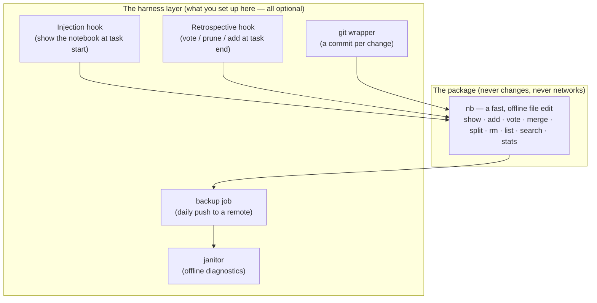

# Harness setup guide

*How to wire `agent-notebook` into your AI coding harness so it is used
automatically — for Claude Code and Codex CLI, on Linux, macOS, and Windows.*

New to the tool? Read the [plain-language intro](getting-started.md) first. The
behaviour you are turning on is specified in [AGENTS.md](../AGENTS.md).

---

## Mental model: a dumb core, a harness around it

Keep these two layers straight and everything else follows:



Nothing in the harness layer runs *inside* an `nb` call; all of it reads or wraps
the plain files. You can adopt one piece and ignore the rest.

---

## Step 0 — prerequisites and install

| Need | How |
|---|---|
| **Node.js ≥ 18** | <https://nodejs.org> (`node --version`). The only hard dependency. |
| **`nb` on your PATH** | `npm install -g agent-notebook`, then `nb --help`. |
| **git** (optional) | Only for versioning + backup (§[Git-versioning](#git-versioning)). |
| **bash** (optional) | For the example shell scripts. Built-in on Linux/macOS; on Windows use WSL or Git Bash (§[Windows](#windows)). |

The example scripts referenced below live in [`examples/`](../examples/). Clone
the repo or copy the files you want.

---

## Step 1 — wire the four moments into your harness

The [AGENTS.md contract](../AGENTS.md#2-the-four-moments--what-to-do-and-when)
defines four moments. Here is how each maps to a real mechanism.

### Claude Code

Claude Code has real lifecycle hooks, so the wiring is direct. Copy the
[`examples/hooks/claude-code/`](../examples/hooks/claude-code/) scripts and merge
the provided `settings.json` block (full steps in that folder's README):

| Moment | Mechanism |
|---|---|
| ① read | `SessionStart` hook runs `nb-session-start.sh` → injects `nb show <role>` + `nb list` into context. |
| ② consult | covered by the injection + the AGENTS.md instruction; optionally a `UserPromptSubmit` nudge. |
| ③ subagent | give each subagent its own role (see [Subagents](#subagents)). |
| ④ retrospective | `Stop` / `SubagentStop` hook runs `nb-retrospective.sh` → blocks the stop once with the vote/prune/add checklist. |

### Codex CLI

Codex CLI has no per-event hooks, so the contract rides in `AGENTS.md`, which
Codex loads automatically every session. Append the snippet and you have moments
① ② ④; add the PATH wrapper for history. Full steps in
[`examples/hooks/codex-cli/`](../examples/hooks/codex-cli/).

```sh
cat examples/hooks/codex-cli/AGENTS.snippet.md >> ~/.codex/AGENTS.md
```

> **One file for both tools.** If you use Claude Code *and* Codex, make `CLAUDE.md`
> a symlink to `AGENTS.md` (as this repo does: `ln -s AGENTS.md CLAUDE.md`). One
> protocol, both harnesses.

### Subagents

Claude Code has no "subagent started" event, so moment ③ is handled by *role
assignment*, not a hook. When you spawn a specialised subagent (reviewer,
patcher, repro-builder), give it its own role so it loads its own lessons and
writes new ones back:

1. In the subagent's definition or spawn prompt, tell it to run `nb show <role>`
   first — e.g. `reviewer`, `patcher@my-repo`.
2. Run `nb list` before spawning and **reuse an existing role** rather than
   minting a near-duplicate — role matching is exact, so `reviewer` and `review`
   become two unrelated memories (the [janitor](#the-janitor) flags this).
3. The `SubagentStop` hook drives that subagent's retrospective automatically.

This is the "notebook role reuse" pattern: the orchestrator discovers roles with
`nb list`, hands one to each subagent, and memory accumulates per role across
many tasks instead of being lost when the subagent exits.

---

## Git-versioning

By default a notebook is a plain file that your normal home-directory backup
already covers. Turning `NB_DIR` into a git repository upgrades that to a
**reviewable, revertible history of memory forming** — every added lesson is a
green `+`, every vote a score change you can `git diff` and `git revert`.

```sh
cd "$(nb path)"          # the notebooks directory
git init
printf '%s\n' '.nb-usage.log' '.nb.lock' '*.tmp' '.retro-*' '.nb-backup.log*' > .gitignore
git add -A && git commit -m "init agent-notebook store"
```

To get **one commit per change** automatically, install the
[`nb-git-wrapper.mjs`](../examples/nb-git-wrapper.mjs) first on your PATH as `nb`:

```sh
mkdir -p ~/.local/bin
cp examples/nb-git-wrapper.mjs ~/.local/bin/nb && chmod +x ~/.local/bin/nb
# ensure ~/.local/bin precedes npm's global bin on PATH, then:
hash -r; nb add reviewer "first versioned lesson"
git -C "$(nb path)" log --oneline      # → "nb add reviewer"
```

The wrapper is fail-open: if git is missing or a hook hangs, the lesson is still
written and the commit is skipped (the backup job sweeps stragglers). Opt out any
time with `NB_GIT_AUTOCOMMIT=0`. Don't want to shadow `nb`? Keep the real `nb` and
run the wrapper only where you want commits.

> Why commit per change and not once a day? So the history mirrors the agent's
> actual learning sequence — you can see *which task* added or downvoted a lesson,
> not just a daily blob. The daily job (next section) only pushes.

---

## Backup

If you want memory to survive a lost laptop — or to be *shared* to a team remote —
schedule [`nb-backup.sh`](../examples/nb-backup.sh) to push the git history
regularly. It commits any straggler first, then pushes; it is idempotent and
safe to run often.

```sh
cd "$(nb path)"
git remote add origin git@github.com:you/agent-notebooks.git   # a PRIVATE repo
git push -u origin main
```

Then schedule the daily push:

**Linux / WSL / macOS (cron):**
```cron
10 3 * * * NB_DIR=$HOME/.agent-notebook/notebooks /path/to/examples/nb-backup.sh >> $HOME/.agent-notebook/notebooks/.nb-backup.cron.log 2>&1
```

**macOS (launchd)** — if you prefer it to cron, wrap the same command in a
`launchd` plist with a `StartCalendarInterval` of hour 3, minute 10.

**Windows** — see [§Windows](#windows).

The authoritative choice of remote (GitHub/GitLab, self-hosted, or an internal
mirror) is a sovereignty/security decision — see the
[enterprise guide](enterprise.md#where-the-remote-lives).

---

## The janitor

`nb stats` tells you how one notebook is doing *now*. The
[`nb-janitor.mjs`](../examples/nb-janitor.mjs) takes the long, cross-notebook view
`nb stats` cannot — reading every file, the usage log, and the git history — and
prints concrete suggestions. Run it occasionally (weekly, or as its own scheduled
job), read the four sections, and apply the `nb` commands it proposes.

```sh
node examples/nb-janitor.mjs            # human report over $NB_DIR
node examples/nb-janitor.mjs --json     # machine-readable, for a supervising agent
node examples/nb-janitor.mjs --days 60 --sim 0.55
```

What each section diagnoses, and why it matters:

| Section | Signal | What you do about it |
|---|---|---|
| **1. Cap pressure & reorg** | a notebook ≥ 80% of the 200-line cap is about to start evicting lessons | split its concerns into [namespaced roles](../README.md#grouping-notebooks--the--namespace-convention) so no single notebook thrashes |
| **2. Near-duplicate roles** | `reviewer` vs `review` — the same memory fragmented by a typo | consolidate the lessons under one role, retire the orphan |
| **3. Duplicate lessons** | paraphrase pairs the exact-match dedup let through (a *recall* problem — the agent re-derived something it already knew) | `nb merge` the real duplicates into one tighter line |
| **4. Volume & silence** | how the store grew over time (from git), and roles that went quiet | spot a role that broke/was abandoned, or a healthy "notebook is sufficient" plateau |

The janitor is strictly **read-only** — it never edits a notebook, so it is safe
to run anywhere, including in CI. It embodies the project's design: all the clever
analysis lives offline, the hot `nb` path stays dumb and deterministic
([DP-6](requirements.md#dp-6)); it finds paraphrase duplicates with cheap lexical
similarity, never embeddings ([NG-001](requirements.md#ng-001)). It is the first
rung of the [self-improvement ladder](self-observing-notebook.md#5-how-the-signals-get-used--a-gated-ladder):
diagnose, read-only, a human (or agent) acts.

---

## Windows

Everything works on Windows; only the shell scripts need a bash. Three supported
setups, easiest first:

1. **WSL (recommended).** Run Claude Code / Codex and all example scripts inside
   WSL exactly as on Linux. `nb`, the wrapper, backup, and janitor are unchanged.
2. **Git Bash.** `npm install -g agent-notebook` in PowerShell makes `nb` work
   everywhere; run `nb-backup.sh` and the hook scripts from Git Bash. The
   `nb-git-wrapper.mjs` and `nb-janitor.mjs` are pure Node and run from any shell.
3. **Native, no bash.** The Node pieces (`nb`, `nb-git-wrapper.mjs`,
   `nb-janitor.mjs`) run directly. For the daily push, skip `nb-backup.sh` and
   schedule the equivalent two commands with **Task Scheduler**:
   ```powershell
   git -C "$env:USERPROFILE\.agent-notebook\notebooks" add -A
   git -C "$env:USERPROFILE\.agent-notebook\notebooks" commit -m "nb-backup" 2>$null
   git -C "$env:USERPROFILE\.agent-notebook\notebooks" push origin main
   ```

Role names and the `.` namespace convention are filesystem-safe on NTFS; `NB_DIR`
defaults to `%USERPROFILE%\.agent-notebook\notebooks`.

---

## Verify it's working

```sh
nb --version                         # the CLI resolves
nb add smoke "setup check" && nb show smoke   # a notebook round-trips
nb list                              # the index renders
node examples/nb-janitor.mjs         # diagnostics run
git -C "$(nb path)" log --oneline    # (if versioning) a commit appeared
nb rm smoke "setup check"            # clean up the smoke lesson
```

In your harness, start a fresh session: you should see the notebook injected at
the top (Claude Code) or the protocol honoured from `AGENTS.md` (Codex), and a
retrospective prompt when the task ends (Claude Code).

Rolling this out across a team or under compliance constraints? Continue to the
**[enterprise integration guide](enterprise.md)**.
