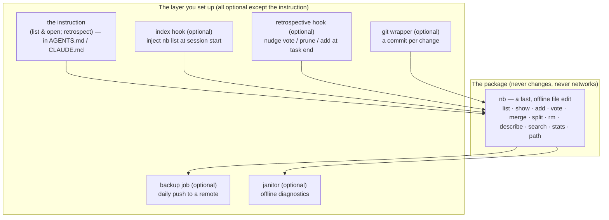

# Harness setup guide

*How to make your AI coding agent use `agent-notebook` — for Claude Code and
Codex CLI, on Linux, macOS, and Windows.*

New to the tool? Read the [plain-language intro](getting-started.md) first. The
behaviour you are turning on is specified in [AGENTS.md](../AGENTS.md).

The whole setup is one idea: **tell the agent to list the notebooks, open the
ones that fit, and run a retrospective at the end.** That instruction is
harness-agnostic — there is no per-notebook wiring and no "which notebook is this
agent?" logic to maintain. Everything else on this page (git history, backup, a
janitor, convenience hooks) is optional.

---

## Mental model: a dumb core, a thin layer around it

Keep these two layers straight and everything else follows:



Nothing in this layer runs *inside* an `nb` call; all of it reads or wraps the
plain files. The one thing that matters is the instruction; adopt the rest piece
by piece, or not at all.

---

## Install

| Need | How |
|---|---|
| **Node.js ≥ 18** | <https://nodejs.org> (`node --version`). The only hard dependency. |
| **`nb` on your PATH** | `npm install -g agent-notebook`, then `nb --help`. |
| **git** (optional) | Only for versioning + backup ([Git-versioning](#git-versioning)). |
| **bash** (optional) | For the example shell scripts. Built-in on Linux/macOS; on Windows use WSL or Git Bash ([Windows](#windows)). |

The example scripts referenced below live in [`examples/`](../examples/). Clone
the repo or copy the files you want.

---

## Give your agent the instruction

This is the only required step. The agent needs to know to run the
[four moments](../AGENTS.md#2-the-four-moments--what-to-do-and-when): **① `nb list`
→ ② open the notebooks that fit → ③ a subagent does the same → ④ retrospective.**
Put that instruction wherever your harness reads standing instructions.

### Claude Code

Claude Code auto-loads a `CLAUDE.md` from the project (and `~/.claude/CLAUDE.md`
for every project), so the instruction just needs to live there. The simplest
way is to reuse this repo's [AGENTS.md](../AGENTS.md) as the contract:

```sh
# In your project (or your home dir for a global default):
cp /path/to/agent-notebook/AGENTS.md ./AGENTS.md
ln -s AGENTS.md CLAUDE.md          # one file, loaded by Claude Code and read by Codex
```

Or paste the shorter [Codex snippet](../examples/hooks/codex-cli/AGENTS.snippet.md)
into an existing `CLAUDE.md`. That is enough: the agent will run `nb list` itself
at the start of a task and open what fits.

**Optional convenience hooks** (Claude Code has real lifecycle hooks; see
[`examples/hooks/claude-code/`](../examples/hooks/claude-code/)):

| Hook | What it adds | Moment |
|---|---|---|
| `SessionStart` → `nb-session-start.sh` | injects the `nb list` **index** into context so the agent sees it without spending a call — no role logic, same for every project | ① |
| `Stop` / `SubagentStop` → `nb-retrospective.sh` | nudges the retrospective once per session so it isn't forgotten | ④ |

The index hook injects the *index of descriptions*, not a guessed "role" notebook
— so it stays generic across every project and never has to answer "which notebook
is this?". It saves the agent one `nb list` call; the agent still chooses what to
open. Skip it and nothing breaks — the instruction already tells the agent to list.

### Codex CLI

Codex has no lifecycle hooks, so the instruction is the whole integration — and
Codex already auto-loads `AGENTS.md` (the global `~/.codex/AGENTS.md`, the repo
root, and the working dir, merged). Append the snippet once:

```sh
cat examples/hooks/codex-cli/AGENTS.snippet.md >> ~/.codex/AGENTS.md
```

Now every Codex session starts with the list-and-open contract in context. Add
the [git wrapper](#git-versioning) if you want per-change history. Full notes in
[`examples/hooks/codex-cli/`](../examples/hooks/codex-cli/).

> **One file for both tools.** `CLAUDE.md` can be a symlink to `AGENTS.md` (as
> this repo does: `ln -s AGENTS.md CLAUDE.md`). One contract, both harnesses.

### Subagents

When your agent spawns a specialised subagent (reviewer, patcher, repro-builder),
the subagent does the **same ① → ② → ④** for its own task — there is no
per-subagent role to assign and no "subagent started" hook to rely on. Just point
the subagent at the same contract (its definition, or the prompt you spawn it
with, references `AGENTS.md`), and it will:

1. run `nb list`, open the notebooks that fit *its* job, and use them;
2. **reuse an existing notebook** rather than mint a near-duplicate — role
   matching is exact, so `reviewer` and `review` become two unrelated memories
   (the [janitor](#the-janitor) flags this);
3. run its own retrospective at the end.

If you installed the retrospective hook, note it fires **once per session**, keyed
on the session id — so the first stop (a subagent's or the main agent's) gets the
nudge and later stops are suppressed. It is a backstop, not a per-subagent driver;
the reliable place for the subagent's retrospective is the contract it was given.

---

## Git-versioning

By default a notebook is a plain file that your normal home-directory backup
already covers. Turning the notebooks directory `NB_DIR` (the folder `nb path`
prints) into a git repository upgrades that to a **reviewable, revertible history
of memory forming** — every added lesson is a green `+`, every vote a score change
you can `git diff` and `git revert`.

```sh
cd "$(nb path)"          # the notebooks directory (NB_DIR)
git init
printf '%s\n' '.nb-usage.log' '.nb.lock' '*.tmp' '.retro-*' '.nb-backup.log*' > .gitignore
git add -A && git commit -m "init agent-notebook store"
```

To get **one commit per change** automatically, install the
[`nb-git-wrapper.mjs`](../examples/nb-git-wrapper.mjs) first on your PATH as `nb`:

```sh
mkdir -p ~/.local/bin
cp examples/nb-git-wrapper.mjs ~/.local/bin/nb && chmod +x ~/.local/bin/nb
# ensure ~/.local/bin precedes npm's global bin on PATH, then:
hash -r; nb add reviewer "first versioned lesson"
git -C "$(nb path)" log --oneline      # → "nb add reviewer"
```

The wrapper is fail-open: if git is missing or a hook hangs, the lesson is still
written and the commit is skipped (the backup job sweeps stragglers). Opt out any
time with `NB_GIT_AUTOCOMMIT=0`. Don't want to shadow `nb`? Keep the real `nb` and
run the wrapper only where you want commits.

> Why commit per change and not once a day? So the history mirrors the agent's
> actual learning sequence — you can see *which task* added or downvoted a lesson,
> not just a daily blob. The daily job (next section) only pushes.

---

## Backup

If you want memory to survive a lost laptop — or to be *shared* to a team remote —
schedule [`nb-backup.sh`](../examples/nb-backup.sh) to push the git history
regularly. It commits any straggler first, then pushes; it is idempotent and
safe to run often.

```sh
cd "$(nb path)"
git remote add origin git@github.com:you/agent-notebooks.git   # a PRIVATE repo
git push -u origin main
```

Then schedule the daily push:

**Linux / WSL / macOS (cron):**
```cron
10 3 * * * NB_DIR=$HOME/.agent-notebook/notebooks /path/to/examples/nb-backup.sh >> $HOME/.agent-notebook/notebooks/.nb-backup.cron.log 2>&1
```

**macOS (launchd)** — if you prefer it to cron, wrap the same command in a
`launchd` plist with a `StartCalendarInterval` of hour 3, minute 10.

**Windows** — see [Windows](#windows).

The authoritative choice of remote (GitHub/GitLab, self-hosted, or an internal
mirror) is a sovereignty/security decision — see the
[enterprise guide](enterprise.md#where-the-remote-lives).

---

## The janitor

`nb stats` tells you how one notebook is doing *now*. The
[`nb-janitor.mjs`](../examples/nb-janitor.mjs) takes the long, cross-notebook view
`nb stats` cannot — reading every file, the usage log, and the git history — and
prints concrete suggestions. Run it occasionally (weekly, or as its own scheduled
job), read the four sections, and apply the `nb` commands it proposes.

> The **usage log** (`.nb-usage.log`, in `NB_DIR`) is an append-only record of
> which lessons `nb` touched and how — the entry voted/added, the outcome
> (`accepted` / `dedup-blocked` / `up` / `down` …), and the session — written by
> every `nb` call. It is the raw signal behind the janitor's sections 3 and 4 and
> behind `nb stats`; set `NB_SESSION` so calls group by session.

```sh
node examples/nb-janitor.mjs            # human report over $NB_DIR
node examples/nb-janitor.mjs --json     # machine-readable, for a supervising agent
node examples/nb-janitor.mjs --days 60 --sim 0.55
```

What each section diagnoses, and why it matters:

| Section | Signal | What you do about it |
|---|---|---|
| **1. Cap pressure & reorg** | a notebook ≥ 80% of the 200-line cap is about to start evicting lessons | split its concerns into [namespaced roles](../README.md#grouping-notebooks--the--namespace-convention) so no single notebook thrashes |
| **2. Near-duplicate roles** | `reviewer` vs `review` — the same memory fragmented by a typo | consolidate the lessons under one role, retire the orphan |
| **3. Duplicate lessons** | paraphrase pairs the exact-match dedup let through (a *recall* problem — the agent re-derived something it already knew) | `nb merge` the real duplicates into one tighter line |
| **4. Volume & silence** | how the store grew over time (from git), and roles that went quiet | spot a role that broke/was abandoned, or a healthy "notebook is sufficient" plateau |

The janitor is strictly **read-only** — it never edits a notebook, so it is safe
to run anywhere, including in CI. It embodies the project's design: all the clever
analysis lives offline, the hot `nb` path stays dumb and deterministic
([DP-6](requirements.md#dp-6)); it finds paraphrase duplicates with cheap lexical
similarity, never embeddings ([NG-001](requirements.md#ng-001)). It is the first
rung of the [self-improvement ladder](self-observing-notebook.md#5-how-the-signals-get-used--a-gated-ladder):
diagnose, read-only, a human (or agent) acts.

---

## Windows

Everything works on Windows; only the shell scripts need a bash. Three supported
setups, easiest first:

1. **WSL (recommended).** Run Claude Code / Codex and all example scripts inside
   WSL exactly as on Linux. `nb`, the wrapper, backup, and janitor are unchanged.
2. **Git Bash.** `npm install -g agent-notebook` in PowerShell makes `nb` work
   everywhere; run `nb-backup.sh` and the hook scripts from Git Bash. The
   `nb-git-wrapper.mjs` and `nb-janitor.mjs` are pure Node and run from any shell.
3. **Native, no bash.** The Node pieces (`nb`, `nb-git-wrapper.mjs`,
   `nb-janitor.mjs`) run directly. For the daily push, skip `nb-backup.sh` and
   schedule the equivalent two commands with **Task Scheduler**:
   ```powershell
   git -C "$env:USERPROFILE\.agent-notebook\notebooks" add -A
   git -C "$env:USERPROFILE\.agent-notebook\notebooks" commit -m "nb-backup" 2>$null
   git -C "$env:USERPROFILE\.agent-notebook\notebooks" push origin main
   ```

Role names and the `.` namespace convention are filesystem-safe on NTFS; `NB_DIR`
defaults to `%USERPROFILE%\.agent-notebook\notebooks`.

---

## Verify it's working

```sh
nb --version                         # the CLI resolves
nb add smoke "setup check" && nb show smoke   # a notebook round-trips
nb list                              # the index renders
node examples/nb-janitor.mjs         # diagnostics run
git -C "$(nb path)" log --oneline    # (if versioning) a commit appeared
nb rm smoke "setup check"            # clean up the smoke lesson
```

In your harness, start a fresh session and give it a task: the agent should run
`nb list` and open a relevant notebook on its own (the contract is in context),
and — if you added the optional hooks — you'll also see the index injected at the
top and a retrospective nudge when the task ends.

Rolling this out across a team or under compliance constraints? Continue to the
**[enterprise integration guide](enterprise.md)**.
